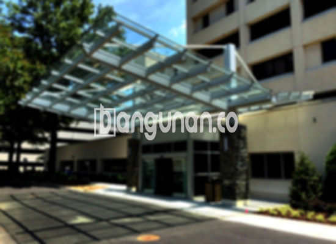

**Jasa Pasang Kanopi Rumah Minimalis di Kramat Jakarta** – Menciptakan ruang luar yang nyaman dan terlindungi adalah prioritas utama setiap pemilik rumah. Mitra Bangunan di Kramat Jakarta hadir untuk mewujudkan hal tersebut dengan menyediakan jasa pemasangan kanopi berkualitas tinggi dan terjangkau. Kanopi tidak hanya berfungsi sebagai pelindung dari cuaca ekstrem, tetapi juga meningkatkan estetika bangunan Anda. Mari wujudkan kenyamanan maksimal untuk hunian Anda bersama kami.

Kanopi hadir dalam berbagai material, seperti galvalum dan besi hollo, masing-masing menawarkan keunggulan unik. Pemilihan material yang tepat akan sangat mempengaruhi tampilan dan ketahanan kanopi Anda. Dengan memahami perbedaan ini, Anda dapat menentukan pilihan yang paling sesuai dengan kebutuhan dan anggaran Anda.

Investasi pada kanopi adalah investasi pada kenyamanan dan keamanan rumah Anda. Selain melindungi dari panas matahari dan hujan, kanopi juga dapat memperindah tampilan eksterior rumah Anda. Ada banyak manfaat lain yang akan Anda rasakan setelah memasang kanopi di properti Anda.



## Harga Kanopi Rumah Minimalis di Kramat Jakarta

Apakah Anda sedang mempertimbangkan untuk memasang kanopi untuk rumah Anda? Sebelum membuat keputusan, penting untuk mengetahui perkiraan biaya yang perlu dikeluarkan. Dengan mengetahui kisaran harga, Anda dapat merencanakan anggaran dengan lebih baik dan memilih kanopi yang sesuai dengan kemampuan finansial Anda.

Harga kanopi bervariasi tergantung pada beberapa faktor penting, di antaranya:

### - Material yang Digunakan

Pilihan material sangat memengaruhi harga akhir kanopi. Material seperti besi, baja ringan, dan polycarbonate memiliki harga yang berbeda-beda. Anda dapat memilih material yang sesuai dengan kebutuhan dan gaya Anda, sembari mempertimbangkan anggaran yang tersedia.

### - Model Kanopi

Desain dan model kanopi juga memengaruhi harga. Kanopi dengan desain yang lebih rumit atau khusus biasanya akan lebih mahal dibandingkan dengan desain yang sederhana dan standar. Pilih model yang sesuai dengan gaya arsitektur rumah Anda dan preferensi pribadi.

### - Ukuran Kanopi

Ukuran kanopi secara langsung memengaruhi jumlah material yang dibutuhkan dan kompleksitas pemasangan. Semakin besar ukuran kanopi, semakin tinggi pula biayanya. Pastikan Anda mengukur area yang akan ditutup dengan tepat sebelum memesan kanopi.

Untuk informasi lebih detail mengenai harga, silakan lihat tabel harga yang tersedia  atau hubungi tim kami untuk mendapatkan penawaran khusus yang disesuaikan dengan kebutuhan Anda.

## Rekomendasi Jenis Kanopi Rumah Minimalis di Kramat Jakarta

**Ref by:**  [Kanopi Rumah Minimalis Kramat Jakarta](https://id.wikipedia.org/wiki/Kanopi)

Jika Anda sedang mencari referensi jenis kanopi yang tepat untuk rumah Anda, ada beberapa pilihan yang populer dan direkomendasikan. Salah satunya adalah kanopi berbahan baja ringan yang menawarkan kombinasi ideal antara kekuatan, estetika, dan harga yang terjangkau. Berikut adalah beberapa keunggulan utama dari kanopi baja ringan:

### - Kekuatan dan Ketahanan Tinggi

Kanopi baja ringan dikenal karena kekuatannya yang luar biasa. Material ini mampu menahan beban yang berat dan tahan terhadap kondisi cuaca ekstrem. Anda dapat mengandalkan kanopi baja ringan untuk memberikan perlindungan yang tahan lama bagi rumah Anda.

### - Desain yang Fleksibel

Kanopi baja ringan sangat fleksibel dalam hal desain. Anda dapat memilih dari berbagai bentuk dan ukuran untuk menyesuaikan dengan gaya arsitektur rumah Anda. Jenis kanopi ini juga ideal untuk menciptakan desain yang unik dan personal.

### - Keamanan Terjamin

Baja ringan adalah material yang aman dan tidak mudah terbakar. Dengan memilih kanopi baja ringan, Anda dapat meningkatkan keamanan rumah Anda dan mengurangi risiko bahaya kebakaran. Keamanan ini sangat penting untuk melindungi keluarga dan harta benda Anda.

Kanopi baja ringan merupakan pilihan yang sangat baik bagi Anda yang menginginkan kanopi yang kuat, tahan lama, dan aman. Dengan berbagai keunggulan yang ditawarkannya, Anda tidak akan menyesal memilih jenis kanopi ini untuk rumah Anda di Kramat Jakarta.

Mitra Bangunan siap membantu Anda menemukan solusi kanopi terbaik untuk rumah Anda di Kramat Jakarta. Jangan ragu untuk menghubungi kami melalui tombol WhatsApp atau Telepon yang tersedia di halaman ini untuk konsultasi gratis dan penawaran terbaik. Hubungi kami sekarang dan wujudkan kenyamanan maksimal untuk hunian Anda!