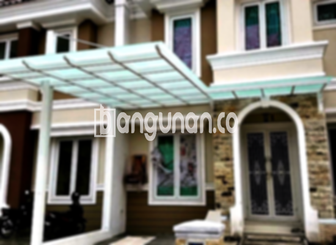

**Jasa Pasang Kanopi Rumah Minimalis di KramatPela Jakarta** – Menciptakan ruang luar yang nyaman dan terlindungi adalah prioritas utama bagi Mitra Bangunan di KramatPela Jakarta. Kanopi hadir sebagai solusi praktis untuk melindungi teras, garasi, atau area outdoor dari teriknya matahari dan guyuran hujan. Kami hadir untuk membantu Anda mewujudkan kenyamanan tersebut dengan layanan pemasangan kanopi berkualitas.

Kanopi hadir dalam berbagai pilihan material, termasuk baja ringan dan besi hollo. Setiap material memiliki karakteristik unik yang dapat disesuaikan dengan kebutuhan dan preferensi Anda. Memilih jenis kanopi yang tepat akan memaksimalkan manfaat dan estetika hunian Anda.

Memiliki kanopi bukan hanya soal perlindungan, melainkan juga memberikan nilai tambah pada rumah Anda. Dengan desain yang tepat, kanopi dapat meningkatkan tampilan fasad rumah dan menciptakan ruang luar yang lebih fungsional dan menarik. 



## Harga Kanopi Rumah Minimalis di KramatPela Jakarta

Tertarik untuk memasang kanopi di rumah Anda di KramatPela Jakarta? Sebelum membuat keputusan, penting untuk memahami faktor-faktor yang memengaruhi harga kanopi. Dengan pemahaman yang baik, Anda dapat memilih kanopi yang sesuai dengan anggaran dan ekspektasi Anda.

Berikut adalah beberapa faktor utama yang memengaruhi harga kanopi:

### \- Pemilihan Material oleh Jasa Pasang Kanopi Rumah Minimalis di KramatPela Jakarta

Jenis material yang digunakan merupakan salah satu faktor penentu utama harga kanopi. Material yang populer antara lain besi dan baja ringan. Setiap material memiliki keunggulan dan kekurangan masing-masing serta rentang harga yang berbeda. Pastikan Anda mempertimbangkan kebutuhan dan anggaran Anda sebelum memilih material.

### \- Desain Kanopi dari Jasa Pasang Kanopi Rumah Minimalis di KramatPela Jakarta

Desain kanopi juga memengaruhi harga secara signifikan. Semakin kompleks desainnya, semakin tinggi biayanya. Kami menawarkan berbagai pilihan desain, mulai dari yang sederhana hingga yang lebih rumit. Konsultasikan dengan tim kami untuk menemukan desain yang paling sesuai dengan gaya arsitektur rumah Anda.

### \- Ukuran Kanopi

Ukuran kanopi, yaitu panjang dan lebar, juga berpengaruh terhadap harga. Semakin besar ukuran kanopi, semakin banyak material yang dibutuhkan, dan semakin tinggi biayanya. Pastikan Anda mengukur area yang akan ditutupi kanopi dengan akurat sebelum melakukan pemesanan.

Untuk informasi lebih detail mengenai harga, silakan merujuk ke tabel harga yang tersedia  atau hubungi tim kami untuk mendapatkan penawaran yang disesuaikan dengan kebutuhan Anda.

## Inspirasi Variasi Kanopi Rumah Minimalis di KramatPela Jakarta

**Ref by:**  [Kanopi Rumah Minimalis KramatPela Jakarta](https://id.wikipedia.org/wiki/Kanopi)

Bagi Anda yang berencana memasang kanopi untuk rumah, ada beragam pilihan desain yang bisa Anda pertimbangkan. Salah satu material yang sangat direkomendasikan adalah baja ringan. Kanopi baja ringan menawarkan beberapa keunggulan dibandingkan material lain.

### \- Kekuatan dan Daya Tahan Utama

Kekuatan dan daya tahan merupakan aspek penting yang harus diperhatikan dalam memilih kanopi. Kanopi baja ringan dikenal akan kualitasnya yang superior. Material ini mampu menahan beban dan kondisi cuaca ekstrem, memastikan kanopi Anda awet dan tahan lama.

Kekuatan baja ringan telah teruji oleh waktu. Banyak pemilik rumah di KramatPela Jakarta yang mempercayakan perlindungan properti mereka kepada kanopi baja ringan.

### \- Pilihan Desain yang Beragam dari Jasa Pasang Kanopi Rumah Minimalis di KramatPela Jakarta

Fleksibilitas desain adalah salah satu keunggulan utama kanopi baja ringan. Anda dapat memilih dari berbagai bentuk dan ukuran untuk menciptakan tampilan yang sesuai dengan gaya rumah Anda. Kami siap membantu Anda mewujudkan desain kanopi impian Anda.

### \- Keamanan Terjamin dari Jasa Pasang Kanopi Rumah Minimalis di KramatPela Jakarta

Keamanan adalah prioritas utama kami. Baja ringan adalah material yang kokoh dan tahan terhadap benturan, sehingga dapat memberikan perlindungan maksimal bagi Anda dan keluarga. Anda dapat merasa tenang dengan kanopi baja ringan yang terpasang di rumah Anda.

Jika Anda sedang mencari jasa pasang kanopi di KramatPela Jakarta, kami siap memberikan solusi terbaik untuk kebutuhan Anda. Dengan pengalaman dan dedikasi yang tinggi, kami akan memastikan kanopi Anda terpasang dengan rapi, kuat, dan tahan lama.

Mitra Bangunan yang berlokasi di KramatPela Jakarta dan ingin memiliki kanopi berkualitas, segera hubungi kami melalui tombol WhatsApp atau Telepon yang tersedia di halaman ini. Tim kami akan dengan senang hati membantu Anda menemukan solusi kanopi yang tepat untuk rumah Anda.