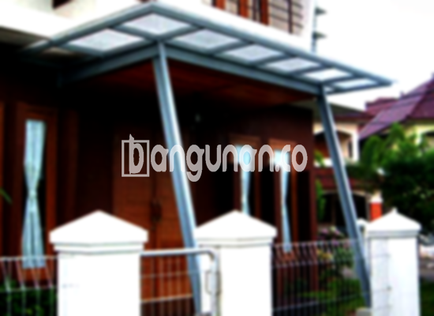

**Jasa Pasang Kanopi Rumah Minimalis di Krendang Jakarta** – Memiliki area luar ruangan yang nyaman dan terlindungi adalah dambaan setiap pemilik rumah di Krendang Jakarta. Kanopi hadir sebagai solusi praktis untuk melindungi teras, garasi, atau area depan rumah dari cuaca ekstrem. Mitra Bangunan memahami kebutuhan Anda dan siap membantu mewujudkan kenyamanan tersebut dengan layanan pemasangan kanopi berkualitas.

Kanopi bukan hanya berfungsi sebagai pelindung, tetapi juga dapat meningkatkan estetika bangunan Anda. Tersedia beragam jenis kanopi yang dapat disesuaikan dengan gaya arsitektur rumah dan kebutuhan fungsional Anda. Pemilihan material yang tepat akan memastikan kanopi tahan lama dan memberikan manfaat optimal.



## Harga Kanopi Rumah Minimalis di Krendang Jakarta

Merencanakan pemasangan kanopi untuk rumah Anda di Krendang Jakarta? Wawasan tentang perkiraan biaya akan sangat membantu dalam pengambilan keputusan. Anda dapat mempertimbangkan berbagai pilihan material dan desain agar sesuai dengan anggaran dan preferensi Anda. 

Beberapa faktor utama memengaruhi harga kanopi, di antaranya:

### \- Bahan yang Digunakan oleh Jasa Pasang Kanopi Rumah Minimalis di Krendang Jakarta

Material merupakan aspek penting yang perlu Anda pertimbangkan saat memilih kanopi. Terdapat berbagai pilihan material, seperti besi, baja ringan, dan polycarbonate, masing-masing dengan karakteristik dan harga yang berbeda. Anda dapat memilih material yang paling sesuai dengan kebutuhan dan anggaran Anda.

### \- Model Kanopi dari Jasa Pasang Kanopi Rumah Minimalis di Krendang Jakarta

Model kanopi juga memengaruhi harga secara signifikan. Beragam desain tersedia, mulai dari yang sederhana hingga yang rumit, dengan variasi harga yang sesuai. Anda dapat memilih model yang selaras dengan gaya arsitektur rumah Anda dan menambahkan nilai estetika pada properti Anda.

### \- Ukuran Kanopi

Ukuran kanopi yang Anda butuhkan juga memengaruhi biaya pemasangan. Semakin luas area yang perlu ditutupi, semakin banyak material yang dibutuhkan dan semakin tinggi biayanya. Pastikan Anda mengukur area yang akan dipasang kanopi dengan akurat sebelum melakukan pemesanan.

Untuk informasi lebih detail mengenai harga, Anda dapat melihat tabel harga yang tersedia  di halaman kami atau menghubungi tim kami untuk mendapatkan penawaran khusus yang sesuai dengan kebutuhan Anda.

## Pilihan Material Kanopi Rumah Minimalis di Krendang Jakarta

Bagi Anda yang berencana memasang kanopi untuk rumah di Krendang Jakarta, terdapat beragam pilihan material yang bisa dipertimbangkan. Salah satu material yang populer dan direkomendasikan adalah baja ringan. Material ini menawarkan sejumlah keunggulan yang membuatnya menjadi pilihan yang tepat.

### \- Kekuatan dan Ketahanan sebagai Prioritas Utama

Keawetan kanopi adalah faktor penting yang dicari oleh setiap pemilik rumah. Kanopi yang terbuat dari baja ringan dikenal akan kekuatannya dan daya tahannya. Material ini mampu menahan beban berat dan tahan terhadap berbagai kondisi cuaca ekstrem, sehingga memberikan perlindungan jangka panjang bagi properti Anda.

Banyak pengguna telah membuktikan ketahanan kanopi baja ringan, bahkan bertahan selama bertahun-tahun tanpa mengalami kerusakan signifikan.

### \- Fleksibilitas Desain dan Model dari Jasa Pasang Kanopi Rumah Minimalis di Krendang Jakarta

Selain kekuatannya, baja ringan juga sangat fleksibel dalam hal desain dan model. Anda dapat memilih berbagai model kanopi yang sesuai dengan gaya arsitektur rumah Anda. Kemudahan dalam pembentukan dan penyesuaian memungkinkan Anda menciptakan kanopi yang unik dan menarik.

### \- Keamanan Terjamin dengan Jasa Pasang Kanopi Rumah Minimalis di Krendang Jakarta

Baja ringan merupakan material yang aman dan tidak mudah berkarat. Hal ini menjamin keamanan properti Anda dan dapat meminimalkan risiko kerusakan akibat korosi. Dengan memilih kanopi baja ringan, Anda dapat merasa tenang dan nyaman karena kualitas dan keamanannya terjamin.

Jika Anda sedang mencari solusi kanopi yang kuat, tahan lama, dan aman untuk rumah Anda di Krendang Jakarta, kanopi yang terbuat dari baja ringan adalah pilihan yang tepat.

**Ref by:**  [Kanopi Rumah Minimalis Krendang Jakarta](https://id.wikipedia.org/wiki/Kanopi)

Mitra Bangunan siap membantu Anda dalam memilih dan memasang kanopi yang sesuai dengan kebutuhan dan anggaran Anda di Krendang Jakarta. Hubungi kami melalui tombol WhatsApp atau Telepon di halaman ini untuk konsultasi gratis dan penawaran terbaik.