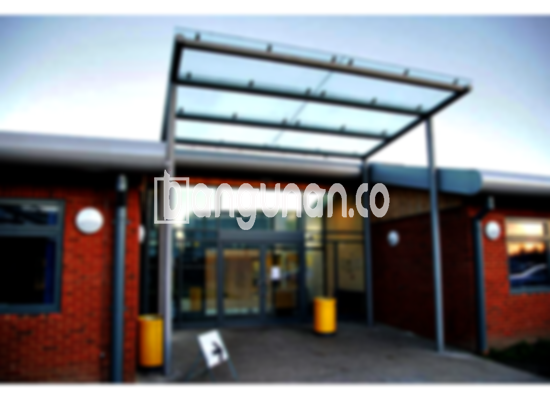

**Jasa Pasang Kanopi Rumah Minimalis di Kresek Tangerang** – Apakah Anda sedang mempertimbangkan untuk memasang kanopi di Kresek Tangerang guna meningkatkan kenyamanan dan estetika rumah Anda? Kanopi yang baik akan melindungi rumah dari sengatan matahari dan tetesan hujan, sekaligus menambah nilai visual pada properti Anda. Mitra Bangunan hadir sebagai solusi komprehensif untuk kebutuhan pembuatan dan pemasangan kanopi, menawarkan layanan borongan dengan harga yang kompetitif. Kami memahami betul pentingnya memiliki kanopi yang kokoh dan sesuai dengan gaya arsitektur rumah Anda.

Kanopi tersedia dalam beragam material, seperti baja ringan dan kaca, masing-masing menawarkan keunggulan unik. Pemilihan material yang tepat akan memastikan kanopi Anda tahan lama dan memberikan manfaat maksimal. Selain itu, desain kanopi juga memainkan peran penting dalam menentukan tampilan keseluruhan rumah Anda.

Melindungi area luar rumah dari cuaca ekstrem adalah fungsi utama kanopi. Namun, kanopi juga dapat bertindak sebagai elemen desain yang mempercantik fasad bangunan Anda.

## Informasi Harga Kanopi Rumah Minimalis di Kresek Tangerang

Apakah Anda ingin mengetahui perkiraan biaya pemasangan kanopi di Kresek Tangerang? Harga kanopi dapat bervariasi tergantung pada beberapa faktor penting yang sebaiknya Anda pertimbangkan. Dengan memahami faktor-faktor ini, Anda dapat mengambil keputusan yang tepat sesuai dengan anggaran dan kebutuhan Anda.

Berikut adalah beberapa poin utama yang memengaruhi harga kanopi:

### – Jenis Material yang Dipilih

Material yang digunakan merupakan faktor utama yang berpengaruh pada harga kanopi. Bahan seperti besi, baja ringan, dan polycarbonate memiliki harga yang berbeda-beda. Setiap material menawarkan karakteristik dan kelebihan yang unik, sehingga Anda dapat memilih yang paling sesuai dengan preferensi dan anggaran Anda.

### – Desain dan Model Kanopi

Model kanopi yang Anda pilih juga akan memengaruhi harga. Desain yang lebih sederhana umumnya lebih terjangkau dibandingkan model yang kompleks dengan detail dekoratif. Anda dapat memilih desain yang selaras dengan gaya rumah Anda dan anggaran yang telah ditetapkan.

### – Ukuran Area yang Dicakup

Ukuran kanopi yang dibutuhkan adalah faktor penting lainnya. Semakin luas area yang perlu ditutupi, semakin banyak material dan tenaga kerja yang diperlukan. Pastikan Anda mengukur area secara akurat sebelum memesan untuk mendapatkan perkiraan biaya yang tepat.

Untuk mendapatkan informasi harga yang lebih detail dan sesuai dengan kebutuhan spesifik Anda, silakan lihat tabel harga yang telah kami sediakan  atau hubungi tim kami untuk layanan konsultasi gratis.

## Pilihan Variasi Kanopi Rumah Minimalis di Kresek Tangerang



Bagi Anda yang berencana memasang kanopi di Kresek Tangerang, kami menawarkan berbagai pilihan desain dan material yang dapat disesuaikan dengan selera dan anggaran Anda. Salah satu material yang sangat direkomendasikan adalah baja ringan, yang dikenal karena kekuatannya, daya tahannya, dan harganya yang terjangkau.

### – Konstruksi yang Kokoh dan Tahan Lama

Kanopi yang terbuat dari baja ringan dirancang untuk menahan berbagai kondisi cuaca yang ekstrem. Material ini memiliki kekuatan yang cukup untuk menahan angin kencang dan hujan deras, menjamin perlindungan optimal untuk rumah Anda selama bertahun-tahun.

### – Desain yang Fleksibel dan Adaptif

Baja ringan sangat mudah dibentuk, sehingga memungkinkan Anda untuk memilih berbagai desain dan model kanopi sesuai dengan gaya rumah Anda. Anda dapat memilih desain yang sederhana dan minimalis, atau desain yang lebih rumit dengan detail dekoratif yang elegan.

### – Keamanan Terjamin Sepenuhnya

Baja ringan adalah material yang aman dan tahan lama. Dengan pemasangan yang benar oleh tenaga ahli, kanopi baja ringan akan memberikan perlindungan yang andal dan mengurangi risiko kerusakan akibat cuaca buruk.

Selain baja ringan, Anda juga dapat mempertimbangkan material lain seperti polycarbonate atau kaca untuk tampilan yang lebih modern dan mewah. Pilihlah material yang paling sesuai dengan visi desain Anda dan anggaran yang tersedia.

**Ref by:**  [Kanopi Rumah Minimalis Kresek Tangerang](https://id.wikipedia.org/wiki/Kanopi)

Mitra Bangunan adalah mitra terpercaya Anda dalam mewujudkan kanopi impian di Kresek Tangerang. Dengan pengalaman bertahun-tahun dan tim profesional yang handal, kami berkomitmen untuk memberikan layanan berkualitas tinggi dan solusi yang sesuai dengan kebutuhan Anda. Jangan ragu untuk menghubungi kami melalui tombol WhatsApp atau Telepon yang tertera di halaman ini untuk mendapatkan penawaran terbaik dan layanan pemasangan yang profesional.