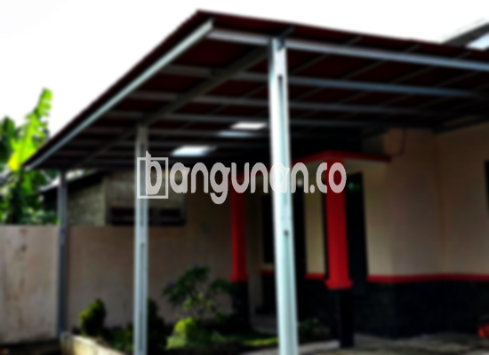

**Jasa Pasang Kanopi Rumah Minimalis di Krukut Depok** – Apakah Anda mempertimbangkan untuk menambahkan kanopi pada properti Anda di Krukut Depok? Kanopi merupakan struktur atap yang umumnya dipasang di atas teras depan rumah, jendela, atau area parkir. Fungsi utamanya adalah untuk melindungi dari paparan langsung sinar matahari dan hujan, menjadikan area tersebut lebih nyaman untuk digunakan. Mitra Bangunan menyediakan solusi pemasangan kanopi berkualitas tinggi untuk memenuhi kebutuhan hunian Anda di Krukut Depok.

Kanopi hadir dalam berbagai variasi, termasuk kanopi dengan material galvalum yang ringan dan kuat, serta kanopi besi hollo yang kokoh dan tahan lama. Pemilihan model kanopi yang tepat akan sangat bergantung pada preferensi pribadi dan karakteristik bangunan Anda. Setiap jenis kanopi memiliki kelebihan dan kekurangan tersendiri, yang akan memengaruhi performa dan estetika keseluruhan.

Selain untuk rumah tinggal, pemasangan kanopi juga sangat bermanfaat bagi pemilik ruko atau usaha di Krukut Depok. Kanopi dapat membantu menjaga area depan toko tetap teduh dan kering, memberikan kenyamanan bagi pelanggan, sekaligus meningkatkan citra bisnis Anda. Dengan demikian, kanopi menjadi investasi cerdas bagi properti Anda.



## Harga Kanopi Rumah Minimalis di Krukut Depok

Ketika Anda berencana membeli kanopi untuk rumah, penting untuk memahami terlebih dahulu perkiraan biaya yang dibutuhkan. Mengetahui harga kanopi rumah akan membantu Anda dalam merencanakan anggaran dengan lebih efektif. Untuk mendapatkan penawaran terbaik, bandingkan harga dari beberapa penyedia jasa pemasangan kanopi di Krukut Depok dan pertimbangkan faktor-faktor yang memengaruhi harga.

Berikut adalah beberapa faktor utama yang memengaruhi harga kanopi:

### - Pemilihan Bahan Material oleh Jasa Pasang Kanopi Rumah Minimalis di Krukut Depok

Jenis material yang digunakan merupakan salah satu faktor terpenting dalam menentukan harga kanopi. Terdapat berbagai pilihan material yang tersedia, seperti besi, baja ringan, polycarbonate, dan kaca. Masing-masing material memiliki karakteristik dan harga yang berbeda. Anda dapat memilih material yang paling sesuai dengan anggaran dan kebutuhan Anda.

### - Desain dan Model Kanopi dari Jasa Pasang Kanopi Rumah Minimalis di Krukut Depok

Desain dan model kanopi juga memainkan peran penting dalam menentukan harganya. Kanopi dengan desain yang sederhana dan standar umumnya lebih murah daripada kanopi dengan desain yang rumit atau custom. Anda dapat memilih model kanopi yang sesuai dengan gaya arsitektur rumah Anda dan preferensi pribadi Anda.

### - Ukuran dan Luas Area yang Ditutupi

Ukuran dan luas area yang akan ditutupi oleh kanopi secara langsung memengaruhi harga. Semakin besar area yang perlu ditutupi, semakin banyak material yang dibutuhkan, dan semakin tinggi biayanya. Pastikan untuk mengukur area yang akan ditutupi dengan akurat sebelum memesan kanopi.

Untuk mendapatkan informasi harga yang lebih detail dan sesuai dengan kebutuhan Anda, Anda dapat melihat tabel harga kami  atau menghubungi tim ahli kami untuk konsultasi gratis.

## Saran Jenis Kanopi Rumah Minimalis di Krukut Depok

**Ref by:**  [Kanopi Rumah Minimalis Krukut Depok](https://id.wikipedia.org/wiki/Kanopi)

Bagi Anda yang sedang mempertimbangkan untuk memasang kanopi untuk rumah, ruko, atau bangunan lainnya, terdapat banyak pilihan jenis kanopi yang bisa Anda pilih. Salah satu jenis kanopi yang paling direkomendasikan adalah kanopi berbahan baja ringan. Kanopi baja ringan menawarkan berbagai keunggulan dibandingkan dengan material lainnya.

### - Kekuatan dan Ketahanan Material Utama

Saat memutuskan untuk berinvestasi dalam kanopi untuk rumah Anda, kekuatan dan daya tahan seringkali menjadi pertimbangan utama. Kanopi yang terbuat dari material baja ringan terkenal akan kualitas dan ketangguhannya. Kanopi jenis ini menawarkan performa yang andal dan tahan lama, menjadikannya pilihan investasi yang cerdas.

Banyak orang sudah membuktikan bahwa kanopi yang terbuat dari baja ringan dapat bertahan selama bertahun-tahun tanpa kehilangan kekuatannya. Ini menjamin bahwa investasi Anda akan memberikan manfaat jangka panjang dan melindungi properti Anda dari elemen cuaca.

### - Variasi Model yang Luas dari Jasa Pasang Kanopi Rumah Minimalis di Krukut Depok

Ketika Anda memutuskan untuk mempercantik rumah Anda dengan kanopi, memiliki beragam pilihan model dapat membuat proses pengambilan keputusan menjadi lebih menyenangkan. Kanopi berbahan baja ringan menawarkan beragam desain dan gaya untuk memenuhi selera Anda. Fleksibilitas ini memastikan bahwa Anda dapat menemukan kanopi yang sempurna untuk melengkapi arsitektur rumah Anda.

Kelebihan ini menjadikan baja ringan sebagai pilihan populer di kalangan pemilik rumah dan arsitek yang mencari opsi kanopi yang serbaguna dan menarik secara visual.

### - Tingkat Keamanan yang Tinggi dari Jasa Pasang Kanopi Rumah Minimalis di Krukut Depok

Keamanan merupakan aspek penting dalam memilih kanopi untuk rumah Anda. Baja ringan adalah material yang sangat kuat dan tahan lama, sehingga memberikan tingkat keamanan yang tinggi. Anda dapat yakin bahwa kanopi baja ringan akan melindungi Anda dan keluarga dari berbagai risiko, seperti kerusakan akibat angin kencang atau hujan deras.

Bahan ini secara signifikan mengurangi kemungkinan terjadinya kecelakaan atau kerusakan properti, memastikan ketenangan pikiran bagi Anda dan orang-orang terkasih.

Jika Anda mencari kanopi untuk ruko atau bangunan komersial, kanopi berbahan galvalum juga dapat menjadi pilihan yang tepat. Material ini menawarkan kombinasi yang baik antara kekuatan, ketahanan, dan harga yang terjangkau. Dengan berbagai keunggulan yang ditawarkan, Anda dapat yakin bahwa kanopi yang Anda pilih akan memberikan perlindungan dan estetika yang optimal.

Mitra Bangunan hadir untuk membantu Anda memilih dan memasang kanopi yang ideal untuk kebutuhan Anda di Krukut Depok. Jangan ragu untuk menghubungi tim kami melalui tombol WhatsApp atau Telepon di halaman ini untuk mendapatkan penawaran harga dan layanan konsultasi profesional. Kami berkomitmen untuk memberikan solusi kanopi terbaik yang sesuai dengan anggaran dan harapan Anda.