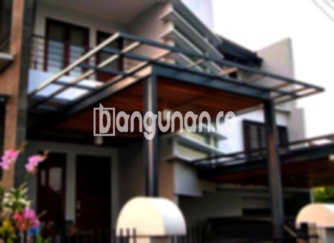

**Jasa Pasang Kanopi Rumah Minimalis di Krukut Jakarta** – Apakah Anda sedang merencanakan pemasangan kanopi untuk rumah atau bangunan di Krukut Jakarta? Kanopi adalah solusi cerdas untuk melindungi teras, garasi, atau area outdoor dari paparan cuaca ekstrem. Bagi Mitra Bangunan di Krukut Jakarta, kami menawarkan layanan pembuatan dan pemasangan kanopi berkualitas dengan harga terjangkau. Dengan kanopi yang tepat, Anda dapat mempercantik tampilan bangunan sekaligus meningkatkan kenyamanan.

Kanopi hadir dalam berbagai material, seperti galvalum dan besi hollo, masing-masing dengan keunggulan dan kekurangan tersendiri. Pemilihan material yang sesuai akan menentukan estetika dan ketahanan kanopi Anda.

Memiliki kanopi tidak hanya memberikan perlindungan, tetapi juga manfaat signifikan bagi hunian Anda. Mari kita bahas lebih lanjut apa saja keuntungan yang bisa Anda dapatkan.



## Harga Kanopi Rumah Minimalis di Krukut Jakarta

Bagi Anda yang berencana memesan kanopi, memahami perkiraan harga terlebih dahulu adalah langkah yang bijak. Harga kanopi dapat bervariasi tergantung pada beberapa faktor. Dengan mempertimbangkan faktor-faktor ini, Anda dapat memilih kanopi yang sesuai dengan anggaran dan kebutuhan Anda.

Berikut adalah beberapa faktor utama yang memengaruhi harga kanopi:

### – Bahan yang Digunakan

Pemilihan bahan merupakan pertimbangan penting dalam menentukan harga kanopi. Material seperti besi, baja ringan, dan polycarbonate memiliki harga yang berbeda-beda. Anda dapat memilih material yang paling sesuai dengan preferensi dan anggaran Anda.

### – Model Kanopi

Model atau desain kanopi juga berpengaruh terhadap harga. Kami menawarkan berbagai pilihan model, mulai dari yang sederhana hingga yang lebih kompleks. Semakin rumit desainnya, umumnya semakin tinggi pula harganya.

### – Ukuran Kanopi

Ukuran kanopi, baik panjang maupun lebar, akan memengaruhi total biaya. Semakin besar ukuran kanopi, semakin banyak material yang dibutuhkan, sehingga biaya yang dikeluarkan juga akan lebih tinggi.

Dengan memahami faktor-faktor ini, Anda dapat memperkirakan biaya yang dibutuhkan dan memilih kanopi yang paling sesuai dengan kebutuhan dan anggaran Anda. Untuk informasi harga yang lebih detail, silakan lihat tabel harga di bawah ini atau hubungi tim kami untuk konsultasi gratis.



## Saran Variasi Kanopi Rumah Minimalis di Krukut Jakarta

Untuk Anda yang ingin mempercantik hunian dengan kanopi, ada beragam variasi yang dapat Anda pilih. Salah satu pilihan yang sangat direkomendasikan adalah kanopi berbahan baja ringan. Baja ringan menawarkan berbagai keunggulan dibandingkan material lainnya.

### – Kekuatan dan Ketahanan

Kekuatan adalah faktor utama yang perlu dipertimbangkan saat memilih kanopi. Kanopi berbahan baja ringan dikenal akan kualitas dan ketahanannya yang sangat baik. Investasi pada kanopi baja ringan akan memberikan perlindungan yang tahan lama untuk properti Anda.

Kanopi baja ringan mampu bertahan selama bertahun-tahun tanpa kehilangan kekuatannya, menjadikannya pilihan yang sangat ekonomis dalam jangka panjang.

### – Desain yang Fleksibel

Kanopi baja ringan menawarkan fleksibilitas desain yang tinggi. Anda dapat memilih berbagai model dan bentuk yang sesuai dengan gaya arsitektur rumah Anda. Keunggulan ini memungkinkan Anda menciptakan tampilan yang unik dan personal.

### – Keamanan Terjamin

Baja ringan adalah material yang kokoh dan tahan terhadap berbagai kondisi cuaca. Hal ini memberikan tingkat keamanan yang lebih tinggi dibandingkan dengan material lain. Anda dapat merasa tenang mengetahui bahwa kanopi baja ringan akan melindungi Anda dari berbagai risiko.

Bagi Anda yang mencari solusi kanopi yang kuat, tahan lama, dan aman, kanopi berbahan baja ringan adalah pilihan yang tepat. Kami siap membantu Anda memilih dan memasang kanopi yang sesuai dengan kebutuhan Anda di Krukut Jakarta.

**Ref by:**  [Kanopi Rumah Minimalis Krukut Jakarta](https://id.wikipedia.org/wiki/Kanopi)

Mitra Bangunan yang mencari jasa pasang kanopi berkualitas di Krukut Jakarta, jangan ragu untuk menghubungi kami melalui tombol WhatsApp atau Telepon di halaman ini. Kami siap memberikan solusi terbaik untuk melindungi dan mempercantik properti Anda.