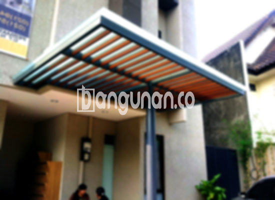

**Jasa Pasang Kanopi Rumah Minimalis di Kudus** – Memiliki area terbuka yang nyaman dan terlindungi adalah dambaan setiap pemilik rumah di Kudus. Kanopi hadir sebagai solusi praktis untuk menjaga teras, garasi, atau area luar ruangan lainnya dari cuaca ekstrem seperti hujan dan panas terik. Mitra Bangunan menyediakan layanan pembuatan dan pemasangan kanopi yang berkualitas, tahan lama, dan terjangkau untuk rumah Anda di Kudus.

Kanopi tersedia dalam berbagai pilihan material, seperti galvalum dan besi hollo, masing-masing dengan kelebihan dan kekurangannya. Pemilihan material yang tepat akan sangat memengaruhi tampilan dan ketahanan kanopi Anda. 

Tak hanya melindungi dari cuaca, pemasangan kanopi juga memberikan banyak manfaat lain untuk hunian Anda.



## Harga Kanopi Rumah Minimalis di Kudus

Tertarik untuk mempercantik dan melindungi rumah Anda dengan kanopi? Sebelum membuat keputusan, penting untuk memahami bagaimana harga kanopi rumah di Kudus ditentukan. Memahami faktor-faktor yang memengaruhi harga akan membantu Anda memilih kanopi yang sesuai dengan kebutuhan dan anggaran Anda.

Harga kanopi bervariasi tergantung pada beberapa aspek penting, di antaranya:

### \- Material yang Digunakan oleh Jasa Pasang Kanopi Rumah Minimalis di Kudus

Material adalah faktor utama yang memengaruhi harga kanopi. Ada berbagai pilihan material, seperti besi, baja ringan, dan lainnya. Setiap material memiliki karakteristik dan harga yang berbeda. Anda dapat memilih material yang paling sesuai dengan kebutuhan dan preferensi estetika Anda.

### \- Model Kanopi dari Jasa Pasang Kanopi Rumah Minimalis di Kudus

Model kanopi juga memainkan peran penting dalam menentukan harga. Tersedia berbagai macam model yang dapat disesuaikan dengan gaya arsitektur rumah Anda. Jika Anda belum memiliki gambaran, Anda dapat mencari referensi di internet atau media lain untuk mendapatkan inspirasi.

### \- Luas Kanopi

Luas area yang akan ditutupi oleh kanopi juga memengaruhi harga. Semakin luas area yang ditutupi, semakin banyak material yang dibutuhkan dan semakin tinggi biayanya. Pastikan Anda mengukur area dengan tepat sebelum memesan kanopi.

Dengan memahami faktor-faktor ini, Anda dapat memperkirakan biaya yang dibutuhkan dan memilih kanopi yang paling sesuai dengan anggaran Anda. Untuk informasi harga yang lebih detail, silakan lihat tabel di bawah ini atau hubungi tim kami untuk konsultasi.



## Rekomendasi Jenis Kanopi Rumah Minimalis di Kudus

Bagi Anda yang berencana memasang kanopi untuk rumah, ada banyak pilihan jenis kanopi yang tersedia. Salah satu pilihan yang paling direkomendasikan adalah kanopi dari bahan baja ringan. Bahan ini menawarkan sejumlah keunggulan dibandingkan material lain. Berikut adalah beberapa kelebihannya:

### \- Kekuatan dan Ketahanan Jadi Prioritas Utama

Ketika Anda membeli kanopi untuk rumah, kekuatan adalah salah satu faktor terpenting yang perlu dipertimbangkan. Kanopi yang terbuat dari bahan galvalum dikenal karena kualitasnya yang sangat baik. Kekuatan dan ketahanannya terjamin, sehingga Anda tidak perlu khawatir akan kerusakan atau penggantian dalam waktu dekat.

Banyak pengguna telah membuktikan bahwa kanopi baja ringan dapat bertahan puluhan tahun tanpa kehilangan kekokohannya.

### \- Pilihan Model yang Beragam dari Jasa Pasang Kanopi Rumah Minimalis di Kudus

Kanopi baja ringan menawarkan berbagai pilihan model yang dapat disesuaikan dengan gaya rumah Anda. Baik untuk rumah minimalis, modern, atau klasik, Anda pasti akan menemukan model yang sesuai. Keberagaman ini menjadikan kanopi baja ringan sebagai pilihan populer di kalangan pemilik rumah di Kudus.

### \- Keamanan yang Lebih Terjamin dari Jasa Pasang Kanopi Rumah Minimalis di Kudus

Galvalum adalah material yang memiliki tingkat kekokohan yang tinggi, sehingga memberikan keamanan yang optimal. Anda dapat merasa tenang mengetahui bahwa kanopi Anda mampu melindungi rumah dan keluarga Anda dari berbagai risiko, seperti kerusakan akibat cuaca buruk atau bahkan roboh.

Jika Anda mencari kanopi yang berkualitas dan aman, kanopi yang terbuat dari bahan galvalum adalah pilihan yang tepat.

Dengan berbagai keunggulan yang ditawarkan, kanopi baja ringan adalah investasi yang cerdas untuk rumah Anda.

**Ref by:**  [Kanopi Rumah Minimalis Kudus](https://id.wikipedia.org/wiki/Kanopi)

Mitra Bangunan siap membantu Anda memilih dan memasang kanopi yang ideal untuk rumah Anda di Kudus. Jangan ragu untuk menghubungi kami melalui tombol WhatsApp atau Telepon di halaman ini untuk mendapatkan penawaran terbaik dan layanan yang profesional.