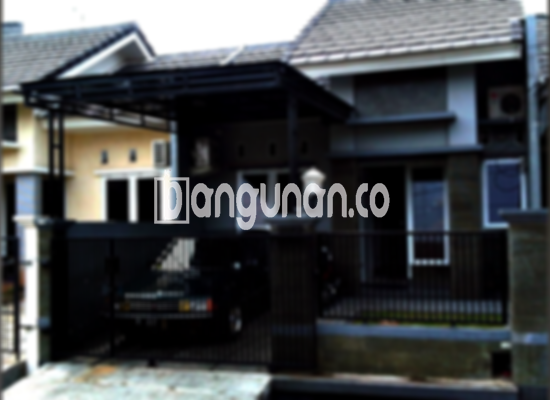

**Jasa Pasang Kanopi Rumah Minimalis di Kukusan Depok** – Apakah Anda sedang mencari solusi perlindungan terbaik untuk properti Anda di Kukusan Depok? Mitra Bangunan hadir sebagai penyedia jasa pemasangan kanopi rumah minimalis yang terpercaya dan terjangkau. Kanopi bukan sekadar elemen dekoratif, melainkan investasi penting untuk melindungi area luar rumah Anda dari cuaca ekstrem dan menciptakan ruang yang nyaman serta estetis.

Kanopi memiliki peran vital dalam menjaga kualitas hidup Anda. Dengan pemasangan kanopi yang tepat, Anda dapat menikmati teras atau garasi tanpa khawatir terganggu oleh panas matahari atau hujan deras. Tersedia berbagai material yang dapat Anda pilih, seperti galvalum, baja ringan, kaca, dan polycarbonate, masing-masing dengan karakteristik dan keunggulan tersendiri. Pemilihan material yang tepat akan menentukan tampilan dan ketahanan kanopi Anda.



## Pertimbangan Penting: Harga Kanopi Rumah Minimalis di Kukusan Depok

Sebelum memutuskan untuk membeli kanopi, penting bagi Anda untuk memahami faktor-faktor yang memengaruhi harga. Dengan mengetahui estimasi biaya, Anda dapat merencanakan anggaran dengan lebih efektif dan memilih kanopi yang sesuai dengan kebutuhan serta kemampuan finansial Anda. Investasi pada kanopi berkualitas akan memberikan manfaat jangka panjang bagi properti Anda.

Harga kanopi dipengaruhi oleh beberapa faktor penting, antara lain:

### \- Jenis Material yang Digunakan oleh Jasa Pasang Kanopi Rumah Minimalis di Kukusan Depok

Material merupakan penentu utama harga kanopi. Material seperti baja ringan, galvalum, kaca, dan polycarbonate memiliki rentang harga yang berbeda-beda. Anda perlu mempertimbangkan kelebihan dan kekurangan masing-masing material sebelum membuat keputusan. Pilihlah material yang paling sesuai dengan anggaran, gaya arsitektur, dan kebutuhan perlindungan properti Anda. 

### \- Desain dan Model Kanopi dari Jasa Pasang Kanopi Rumah Minimalis di Kukusan Depok

Desain kanopi juga berpengaruh terhadap harga. Desain yang sederhana dan minimalis cenderung lebih terjangkau dibandingkan desain yang rumit dengan banyak detail dekoratif. Anda dapat memilih model kanopi yang sesuai dengan gaya arsitektur rumah Anda dan preferensi pribadi. Konsultasikan dengan kami untuk mendapatkan inspirasi desain yang tepat.

### \- Ukuran Area yang Akan Ditutupi

Ukuran area yang membutuhkan perlindungan kanopi akan menentukan jumlah material yang dibutuhkan. Semakin luas area yang ditutupi, semakin banyak material yang digunakan, dan semakin tinggi pula biayanya. Pastikan Anda mengukur area dengan akurat sebelum melakukan pemesanan agar mendapatkan estimasi harga yang tepat.

Dengan mempertimbangkan faktor-faktor di atas, Anda dapat membuat keputusan yang bijaksana dan mendapatkan kanopi berkualitas dengan harga yang sesuai. 

## Pilihan Material Terbaik untuk Kanopi Rumah Minimalis di Kukusan Depok

**Ref by:**  [Kanopi Rumah Minimalis Kukusan Depok](https://id.wikipedia.org/wiki/Kanopi)

Bagi Anda yang berencana memasang kanopi untuk rumah atau bangunan komersial di Kukusan Depok, ada berbagai pilihan material yang tersedia. Material baja ringan adalah salah satu opsi yang paling direkomendasikan karena menawarkan kombinasi keunggulan yang optimal. Keunggulan material ini menjadikannya pilihan populer di kalangan pemilik rumah dan pengusaha.

### \- Keawetan dan Ketahanan Terhadap Cuaca Ekstrem

Salah satu keunggulan utama kanopi baja ringan adalah keawetannya. Material ini tahan terhadap karat, korosi, dan kerusakan akibat cuaca ekstrem seperti hujan, panas, dan angin kencang. Dengan demikian, Anda tidak perlu khawatir tentang perawatan yang mahal atau penggantian kanopi dalam waktu dekat.

### \- Fleksibilitas Desain yang Tinggi dari Jasa Pasang Kanopi Rumah Minimalis di Kukusan Depok

Baja ringan sangat fleksibel dan mudah dibentuk, sehingga memungkinkan Anda untuk membuat kanopi dengan berbagai desain dan gaya yang unik. Anda dapat memilih dari berbagai pilihan warna dan bentuk untuk menciptakan tampilan yang sesuai dengan karakter rumah Anda.

### \- Keamanan dan Kekuatan Struktural dari Jasa Pasang Kanopi Rumah Minimalis di Kukusan Depok

Meskipun ringan, baja ringan memiliki kekuatan struktural yang tinggi. Hal ini menjamin keamanan dan stabilitas kanopi, bahkan dalam kondisi cuaca buruk. Anda dapat merasa tenang dan nyaman mengetahui bahwa kanopi Anda dapat melindungi properti Anda dengan andal.

Dengan memilih kanopi baja ringan, Anda mendapatkan solusi perlindungan yang tahan lama, estetis, dan aman untuk properti Anda di Kukusan Depok. Mitra Bangunan siap membantu Anda dalam memilih dan memasang kanopi yang tepat sesuai dengan kebutuhan Anda. Jika Anda adalah seorang Mitra Bangunan yang sedang mencari jasa pemasangan kanopi di Kukusan Depok, jangan ragu untuk menghubungi kami melalui tombol WhatsApp atau Telepon di halaman ini. Kami akan dengan senang hati memberikan konsultasi gratis dan penawaran harga terbaik.