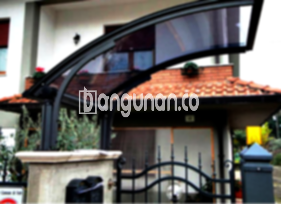

**Jasa Pasang Kanopi Rumah Minimalis di Kuningan Jakarta** – Apakah Anda tahu betapa pentingnya memiliki kanopi yang tepat untuk melindungi rumah Anda? Kanopi adalah struktur atap yang umum diterapkan untuk halaman depan rumah atau jendela, berfungsi menjaga pelataran rumah agar terlindung dari sengatan matahari atau guyuran hujan. Dengan adanya kanopi, Anda dapat menikmati area luar ruangan rumah Anda tanpa khawatir akan perubahan cuaca. Kami siap membantu Mitra Bangunan di Kuningan Jakarta menemukan solusi kanopi yang ideal.

Kanopi tersedia dalam berbagai pilihan, termasuk kanopi berbahan galvalum dan kanopi besi hollo. Anda dapat memilih jenis kanopi yang paling sesuai dengan preferensi dan anggaran Anda. Setiap jenis kanopi memiliki kelebihan dan kekurangan masing-masing yang perlu Anda pertimbangkan sebelum membuat keputusan.

Bagi Anda yang ingin memasang kanopi untuk rumah, terdapat banyak manfaat yang bisa Anda peroleh, termasuk perlindungan optimal dari sinar matahari dan hujan. Kanopi juga menawarkan manfaat tambahan yang signifikan bagi rumah Anda.



## Harga Kanopi Rumah Minimalis di Kuningan Jakarta

Apakah Anda sedang mencari informasi harga kanopi untuk rumah Anda? Sebelum melakukan pembelian, akan sangat membantu jika Anda mengetahui terlebih dahulu perkiraan biaya yang dibutuhkan. Dengan memahami kisaran harga, Anda bisa lebih mudah membandingkan berbagai pilihan dan memilih kanopi yang paling sesuai dengan anggaran Anda.

Terdapat beberapa faktor utama yang memengaruhi harga kanopi, di antaranya:

### \- Material yang Digunakan oleh Jasa Pasang Kanopi Rumah Minimalis di Kuningan Jakarta

Pemilihan material merupakan salah satu aspek terpenting dalam menentukan harga kanopi. Berbagai jenis material dapat digunakan dalam pembuatan kanopi, seperti besi, baja ringan, dan polycarbonate. Setiap material memiliki karakteristik dan harga yang berbeda-beda. Anda dapat memilih material yang paling sesuai dengan kebutuhan dan gaya rumah Anda.

### \- Model Kanopi dari Jasa Pasang Kanopi Rumah Minimalis di Kuningan Jakarta

Model kanopi yang Anda pilih juga akan memengaruhi harga yang perlu Anda bayar. Kami menawarkan beragam model kanopi minimalis yang dapat disesuaikan dengan desain rumah Anda di Kuningan Jakarta. Anda dapat memilih model yang paling menarik bagi Anda atau meminta saran dari tim kami untuk mendapatkan rekomendasi terbaik.

### \- Ukuran dan Luas Kanopi

Selain jenis dan model, ukuran dan luas kanopi yang Anda butuhkan juga akan memengaruhi harga. Setiap rumah memiliki kebutuhan yang berbeda-beda, sehingga penting untuk melakukan pengukuran yang akurat sebelum memesan kanopi.

Dengan mempertimbangkan faktor-faktor tersebut, Anda akan lebih mudah mendapatkan penawaran harga yang sesuai dengan kebutuhan Anda. Silakan lihat tabel harga yang tersedia atau hubungi tim kami untuk mendapatkan penawaran khusus.

## Saran Variasi Kanopi Rumah Minimalis di Kuningan Jakarta



Untuk Anda yang ingin memasang kanopi pada ruko atau bangunan komersial lainnya, kanopi berbahan baja ringan adalah pilihan yang sangat tepat. Jenis kanopi ini menawarkan sejumlah keunggulan dibandingkan material lain. Berikut adalah beberapa kelebihan yang perlu Anda ketahui:

### \- Keawetan Sebagai Prioritas Utama

Setiap orang yang ingin membeli kanopi untuk rumah atau bangunannya tentu saja mencari produk yang awet dan tahan lama. Kanopi yang terbuat dari baja ringan memiliki kualitas yang sangat baik, sehingga dapat bertahan lama tanpa perlu sering diganti. Anda dapat mengandalkannya untuk melindungi properti Anda dari berbagai kondisi cuaca.

Banyak orang telah membuktikan keawetan kanopi berbahan baja ringan, yang dapat bertahan selama bertahun-tahun bahkan puluhan tahun tanpa mengalami kerusakan yang berarti.

### \- Pilihan Model yang Beragam dari Jasa Pasang Kanopi Rumah Minimalis di Kuningan Jakarta

Jika Anda ingin memasang kanopi untuk rumah Anda, Anda akan dimanjakan dengan berbagai pilihan model yang tersedia. Kanopi baja ringan menawarkan fleksibilitas desain yang tinggi, memungkinkan Anda memilih model yang paling sesuai dengan gaya arsitektur rumah Anda. 

### \- Keamanan Terjamin dari Jasa Pasang Kanopi Rumah Minimalis di Kuningan Jakarta

Baja ringan adalah material yang memiliki kekuatan yang tinggi, sehingga dapat memberikan keamanan yang optimal bagi Anda dan keluarga. Anda tidak perlu khawatir tentang risiko kerusakan atau roboh akibat cuaca buruk.

Jika Anda mencari kanopi yang kuat, awet, dan aman, kanopi berbahan baja ringan adalah pilihan yang ideal. Material ini menggabungkan kualitas, kekuatan, dan estetika dalam satu produk.

Semoga informasi yang Kami sampaikan mengenai Jasa Pasang Kanopi Rumah Minimalis di Kuningan Jakarta ini bermanfaat bagi Mitra Bangunan. Untuk pemesanan atau konsultasi lebih lanjut, jangan ragu untuk menghubungi Kami melalui tombol WhatsApp atau Telepon yang tertera di situs web Kami. Kami siap membantu Anda menciptakan hunian yang nyaman dan terlindungi.

**Ref by:**  [Kanopi Rumah Minimalis Kuningan Jakarta](https://id.wikipedia.org/wiki/Kanopi)