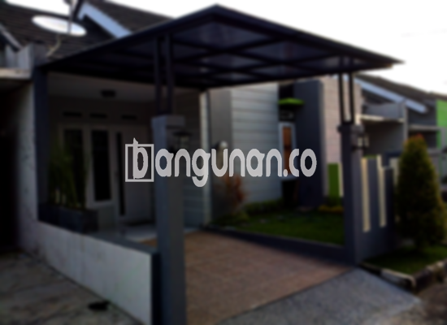

**Jasa Pasang Kanopi Rumah Minimalis di Kuningan Jawa Barat** – Memiliki area luar rumah yang nyaman dan terlindungi adalah kebutuhan utama bagi Mitra Bangunan di Kuningan Jawa Barat. Kanopi menjadi solusi praktis untuk menciptakan perlindungan dari terik matahari dan hujan, sekaligus meningkatkan estetika rumah Anda. Kami hadir sebagai penyedia jasa pemasangan kanopi berkualitas dengan harga terjangkau di Kuningan Jawa Barat.

Kanopi hadir dalam berbagai material, seperti baja ringan dan besi hollo. Anda dapat memilih jenis yang paling sesuai dengan kebutuhan dan preferensi desain rumah Anda. Setiap material memiliki keunggulan dan karakteristik unik yang perlu Anda pertimbangkan.

Memasang kanopi pada rumah Anda menawarkan banyak keuntungan. Selain memberikan perlindungan dari cuaca ekstrem, kanopi juga dapat meningkatkan nilai estetika rumah Anda serta menambah fleksibilitas ruang.



## Harga Kanopi Rumah Minimalis di Kuningan Jawa Barat

Tertarik untuk memesan kanopi untuk rumah Anda? Sebelum melakukan pemesanan, penting bagi Anda untuk memahami perkiraan harga kanopi terlebih dahulu. Dengan memahami kisaran harga, Anda dapat membuat keputusan yang lebih tepat dan memilih kanopi yang sesuai dengan anggaran Anda.

Terdapat beberapa faktor yang dapat memengaruhi harga kanopi, antara lain:

### – Bahan yang Digunakan oleh Jasa Pasang Kanopi Rumah Minimalis di Kuningan Jawa Barat

Jenis bahan yang digunakan merupakan salah satu faktor utama yang memengaruhi harga kanopi. Berbagai macam bahan tersedia untuk pembuatan kanopi, seperti besi, baja ringan, dan lain-lain. Setiap material memiliki harga yang berbeda-beda, disesuaikan dengan kualitas dan karakteristiknya.

### – Model Kanopi dari Jasa Pasang Kanopi Rumah Minimalis di Kuningan Jawa Barat

Model kanopi yang Anda pilih juga akan memengaruhi harga. Terdapat berbagai pilihan model yang tersedia, mulai dari yang sederhana hingga yang lebih kompleks. Model yang lebih rumit biasanya membutuhkan biaya yang lebih tinggi.

### – Ukuran Kanopi

Ukuran kanopi, yaitu panjang dan lebarnya, juga merupakan faktor penentu harga. Semakin besar ukuran kanopi yang Anda pesan, semakin tinggi pula biaya yang dibutuhkan. Pastikan Anda mengukur area yang akan ditutupi kanopi dengan tepat sebelum melakukan pemesanan.

Dengan memahami faktor-faktor di atas, Anda akan dapat memperkirakan biaya yang dibutuhkan untuk memasang kanopi di Kuningan Jawa Barat. Anda juga dapat menghubungi kami untuk mendapatkan penawaran harga yang lebih akurat.

## Rekomendasi Jenis Kanopi Rumah Minimalis di Kuningan Jawa Barat



Bagi Anda yang berencana memasang kanopi untuk hunian, terdapat banyak pilihan jenis kanopi yang dapat Anda pertimbangkan. Salah satu jenis kanopi yang sangat direkomendasikan adalah kanopi berbahan baja ringan. Material ini menawarkan berbagai keunggulan dibandingkan material lainnya.

### – Keawetan Sebagai Prioritas Utama

Ketika Anda memilih kanopi, keawetan tentu menjadi salah satu pertimbangan utama. Kanopi yang terbuat dari baja ringan dikenal memiliki kualitas yang sangat baik dan tahan lama. Anda dapat mengandalkan kekuatannya untuk melindungi rumah Anda selama bertahun-tahun.

Banyak pengguna yang telah membuktikan keawetan kanopi berbahan baja ringan. Bahkan, kanopi jenis ini dapat bertahan puluhan tahun tanpa mengalami kerusakan yang signifikan.

### – Variasi Model yang Luas dari Jasa Pasang Kanopi Rumah Minimalis di Kuningan Jawa Barat

Baja ringan memungkinkan Anda untuk memilih dari berbagai macam model kanopi yang sesuai dengan gaya arsitektur rumah Anda. Fleksibilitas ini memungkinkan Anda menciptakan tampilan yang unik dan menarik.

### – Tingkat Keamanan yang Tinggi dari Jasa Pasang Kanopi Rumah Minimalis di Kuningan Jawa Barat

Material baja ringan terkenal memiliki kekuatan yang tinggi, sehingga dapat memberikan perlindungan maksimal bagi Anda. Anda tidak perlu khawatir tentang keamanan saat menggunakan kanopi berbahan baja ringan. Risiko kerusakan atau roboh dapat diminimalkan secara signifikan.

Jika Anda mencari kanopi yang tahan lama, aman, dan memiliki estetika yang menarik, kanopi berbahan baja ringan adalah pilihan yang tepat.

Semoga informasi tentang Jasa Pasang Kanopi Rumah Minimalis di Kuningan Jawa Barat ini bermanfaat bagi Anda. Mitra Bangunan yang berminat untuk memesan, jangan ragu untuk menghubungi kami melalui tombol WhatsApp atau Telepon yang tersedia di halaman ini. Kami siap membantu Anda mewujudkan hunian yang nyaman dan terlindungi.

**Ref by:**  [Kanopi Rumah Minimalis Kuningan Jawa Barat](https://id.wikipedia.org/wiki/Kanopi)