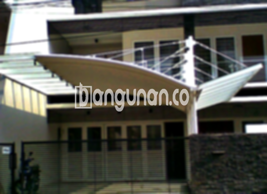

**Jasa Pasang Kanopi Rumah Minimalis di Kutawaluya Karawang** – Menciptakan kenyamanan di area luar rumah adalah prioritas setiap Mitra Bangunan. Apakah Anda membayangkan teras yang teduh di siang hari, atau carport yang terlindungi saat hujan deras? Kanopi hadir sebagai solusi praktis dan estetis, dan kami siap mewujudkannya untuk Anda di Kutawaluya Karawang. Kami menyediakan jasa pemasangan kanopi berkualitas dengan harga yang terjangkau, menyesuaikan dengan kebutuhan dan anggaran Anda.

Kanopi tersedia dalam beragam material, termasuk baja ringan dan besi hollo. Pemilihan material bergantung pada preferensi gaya, anggaran, dan kebutuhan kekuatan struktur. Setiap jenis material memiliki karakteristik unik yang menonjolkan keunggulannya masing-masing.

Memiliki kanopi di rumah memberikan banyak keuntungan. Selain melindungi dari sengatan matahari dan hujan, kanopi juga dapat mempercantik tampilan fasad rumah Anda. 



## Estimasi Biaya Kanopi Rumah Minimalis di Kutawaluya Karawang

Bagi Anda yang berencana memasang kanopi untuk rumah, memahami perkiraan biaya sangatlah penting. Sebelum membuat keputusan, ada baiknya Anda mempertimbangkan berbagai faktor yang memengaruhi harga kanopi. Dengan begitu, Anda dapat memilih opsi yang paling sesuai dengan anggaran dan harapan Anda.

Berikut adalah beberapa faktor yang memengaruhi biaya pemasangan kanopi:

### \- Jenis Material yang Digunakan

Pilihan material adalah salah satu faktor utama yang menentukan harga kanopi. Kami menyediakan berbagai pilihan material, seperti besi, baja ringan, dan lainnya. Setiap material memiliki harga yang berbeda-beda, tergantung pada kualitas dan ketersediaan. Anda dapat memilih material yang paling sesuai dengan anggaran dan preferensi gaya arsitektur rumah Anda.

### \- Desain Kanopi

Desain kanopi juga berperan dalam menentukan biaya. Semakin kompleks desainnya, semakin tinggi biaya yang dibutuhkan. Anda dapat memilih dari berbagai model kanopi yang tersedia, atau bahkan membuat desain khusus sesuai dengan keinginan Anda. Jika Anda ragu, tim kami siap memberikan saran dan rekomendasi desain yang paling cocok untuk rumah Anda.

### \- Ukuran Kanopi

Ukuran kanopi juga memengaruhi biaya pemasangan. Semakin luas area yang akan ditutupi, semakin banyak material dan tenaga kerja yang dibutuhkan. Pastikan Anda mengukur area yang akan dipasang kanopi dengan akurat sebelum melakukan pemesanan.

Setelah mempertimbangkan faktor-faktor tersebut, Anda dapat mendapatkan gambaran yang lebih jelas tentang biaya yang dibutuhkan. Kami menyediakan layanan konsultasi gratis untuk membantu Anda menentukan pilihan kanopi yang tepat. Untuk informasi lebih detail mengenai harga, silakan lihat tabel harga yang tersedia  atau hubungi tim kami untuk mendapatkan penawaran khusus.

## Pilihan Material Kanopi Rumah Minimalis di Kutawaluya Karawang

**Ref by:**  [Kanopi Rumah Minimalis Kutawaluya Karawang](https://id.wikipedia.org/wiki/Kanopi)

Bagi Anda yang mencari solusi terbaik untuk melindungi area luar rumah, kanopi baja ringan adalah pilihan yang sangat direkomendasikan. Material ini menawarkan kombinasi keunggulan yang sulit ditandingi oleh material lain. Berikut adalah beberapa keunggulan kanopi baja ringan:

### \- Kekuatan dan Ketahanan yang Terjamin

Kekuatan adalah faktor utama yang perlu dipertimbangkan saat memilih kanopi. Kanopi yang terbuat dari baja ringan memiliki kualitas yang sangat baik dan mampu menahan beban berat. Struktur baja ringan dirancang untuk menahan tekanan angin kencang dan kondisi cuaca ekstrem lainnya, sehingga Anda dapat merasa tenang dan aman.

Kanopi baja ringan telah teruji kekuatannya oleh banyak pengguna selama bertahun-tahun. Hal ini membuktikan bahwa material ini dapat bertahan lama dan memberikan perlindungan yang andal.

### \- Desain yang Fleksibel

Selain kuat dan tahan lama, kanopi baja ringan juga menawarkan fleksibilitas desain yang tinggi. Anda dapat memilih dari berbagai model dan bentuk yang tersedia. Keunggulan ini memungkinkan Anda untuk menciptakan kanopi yang sesuai dengan gaya arsitektur rumah dan selera pribadi Anda.

### \- Keamanan yang Optimal

Baja ringan adalah material yang kokoh dan tahan terhadap benturan. Hal ini menjamin keamanan yang optimal bagi Anda dan keluarga. Anda tidak perlu khawatir tentang risiko kerusakan atau robohnya kanopi, terutama saat terjadi cuaca buruk.

Bagi Anda yang memiliki ruko atau bangunan komersial, kanopi yang terbuat dari bahan galvalum juga merupakan pilihan yang tepat. Material ini menawarkan keunggulan yang sama dengan baja ringan, serta harga yang lebih terjangkau.

Semoga informasi ini bermanfaat bagi Anda dalam memilih kanopi yang tepat untuk rumah Anda di Kutawaluya Karawang. Jika Anda memiliki pertanyaan lebih lanjut atau ingin memesan kanopi, jangan ragu untuk menghubungi kami melalui tombol WhatsApp atau Telepon yang tersedia di halaman ini. Kami siap membantu Mitra Bangunan mewujudkan teras atau carport impian Anda.