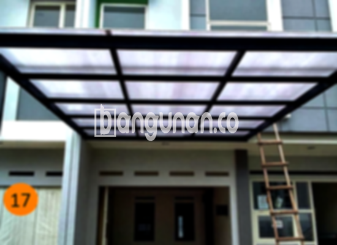

**Jasa Pasang Kanopi Rumah Minimalis di Kwitang Jakarta** – Apakah Anda sedang mempertimbangkan untuk mempercantik dan melindungi area luar rumah Anda di Kwitang Jakarta? Kanopi merupakan solusi praktis dan efektif untuk menciptakan ruang yang nyaman dan terlindungi dari berbagai kondisi cuaca. Sebagai Mitra Bangunan di Kwitang Jakarta, Anda tak perlu lagi khawatir mencari solusi terbaik untuk melindungi teras, garasi, atau area outdoor lainnya. Kami hadir sebagai penyedia jasa pemasangan kanopi yang terpercaya dengan harga yang kompetitif.

Kanopi bukan hanya berfungsi sebagai pelindung dari panas matahari dan hujan, tetapi juga dapat meningkatkan nilai estetika rumah Anda. Dengan desain yang tepat, kanopi dapat menjadi elemen dekoratif yang mempercantik tampilan bangunan Anda.



## Harga Kanopi Rumah Minimalis di Kwitang Jakarta

Memahami estimasi biaya sebelum memutuskan pemasangan kanopi adalah langkah yang bijak. Anda perlu mempertimbangkan berbagai faktor yang dapat memengaruhi harga, seperti material yang digunakan, desain yang dipilih, dan ukuran area yang akan ditutupi kanopi. Kami menyediakan informasi harga yang transparan dan kompetitif untuk membantu Anda merencanakan anggaran dengan lebih baik.

Faktor-faktor yang Mempengaruhi Biaya Kanopi:

### - Jenis Material yang Digunakan oleh Jasa Pasang Kanopi Rumah Minimalis di Kwitang Jakarta

Pilihan material memainkan peran penting dalam menentukan harga kanopi. Material yang umum digunakan meliputi baja ringan, besi hollo, polycarbonate, dan kaca. Setiap material memiliki kelebihan dan kekurangan tersendiri, serta tingkat harga yang berbeda-beda. Anda dapat memilih material yang paling sesuai dengan kebutuhan, anggaran, dan gaya arsitektur rumah Anda.

### - Desain dan Model Kanopi dari Jasa Pasang Kanopi Rumah Minimalis di Kwitang Jakarta

Desain dan model kanopi juga memengaruhi biaya pemasangan. Kanopi dengan desain yang sederhana dan minimalis cenderung lebih terjangkau dibandingkan dengan desain yang rumit dan khusus. Kami menawarkan berbagai pilihan desain kanopi yang dapat disesuaikan dengan preferensi Anda.

### - Luas Area yang Akan Ditutupi Kanopi

Luas area yang akan ditutupi oleh kanopi merupakan faktor penting yang memengaruhi harga. Semakin luas area yang ditutupi, semakin banyak material yang dibutuhkan, dan semakin tinggi biayanya. Kami akan membantu Anda menghitung luas area yang dibutuhkan secara akurat agar Anda mendapatkan penawaran yang sesuai.

Untuk mengetahui lebih lanjut mengenai harga kanopi rumah minimalis di Kwitang Jakarta, Anda dapat merujuk ke tabel harga yang tersedia  atau menghubungi tim kami untuk berkonsultasi dan mendapatkan penawaran harga yang disesuaikan dengan kebutuhan Anda.

## Rekomendasi Variasi Kanopi Rumah Minimalis di Kwitang Jakarta

Ada begitu banyak pilihan model kanopi yang dapat Anda pertimbangkan untuk hunian di Kwitang Jakarta. Kami akan membantu Anda memilih jenis kanopi yang paling sesuai dengan gaya arsitektur rumah Anda dan anggaran yang tersedia. Berikut adalah beberapa rekomendasi variasi kanopi rumah minimalis yang populer:

### - Kanopi Baja Ringan: Pilihan Kuat dan Terjangkau

Kanopi baja ringan merupakan pilihan yang populer karena kuat, ringan, dan terjangkau. Material ini tahan terhadap korosi dan perawatan yang mudah. Anda dapat memilih berbagai desain dan warna untuk menyesuaikan dengan gaya rumah Anda.

*   **Kekuatan dan Ketahanan:** Baja ringan memiliki kekuatan tarik yang tinggi dan mampu menahan beban yang berat.
*   **Bobot Ringan:** Bobotnya yang ringan memudahkan proses pemasangan dan tidak memerlukan struktur penyangga yang terlalu kuat.
*   **Harga Terjangkau:** Kanopi baja ringan umumnya lebih terjangkau dibandingkan dengan jenis kanopi lainnya.

### - Kanopi Galvalum: Tahan Lama dan Perawatan Minimal

Kanopi galvalum merupakan pilihan yang ideal jika Anda mencari kanopi yang tahan lama dan tidak memerlukan perawatan yang rumit. Material ini dilapisi dengan zinc untuk melindungi dari korosi dan karat.

*   **Ketahanan Terhadap Cuaca Buruk:** Kanopi galvalum mampu menahan hujan, panas, angin, dan salju tanpa mengalami kerusakan.
*   **Perawatan Mudah:** Material ini tidak memerlukan pengecatan ulang atau perawatan khusus lainnya.
*   **Tampilan Modern:** Kanopi galvalum memiliki tampilan yang bersih dan modern yang cocok untuk berbagai gaya rumah.

### - Kanopi Kaca: Memberikan Kesan Mewah dan Terbuka

Jika Anda menginginkan tampilan yang mewah dan elegan, kanopi kaca adalah pilihan yang tepat. Kanopi ini memberikan kesan luas dan terbuka, serta memungkinkan cahaya alami masuk ke dalam ruangan.

*   **Estetika yang Menawan:** Kanopi kaca dapat meningkatkan nilai estetika bangunan Anda dan menciptakan suasana yang lebih mewah.
*   **Pencahayaan Alami:** Kanopi ini memungkinkan cahaya alami masuk ke dalam ruangan, sehingga Anda dapat menghemat energi listrik.
*   **Pilihan Beragam:** Anda dapat memilih berbagai jenis kaca, seperti kaca tempered atau kaca laminasi, untuk meningkatkan keamanan dan ketahanan kanopi.

**Ref by:**  [Kanopi Rumah Minimalis Kwitang Jakarta](https://id.wikipedia.org/wiki/Kanopi)

Sebagai Mitra Bangunan di Kwitang Jakarta yang mencari solusi kanopi terbaik, percayakan kebutuhan Anda kepada kami. Kami menawarkan layanan pemasangan kanopi berkualitas tinggi dengan harga yang terjangkau. Hubungi kami sekarang melalui tombol WhatsApp atau Telepon yang tersedia di halaman ini, dan tim kami akan dengan senang hati membantu Anda memilih kanopi yang sempurna untuk rumah Anda.