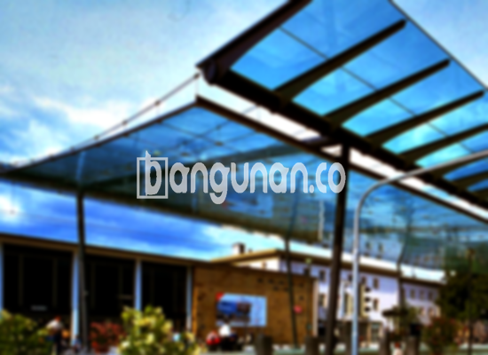

**Jasa Pasang Kanopi Rumah Minimalis di Larangan Tangerang** – Apakah Anda sedang mempertimbangkan pemasangan kanopi untuk rumah atau bangunan komersial? Kanopi adalah solusi praktis untuk melindungi teras, garasi, atau area luar ruangan lainnya dari panas matahari dan hujan. Di Larangan Tangerang, Mitra Bangunan hadir sebagai penyedia jasa pembuatan dan pemasangan kanopi berkualitas dengan harga terjangkau, memberikan kenyamanan dan perlindungan optimal untuk properti Anda.

Kanopi tersedia dalam berbagai material, seperti baja ringan dan besi hollo, masing-masing dengan kelebihan dan kekurangannya. Pilihan material akan bergantung pada preferensi estetika, anggaran, dan kebutuhan fungsional Anda. Dengan mempertimbangkan opsi yang ada, Anda dapat menemukan kanopi yang paling sesuai dengan gaya dan anggaran Anda.

Pemasangan kanopi tidak hanya memberikan perlindungan cuaca, tetapi juga menawarkan beragam manfaat lain bagi hunian Anda. Berikut adalah beberapa keuntungan yang bisa Anda peroleh:



## Informasi Harga Kanopi Rumah Minimalis di Larangan Tangerang

Bagi Anda yang berencana memesan kanopi untuk rumah, mengetahui perkiraan harga menjadi langkah yang bijak. Memahami faktor-faktor yang memengaruhi harga kanopi akan membantu Anda membuat keputusan pembelian yang tepat dan sesuai dengan anggaran. Perencanaan yang matang akan memastikan Anda mendapatkan kanopi yang berkualitas dengan nilai terbaik.

Beberapa faktor utama yang memengaruhi harga kanopi meliputi:

### – Material yang Digunakan oleh Jasa Pasang Kanopi Rumah Minimalis di Larangan Tangerang

Pemilihan material merupakan pertimbangan penting dalam menentukan harga kanopi. Material yang umum digunakan antara lain besi, baja ringan, dan polycarbonate. Setiap jenis material memiliki karakteristik dan rentang harga yang berbeda. Anda dapat memilih material yang paling sesuai dengan kebutuhan dan anggaran Anda.

### – Model Kanopi dari Jasa Pasang Kanopi Rumah Minimalis di Larangan Tangerang

Model kanopi juga berperan dalam menentukan harga. Tersedia berbagai pilihan model, mulai dari yang sederhana hingga yang lebih kompleks. Memilih model yang sesuai dengan gaya arsitektur rumah Anda akan menambah nilai estetika sekaligus memberikan fungsi perlindungan yang optimal.

### – Ukuran Kanopi

Ukuran kanopi secara langsung memengaruhi biaya produksinya. Kanopi dengan ukuran lebih besar tentu membutuhkan lebih banyak material dan waktu pengerjaan, sehingga harganya akan lebih tinggi. Pastikan Anda mengukur area yang akan ditutupi kanopi dengan akurat sebelum melakukan pemesanan.

Dengan memahami faktor-faktor di atas, Anda dapat memperkirakan biaya yang dibutuhkan dan memilih kanopi yang paling sesuai dengan kebutuhan Anda. Untuk informasi harga yang lebih detail, Anda dapat menghubungi kami untuk konsultasi gratis.

## Rekomendasi Ragam Kanopi Rumah Minimalis di Larangan Tangerang



Bagi Anda yang sedang mencari kanopi untuk ruko atau bangunan komersial, kanopi berbahan baja ringan merupakan pilihan yang sangat direkomendasikan. Bahan ini menawarkan sejumlah keunggulan yang menjadikannya solusi ideal untuk kebutuhan perlindungan dan estetika. Mari kita bahas lebih lanjut keunggulan kanopi baja ringan:

### – Keawetan yang Menjadi Prioritas Utama

Salah satu faktor utama yang perlu diperhatikan saat memilih kanopi adalah keawetannya. Kanopi berbahan baja ringan dikenal memiliki kualitas yang sangat baik dan tahan lama. Konstruksinya yang kuat mampu menahan berbagai kondisi cuaca ekstrem, sehingga Anda tidak perlu khawatir tentang perawatan yang sering.

Banyak pengguna telah membuktikan keawetan kanopi baja ringan, dengan beberapa instalasi yang bertahan selama puluhan tahun tanpa masalah berarti. Investasi pada kanopi baja ringan adalah investasi jangka panjang yang akan memberikan nilai tambah bagi properti Anda.

### – Pilihan Model yang Beragam dari Jasa Pasang Kanopi Rumah Minimalis di Larangan Tangerang

Selain keawetan, kanopi baja ringan juga menawarkan fleksibilitas desain yang tinggi. Anda dapat memilih dari berbagai model dan gaya yang sesuai dengan preferensi estetika Anda. Dengan model yang beragam, Anda dapat menciptakan tampilan yang unik dan menarik untuk bangunan Anda.

### – Keamanan yang Terjamin dari Jasa Pasang Kanopi Rumah Minimalis di Larangan Tangerang

Baja ringan adalah material yang sangat kuat dan tahan terhadap benturan. Hal ini menjadikannya pilihan yang aman untuk pemasangan kanopi. Dengan kanopi baja ringan, Anda dapat meminimalkan risiko kerusakan akibat angin kencang, hujan deras, atau faktor eksternal lainnya.

Dengan keunggulan-keunggulan tersebut, kanopi baja ringan adalah solusi terbaik untuk melindungi dan mempercantik properti Anda. Untuk Anda yang ingin memiliki kanopi berkualitas tinggi, kanopi berbahan baja ringan adalah satu-satunya pilihan yang paling tepat.

Mitra Bangunan siap membantu Anda memilih dan memasang kanopi yang sesuai dengan kebutuhan dan anggaran Anda di Larangan Tangerang. Hubungi kami sekarang juga untuk konsultasi gratis dan penawaran terbaik!

**Ref by:**  [Kanopi Rumah Minimalis Larangan Tangerang](https://id.wikipedia.org/wiki/Kanopi)