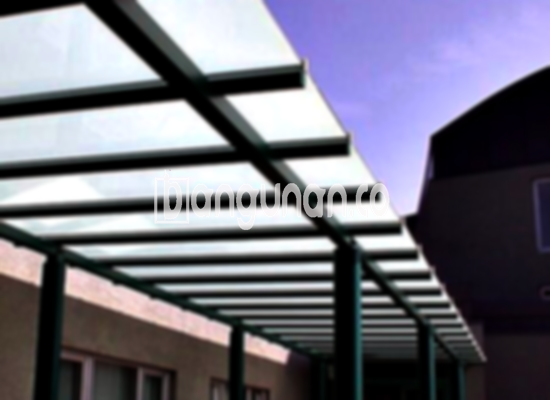

**Jasa Pasang Kanopi Rumah Minimalis di Lawang Gintung Bogor** – Memiliki area luar rumah yang nyaman dan terlindungi adalah dambaan setiap pemilik rumah di Lawang Gintung Bogor. Kanopi hadir sebagai solusi praktis untuk menjaga teras, garasi, dan area lainnya dari paparan cuaca ekstrem. Mitra Bangunan menawarkan layanan pembuatan dan pemasangan kanopi berkualitas dengan harga terjangkau, disesuaikan dengan kebutuhan dan anggaran Anda.

Kanopi hadir sebagai elemen penting dalam desain bangunan modern, bukan hanya berfungsi melindungi dari panas dan hujan, tetapi juga meningkatkan estetika rumah Anda. Tersedia berbagai pilihan material kanopi, masing-masing dengan karakteristik unik yang bisa Anda pilih sesuai preferensi.



## Harga Kanopi Rumah Minimalis di Lawang Gintung Bogor

Bila Anda berencana untuk memasang kanopi di rumah atau bangunan Anda di Lawang Gintung Bogor, memahami estimasi biaya akan sangat membantu dalam perencanaan anggaran. Kami menyarankan Anda untuk mempelajari faktor-faktor yang memengaruhi harga kanopi sebelum membuat keputusan. Detail harga yang lebih spesifik dapat Anda temukan pada tabel harga di bawah ini.

Harga kanopi ditentukan oleh beberapa faktor utama, antara lain:

### – Material yang Digunakan oleh Jasa Pasang Kanopi Rumah Minimalis di Lawang Gintung Bogor

Pemilihan material merupakan pertimbangan penting dalam menentukan harga kanopi. Material seperti besi, baja ringan, dan kaca memiliki tingkat harga yang berbeda. Anda dapat memilih material yang paling sesuai dengan kebutuhan dan anggaran Anda. Setiap material menawarkan kelebihan dan kekurangannya masing-masing.

### – Model Kanopi dari Jasa Pasang Kanopi Rumah Minimalis di Lawang Gintung Bogor

Desain dan model kanopi juga berpengaruh pada harga. Model yang lebih kompleks atau dengan desain khusus biasanya akan memiliki biaya yang lebih tinggi dibandingkan model standar. Anda dapat memilih model yang sesuai dengan gaya arsitektur rumah Anda.

### – Ukuran Kanopi

Ukuran kanopi secara langsung memengaruhi kebutuhan material dan kompleksitas pemasangan. Semakin besar ukuran kanopi, semakin banyak material yang dibutuhkan dan semakin tinggi biayanya. Pastikan Anda mengukur area yang akan dipasangi kanopi dengan tepat untuk mendapatkan penawaran harga yang akurat.

Dengan mempertimbangkan faktor-faktor di atas, Anda dapat memperkirakan biaya yang dibutuhkan untuk pemasangan kanopi. Untuk informasi harga yang lebih detail dan penawaran khusus, silakan hubungi tim kami.

## Saran Jenis Kanopi Rumah Minimalis di Lawang Gintung Bogor



Bagi Anda yang berencana untuk memasang kanopi untuk rumah di Lawang Gintung Bogor, ada banyak pilihan jenis kanopi yang dapat Anda pertimbangkan. Salah satu material yang sangat direkomendasikan adalah baja ringan. Kanopi berbahan baja ringan memiliki beberapa keunggulan dibandingkan material lainnya. Berikut adalah beberapa kelebihannya:

### – Keawetan yang Menjadi Prioritas Utama

Keawetan merupakan faktor penting yang perlu Anda pertimbangkan saat memilih kanopi. Kanopi yang terbuat dari bahan galvalum dikenal memiliki kualitas yang sangat baik dan tahan lama. Material ini mampu bertahan terhadap cuaca ekstrem dan korosi, sehingga menjamin umur pakai yang panjang.

Penggunaan baja ringan dalam pembuatan kanopi telah terbukti mampu bertahan selama bertahun-tahun tanpa kehilangan kekuatannya. 

### – Pilihan Model yang Beragam dari Jasa Pasang Kanopi Rumah Minimalis di Lawang Gintung Bogor

Kanopi baja ringan menawarkan berbagai pilihan model yang dapat disesuaikan dengan gaya arsitektur rumah Anda. Anda dapat memilih dari berbagai desain, mulai dari yang sederhana hingga yang lebih kompleks. Fleksibilitas ini memungkinkan Anda untuk menciptakan kanopi yang sesuai dengan selera dan kebutuhan Anda.

### – Tingkat Keamanan yang Tinggi dari Jasa Pasang Kanopi Rumah Minimalis di Lawang Gintung Bogor

Baja ringan merupakan material yang kokoh dan kuat, sehingga memberikan tingkat keamanan yang tinggi. Anda tidak perlu khawatir dengan risiko kerusakan atau robohnya kanopi karena material ini mampu menahan beban yang berat dan tahan terhadap angin kencang.

Dengan mempertimbangkan keunggulan-keunggulan tersebut, kanopi berbahan galvalum merupakan pilihan yang tepat untuk Anda yang menginginkan kanopi yang awet, aman, dan memiliki tampilan yang menarik.

**Ref by:**  [Kanopi Rumah Minimalis Lawang Gintung Bogor](https://id.wikipedia.org/wiki/Kanopi)

Mitra Bangunan siap membantu Anda dalam memilih dan memasang kanopi yang tepat untuk rumah Anda di Lawang Gintung Bogor. Jangan ragu untuk menghubungi kami melalui tombol WhatsApp atau Telepon di halaman ini untuk mendapatkan konsultasi gratis dan penawaran harga terbaik. Kami berkomitmen untuk memberikan layanan yang profesional dan memuaskan.