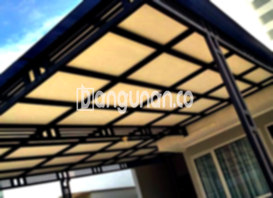

**Jasa Pasang Kanopi Rumah Minimalis di Lebak Bulus Jakarta** – Mencari solusi perlindungan optimal untuk rumah Anda di Lebak Bulus Jakarta? Kanopi adalah investasi cerdas yang memberikan kenyamanan dan estetika. Sebagai Mitra Bangunan, Anda tidak perlu kesulitan mencari penyedia jasa yang terpercaya. Kami hadir untuk memberikan layanan pembuatan dan pemasangan kanopi berkualitas, dengan desain minimalis yang sesuai dengan gaya rumah modern Anda.

Kanopi hadir dalam berbagai material, termasuk baja ringan dan besi hollo. Setiap jenis menawarkan karakteristik unik yang sesuai dengan kebutuhan dan anggaran Anda. Memahami perbedaan ini penting untuk memastikan Anda mendapatkan kanopi yang paling tepat.

Lebih dari sekadar pelindung cuaca, kanopi juga meningkatkan nilai estetika properti Anda. Dengan desain yang tepat, kanopi dapat menjadi elemen dekoratif yang harmonis dengan tampilan rumah.



## Investasi Cerdas: Harga Kanopi Rumah Minimalis di Lebak Bulus Jakarta

Apakah Anda berencana memasang kanopi untuk hunian Anda di Lebak Bulus Jakarta? Memahami perkiraan biaya sebelum memulai proyek adalah langkah yang bijaksana. Perencanaan yang matang membantu Anda memilih kanopi yang sesuai dengan anggaran dan harapan Anda.

Ada beberapa faktor utama yang memengaruhi penentuan harga kanopi:

### \- Pemilihan Material oleh Jasa Pasang Kanopi Rumah Minimalis di Lebak Bulus Jakarta

Material adalah fondasi utama dari setiap kanopi. Berbagai pilihan tersedia, mulai dari besi hingga baja ringan. Setiap material memiliki kelebihan dan kekurangan, serta harga yang berbeda-beda. Pertimbangkan kebutuhan spesifik Anda saat membuat keputusan.

### \- Desain dan Model Kanopi dari Jasa Pasang Kanopi Rumah Minimalis di Lebak Bulus Jakarta

Model kanopi sangat memengaruhi tampilan dan harga. Pilihan desain sangat beragam, mulai dari yang sederhana hingga yang rumit. Anda dapat menyesuaikan desain dengan gaya arsitektur rumah Anda. Untuk referensi, Anda bisa menjelajahi ide desain kanopi secara daring.

### \- Ukuran dan Luas Area yang Dicakup

Luas area yang ingin Anda lindungi dengan kanopi akan langsung memengaruhi jumlah material yang dibutuhkan dan, akibatnya, biaya keseluruhan. Pastikan Anda mengukur area dengan akurat sebelum memesan kanopi. Informasi lebih lanjut mengenai harga terbaru dapat Anda peroleh melalui tabel harga atau dengan menghubungi tim kami.



Dengan mempertimbangkan faktor-faktor ini, Anda dapat memperkirakan biaya yang dibutuhkan dan membuat keputusan yang tepat.

## Pilihan Kanopi Terbaik untuk Rumah Minimalis di Lebak Bulus Jakarta

Bagi Anda yang sedang merencanakan pemasangan kanopi di Lebak Bulus Jakarta, ada beragam pilihan material yang bisa Anda pertimbangkan. Salah satu yang paling populer adalah kanopi berbahan baja ringan. Material ini menawarkan kombinasi keunggulan yang sulit ditandingi.

### \- Keawetan sebagai Prioritas Utama

Keawetan adalah faktor penting yang perlu Anda pertimbangkan. Kanopi berbahan galvalum dikenal karena kualitasnya yang tinggi dan daya tahannya yang luar biasa. Investasi pada kanopi yang awet akan menghemat biaya perbaikan atau penggantian di masa depan.

Banyak pengguna telah membuktikan keawetan kanopi baja ringan, yang mampu bertahan selama bertahun-tahun tanpa kehilangan kualitasnya.

### \- Fleksibilitas Desain dari Jasa Pasang Kanopi Rumah Minimalis di Lebak Bulus Jakarta

Baja ringan memungkinkan berbagai macam desain kanopi yang menarik. Anda dapat menyesuaikan bentuk, ukuran, dan gaya kanopi agar sesuai dengan estetika rumah Anda. Fleksibilitas ini menjadikan baja ringan pilihan ideal bagi Anda yang menginginkan kanopi unik dan personal.

### \- Keamanan Terjamin dari Jasa Pasang Kanopi Rumah Minimalis di Lebak Bulus Jakarta

Baja ringan memiliki tingkat kekokohan yang tinggi, sehingga memberikan keamanan yang optimal. Anda dapat tenang mengetahui bahwa kanopi Anda akan tahan terhadap berbagai kondisi cuaca ekstrem. Risiko kerusakan atau roboh sangat minim jika Anda memilih kanopi baja ringan.

**Ref by:**  [Kanopi Rumah Minimalis Lebak Bulus Jakarta](https://id.wikipedia.org/wiki/Kanopi)

Memilih kanopi baja ringan adalah investasi cerdas untuk hunian Anda. Dengan keawetan, fleksibilitas desain, dan keamanannya, Anda akan mendapatkan perlindungan dan estetika yang maksimal.

Jika Anda adalah Mitra Bangunan yang sedang mencari jasa pasang kanopi di Lebak Bulus Jakarta, jangan ragu untuk menghubungi kami melalui tombol WhatsApp atau Telepon yang tersedia di halaman ini. Kami siap membantu Anda mewujudkan kanopi impian Anda.