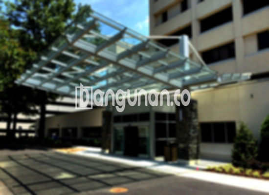

**Jasa Pasang Kanopi Rumah Minimalis di Legok Tangerang** – Apakah Anda membayangkan kanopi yang melindungi rumah dari terik matahari dan derasnya hujan? Kanopi merupakan salah satu elemen penting yang seringkali terlupakan dalam desain eksterior rumah, padahal fungsinya sangat vital. Bagi Mitra Bangunan di Legok Tangerang yang menginginkan perlindungan maksimal untuk teras, carport, atau area luar rumah lainnya, Kami hadir sebagai solusi terpercaya. Kami menyediakan layanan pembuatan dan pemasangan kanopi dengan kualitas terjamin dan harga yang kompetitif, memberikan kenyamanan dan keamanan bagi keluarga Anda.

Kanopi hadir dalam beragam material dan gaya desain, memungkinkan Anda memilih yang paling sesuai dengan estetika dan kebutuhan rumah Anda. Pemilihan material yang tepat, seperti baja ringan yang kuat dan tahan lama, atau polycarbonate yang ringan dan transparan, akan menentukan tampilan dan performa kanopi Anda secara keseluruhan. Setiap material menawarkan kelebihan dan kekurangan masing-masing, yang perlu Anda pertimbangkan dengan cermat.



## Harga Kanopi Rumah Minimalis di Legok Tangerang

Apakah Anda sedang mempertimbangkan untuk memasang kanopi di rumah Anda yang berlokasi di Legok Tangerang? Memperoleh informasi mengenai perkiraan biaya merupakan langkah awal yang bijaksana sebelum mengambil keputusan. Dengan memiliki gambaran harga yang jelas, Anda dapat merencanakan anggaran dengan lebih efektif dan menghindari kejutan biaya di kemudian hari. Perlu diingat bahwa harga kanopi bervariasi, tergantung pada beberapa faktor penting yang akan Kami jelaskan berikut.

Berikut beberapa faktor utama yang memengaruhi biaya pemasangan kanopi oleh Kami:

### \- Jenis Material yang Digunakan

Material yang dipilih memiliki dampak signifikan terhadap harga kanopi. Bahan-bahan seperti besi, baja ringan, dan polycarbonate memiliki harga yang berbeda-beda, tergantung pada kualitas dan ketersediaannya. Anda dapat memilih material yang sesuai dengan anggaran dan preferensi estetika Anda.

### \- Kompleksitas Desain Kanopi

Desain kanopi yang lebih rumit, dengan banyak detail atau bentuk yang unik, akan membutuhkan lebih banyak waktu dan tenaga kerja untuk dibuat. Hal ini tentu saja akan mempengaruhi harga akhir. Anda dapat memilih desain yang sederhana dan fungsional untuk menghemat biaya.

### \- Luas Area yang Ditutupi Kanopi

Ukuran kanopi, atau luas area yang akan ditutupi, merupakan faktor utama dalam perhitungan harga. Semakin luas area yang ditutupi, semakin banyak material yang dibutuhkan, dan semakin tinggi biaya yang harus dikeluarkan. Pastikan untuk mengukur area dengan akurat sebelum melakukan pemesanan.

Untuk mendapatkan penawaran harga yang akurat dan sesuai dengan kebutuhan Anda, jangan ragu untuk menghubungi tim Kami. Kami akan dengan senang hati memberikan konsultasi dan perkiraan biaya yang transparan.

## Saran Tipe Kanopi Rumah Minimalis di Legok Tangerang



Bagi Anda yang berencana untuk memasang kanopi di rumah Anda yang berada di Legok Tangerang, terdapat beragam jenis kanopi yang dapat Anda pertimbangkan. Salah satu material yang sangat populer dan direkomendasikan adalah baja ringan. Kanopi berbahan baja ringan menawarkan sejumlah keunggulan dibandingkan material lain, menjadikannya pilihan ideal untuk melindungi rumah Anda.

### \- Kekuatan dan Daya Tahan Utama

Kekuatan dan daya tahan merupakan faktor penting dalam memilih kanopi. Kanopi yang terbuat dari baja ringan dikenal memiliki kualitas yang sangat baik dan mampu menahan beban berat serta tekanan eksternal. Investasi pada kanopi baja ringan berarti Anda mendapatkan perlindungan jangka panjang dan ketenangan pikiran.

Banyak bukti menunjukkan bahwa kanopi baja ringan dapat bertahan puluhan tahun tanpa mengalami kerusakan signifikan, menjadikannya solusi yang hemat biaya dalam jangka panjang.

### \- Pilihan Model yang Beragam

Selain kekuatannya, kanopi baja ringan juga menawarkan fleksibilitas dalam desain. Anda dapat memilih dari berbagai model dan gaya yang tersedia untuk menciptakan tampilan yang sesuai dengan selera dan gaya arsitektur rumah Anda. Keberagaman desain ini memungkinkan Anda untuk berkreasi dan menciptakan kanopi yang unik dan personal.

### \- Tingkat Keamanan yang Tinggi

Baja ringan adalah material dengan tingkat kekokohan yang tinggi, sehingga memberikan keamanan yang optimal. Anda dapat merasa tenang mengetahui bahwa kanopi Anda akan memberikan perlindungan maksimal terhadap berbagai risiko, seperti angin kencang atau hujan deras.

Jika Anda mencari kanopi yang kuat, tahan lama, dan aman untuk rumah Anda di Legok Tangerang, kanopi berbahan baja ringan adalah pilihan yang tepat. Dengan berbagai kelebihan yang ditawarkannya, Anda akan mendapatkan nilai terbaik untuk investasi Anda. Kami siap membantu Anda mewujudkan kanopi impian Anda.

Mitra Bangunan yang sedang mencari solusi perlindungan terbaik untuk rumah Anda, jangan ragu untuk menghubungi Kami melalui tombol WhatsApp atau Telepon yang tersedia di halaman ini. Kami akan dengan senang hati memberikan konsultasi, penawaran harga, dan layanan pemasangan yang profesional dan terpercaya.

**Ref by:**  [Kanopi Rumah Minimalis Legok Tangerang](https://id.wikipedia.org/wiki/Kanopi)