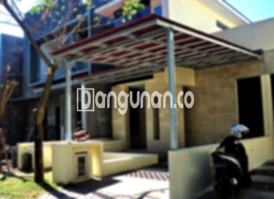

**Jasa Pasang Kanopi Rumah Minimalis di Lemahabang Karawang** – Mempertimbangkan pemasangan kanopi untuk properti Anda adalah keputusan cerdas untuk meningkatkan kenyamanan dan perlindungan. Kanopi merupakan struktur atap tambahan yang umumnya dipasang di atas teras, jendela, atau area parkir. Fungsi utamanya adalah untuk melindungi dari paparan langsung sinar matahari dan hujan, sekaligus memberikan nilai estetika pada bangunan. Bagi Mitra Bangunan di Lemahabang Karawang, kami menyediakan solusi lengkap untuk kebutuhan kanopi dengan layanan borongan pembuatan dan pemasangan yang profesional.

Berbagai material dapat digunakan untuk membuat kanopi, seperti baja ringan, galvalum, kaca, dan polycarbonate. Setiap material memiliki karakteristik dan keunggulan masing-masing, memungkinkan Anda memilih opsi yang paling sesuai dengan preferensi desain dan anggaran. Baik untuk hunian pribadi, ruko, maupun bangunan komersial, kanopi dapat menjadi investasi berharga untuk meningkatkan fungsionalitas dan tampilan properti Anda.



## Harga Kanopi Rumah Minimalis di Lemahabang Karawang

Memahami perkiraan harga kanopi rumah minimalis di Lemahabang Karawang adalah langkah penting sebelum Anda memutuskan untuk melakukan pemasangan. Perlu diingat bahwa harga kanopi dapat bervariasi tergantung pada sejumlah faktor. Dengan memperhitungkan faktor-faktor ini, Anda dapat membuat anggaran yang realistis dan memilih kanopi yang sesuai dengan kebutuhan dan kemampuan finansial Anda.

Beberapa faktor utama yang memengaruhi harga kanopi meliputi:

### – Jenis Material yang Dipilih

Pemilihan material kanopi merupakan salah satu faktor utama yang memengaruhi harga. Material seperti baja ringan, galvalum, kaca, dan polycarbonate memiliki harga yang berbeda-beda. Mempertimbangkan kelebihan dan kekurangan masing-masing material akan membantu Anda membuat keputusan yang tepat.

### – Desain dan Model Kanopi

Desain dan model kanopi yang Anda pilih juga akan memengaruhi harga. Model yang lebih kompleks dan rumit biasanya membutuhkan lebih banyak material dan waktu pengerjaan, sehingga harganya cenderung lebih tinggi.

### – Ukuran Kanopi yang Dibutuhkan

Ukuran kanopi yang akan dipasang secara langsung memengaruhi jumlah material yang diperlukan. Semakin luas area yang akan ditutupi, semakin banyak material yang dibutuhkan, dan semakin tinggi pula biayanya.

Untuk informasi harga yang lebih akurat dan penawaran khusus, jangan ragu untuk menghubungi tim kami. Kami akan memberikan konsultasi gratis dan membantu Anda memilih kanopi yang paling sesuai dengan anggaran Anda.

## Fungsi dan Manfaat Pemasangan Kanopi Rumah di Lemahabang Karawang

Kanopi bukan hanya sekadar elemen dekoratif, tetapi juga memberikan berbagai fungsi dan manfaat penting bagi rumah Anda. Pemasangan kanopi di Lemahabang Karawang dapat memberikan sejumlah keuntungan, antara lain:

*   **Perlindungan dari Cuaca Ekstrem:** Kanopi melindungi teras, jendela, atau area parkir dari paparan langsung sinar matahari, hujan, dan angin kencang.
*   **Mengurangi Panas di Dalam Ruangan:** Dengan menghalangi sinar matahari langsung, kanopi dapat membantu mengurangi panas di dalam ruangan, sehingga menghemat energi pendingin.
*   **Meningkatkan Estetika Bangunan:** Kanopi yang dirancang dengan baik dapat meningkatkan tampilan visual rumah Anda, memberikan kesan modern dan elegan.
*   **Perlindungan Kendaraan:** Kanopi carport melindungi kendaraan Anda dari paparan sinar matahari dan hujan, mencegah kerusakan cat dan interior.

Dengan mempertimbangkan manfaat-manfaat ini, Anda akan menyadari bahwa pemasangan kanopi merupakan investasi yang bijak untuk meningkatkan kualitas hidup Anda.

### Jenis-Jenis Kanopi yang Populer di Lemahabang Karawang

Di Lemahabang Karawang, terdapat beberapa jenis kanopi yang populer dan banyak diminati oleh masyarakat, diantaranya:

*   **Kanopi Baja Ringan:** Dikenal karena kekuatannya, ringan, dan tahan karat, model ini sangat ideal untuk investasi jangka panjang.
*   **Kanopi Galvalum:** Alternatif ekonomis dengan daya tahan yang memadai, cocok untuk kebutuhan budget yang lebih rendah.
*   **Kanopi Kaca:** Memberikan tampilan mewah dan modern, serta memungkinkan cahaya alami masuk ke dalam ruangan.
*   **Kanopi Polycarbonate:** Material ringan yang tahan benturan dan dapat menghalangi sinar UV berbahaya.



## Keunggulan Kanopi Baja Ringan di Lemahabang Karawang

Kanopi baja ringan merupakan pilihan yang sangat populer di Lemahabang Karawang karena berbagai keunggulannya. Berikut adalah beberapa alasan mengapa Anda harus mempertimbangkan kanopi baja ringan untuk rumah Anda:

*   **Kekuatan dan Daya Tahan:** Baja ringan memiliki kekuatan tarik yang tinggi dan tahan terhadap beban berat, sehingga dapat bertahan lama meskipun terpapar cuaca ekstrem.
*   **Ringan dan Mudah Dipasang:** Bobotnya yang ringan memudahkan proses pemasangan dan mengurangi biaya tenaga kerja.
*   **Tahan Karat dan Korosi:** Baja ringan dilapisi dengan lapisan galvanis yang melindungi dari karat dan korosi, sehingga lebih awet dan tahan lama.
*   **Fleksibilitas Desain:** Baja ringan dapat dibentuk menjadi berbagai desain yang sesuai dengan gaya arsitektur rumah Anda.

Dengan keunggulan-keunggulan tersebut, kanopi baja ringan merupakan solusi yang ideal untuk memberikan perlindungan dan estetika pada rumah Anda di Lemahabang Karawang.

### Pertimbangan Penting Sebelum Memasang Kanopi

Sebelum Anda memutuskan untuk memasang kanopi, ada beberapa hal penting yang perlu Anda pertimbangkan:

*   **Ukuran dan Bentuk Kanopi:** Pastikan ukuran dan bentuk kanopi sesuai dengan kebutuhan dan proporsi bangunan Anda.
*   **Material yang Digunakan:** Pilih material yang sesuai dengan anggaran dan gaya arsitektur rumah Anda.
*   **Jasa Pemasangan yang Terpercaya:** Pilih jasa pemasangan kanopi yang berpengalaman dan memiliki reputasi baik.
*   **Perizinan yang Diperlukan:** Pastikan Anda memenuhi semua persyaratan perizinan yang berlaku di wilayah Lemahabang Karawang.

**Ref by:**  [Kanopi Rumah Minimalis Lemahabang Karawang](https://id.wikipedia.org/wiki/Kanopi)

Mitra Bangunan yang sedang merencanakan pemasangan kanopi di Lemahabang Karawang, silakan hubungi kami sekarang juga melalui tombol WhatsApp atau Telepon yang tersedia di halaman ini. Kami siap memberikan layanan konsultasi gratis, survey lokasi, dan penawaran harga yang kompetitif. Percayakan kebutuhan kanopi Anda kepada tim profesional kami, dan nikmati kenyamanan dan perlindungan maksimal untuk rumah Anda!