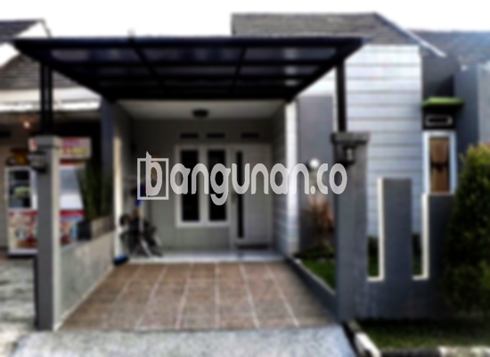

**Jasa Pasang Kanopi Rumah Minimalis di Lembang** – Mitra Bangunan di Lembang yang ingin mempercantik dan melindungi properti mereka, kanopi adalah solusi tepat. Kanopi berfungsi sebagai pelindung optimal dari terik matahari dan hujan, memperpanjang umur bangunan serta meningkatkan nilai estetika rumah atau ruko Anda. Dengan beragam pilihan bahan dan desain, kami hadir untuk memenuhi kebutuhan perlindungan dan keindahan hunian Anda di Lembang.

Kanopi hadir dalam berbagai material seperti baja ringan, besi hollo, kaca, dan polycarbonate. Masing-masing material menawarkan keunggulan unik yang bisa disesuaikan dengan preferensi dan anggaran Anda. Pemilihan material yang tepat akan menentukan ketahanan, tampilan, dan fungsi kanopi sesuai kebutuhan.

Selain melindungi dari cuaca ekstrem, kanopi juga memberikan manfaat tambahan bagi properti Anda. Struktur ini dapat menciptakan ruang terbuka yang nyaman, meningkatkan privasi, dan mempercantik tampilan fasad bangunan.



## Harga Kanopi Rumah Minimalis di Lembang

Berminat untuk memasang kanopi di rumah Anda? Sebelum melakukan pembelian, penting bagi Anda untuk memahami faktor-faktor yang memengaruhi harga kanopi. Memahami komponen harga akan membantu Anda membuat keputusan yang tepat dan mendapatkan kanopi yang sesuai dengan anggaran. 

Berikut beberapa faktor utama yang memengaruhi harga kanopi:

### \- Material yang Digunakan

Pemilihan material adalah pertimbangan utama dalam menentukan harga kanopi. Material seperti besi, baja ringan, dan polycarbonate memiliki harga yang berbeda-beda. Anda dapat memilih material yang sesuai dengan anggaran dan preferensi estetik Anda.

### \- Desain dan Model Kanopi

Desain dan model kanopi juga memengaruhi harga. Semakin kompleks desainnya, semakin tinggi biaya pembuatannya. Kami menawarkan berbagai pilihan desain kanopi minimalis yang dapat Anda sesuaikan dengan gaya arsitektur rumah Anda.

### \- Ukuran Kanopi

Ukuran kanopi merupakan faktor penting yang memengaruhi harga. Semakin besar ukuran kanopi, semakin banyak material yang dibutuhkan dan semakin tinggi biayanya. Lakukan pengukuran akurat sebelum memesan kanopi untuk memastikan ukuran yang tepat.

Untuk mengetahui informasi lebih lanjut mengenai harga dan penawaran terbaik, silakan merujuk pada  atau hubungi tim kami untuk konsultasi gratis.

## Rekomendasi Variasi Kanopi Rumah Minimalis di Lembang

**Ref by:**  [Kanopi Rumah Minimalis Lembang](https://id.wikipedia.org/wiki/Kanopi)

Bagi Anda yang berencana memasang kanopi di rumah atau ruko di Lembang, terdapat berbagai pilihan material dan desain yang dapat Anda pertimbangkan. Salah satu material yang populer dan direkomendasikan adalah baja ringan karena keunggulannya.

### \- Kekuatan dan Ketahanan Terjamin

Keunggulan utama kanopi baja ringan terletak pada kekuatannya. Material galvalum pada baja ringan memiliki mutu yang sangat baik, menjamin ketahanan dan umur panjang kanopi. 

Banyak pelanggan yang telah membuktikan bahwa kanopi dari baja ringan dapat bertahan selama bertahun-tahun tanpa mengalami kerusakan signifikan.

### \- Pilihan Desain yang Beragam

Kanopi baja ringan menawarkan fleksibilitas desain yang tinggi. Anda dapat memilih berbagai model dan gaya yang sesuai dengan preferensi Anda. Fleksibilitas ini menjadikan baja ringan pilihan ideal untuk menyesuaikan kanopi dengan desain bangunan Anda.

### \- Keamanan dan Perlindungan Optimal

Baja ringan adalah material yang kuat dan aman, memberikan perlindungan maksimal terhadap cuaca ekstrem. Anda dapat merasa tenang dengan keamanan yang ditawarkan kanopi baja ringan, meminimalkan risiko kerusakan dan kecelakaan.

Jika Anda mencari solusi kanopi yang kokoh, tahan lama, dan estetis untuk properti Anda di Lembang, kanopi baja ringan adalah pilihan yang tepat. 

Mitra Bangunan di Lembang yang sedang mencari jasa pasang kanopi rumah minimalis, jangan ragu untuk menghubungi kami melalui tombol WhatsApp atau Telepon yang tersedia di halaman ini. Kami siap memberikan pelayanan terbaik dan solusi kanopi yang sesuai dengan kebutuhan Anda.