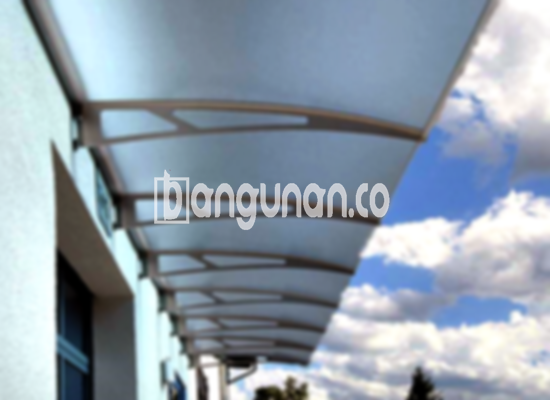

**Jasa Pasang Kanopi Rumah Minimalis di Lenteng Agung Jakarta** – Apakah Anda mempertimbangkan penambahan kanopi untuk rumah Anda? Kanopi merupakan struktur atap yang umumnya diaplikasikan untuk melindungi teras depan atau jendela rumah. Tujuan utama kanopi adalah melindungi area tersebut dari paparan panas matahari dan hujan. Dengan adanya kanopi di atasnya, area depan rumah Anda akan lebih nyaman dan terlindungi. Kami sebagai penyedia jasa borongan pembuatan dan pemasangan kanopi dengan harga terjangkau siap membantu Mitra Bangunan di Lenteng Agung Jakarta mewujudkan hunian yang lebih nyaman dan menarik.

Kanopi tersedia dalam berbagai jenis material, di antaranya adalah kanopi berbahan galvalum dan kanopi besi hollo. Anda dapat memilih jenis kanopi yang paling sesuai dengan kebutuhan dan preferensi desain rumah Anda. Setiap jenis material memiliki keunggulan dan kekurangan masing-masing yang perlu dipertimbangkan sebelum membuat keputusan.

Bagi Anda yang berencana memasang kanopi untuk rumah Anda, terdapat berbagai manfaat yang dapat Anda peroleh. Salah satunya adalah perlindungan dari sengatan matahari dan guyuran hujan. Selain itu, kanopi juga memiliki manfaat lain yang sangat berguna untuk mempercantik dan meningkatkan fungsionalitas rumah Anda.



## Estimasi Biaya Pemasangan Kanopi Rumah Minimalis di Lenteng Agung Jakarta

Apakah Anda sedang berencana untuk membeli kanopi untuk rumah Anda? Sebelum melakukan pembelian, akan lebih baik jika Anda memahami terlebih dahulu perkiraan biaya yang dibutuhkan. Dengan meninjau perkiraan harga kanopi, Anda bisa membandingkan berbagai opsi yang tersedia dan menemukan kanopi yang paling sesuai dengan anggaran Anda.

Ada beberapa faktor yang memengaruhi harga kanopi, di antaranya:

### \- Jenis Material yang Digunakan untuk Kanopi

Material yang digunakan merupakan hal penting yang perlu Anda pertimbangkan dalam memilih kanopi. Terdapat berbagai jenis material yang dapat digunakan untuk membuat kanopi, seperti besi, baja ringan, dan polycarbonate. Anda dapat memilih material yang paling sesuai dengan anggaran dan selera estetika Anda. Setiap material memiliki harga yang berbeda-beda.

### \- Model dan Desain Kanopi

Model kanopi juga memengaruhi harga yang ditawarkan. Model yang lebih rumit atau kompleks biasanya akan membutuhkan biaya yang lebih tinggi dibandingkan dengan model yang sederhana. Kami menawarkan berbagai pilihan model kanopi minimalis yang dapat Anda sesuaikan dengan gaya rumah Anda.

### \- Luas Area yang Akan Ditutupi Kanopi

Selain jenis material dan model, luas area yang akan ditutupi kanopi juga akan memengaruhi harganya. Semakin luas area yang akan ditutupi, semakin banyak material yang dibutuhkan dan semakin tinggi biaya pemasangannya. Kami akan melakukan pengukuran yang akurat untuk memastikan perhitungan biaya yang tepat.

Dengan mempertimbangkan faktor-faktor tersebut, Anda dapat memperkirakan biaya yang dibutuhkan untuk pemasangan kanopi. Untuk mendapatkan informasi lebih detail dan penawaran harga yang paling sesuai dengan kebutuhan Anda, jangan ragu untuk menghubungi tim kami.

## Saran Jenis Kanopi Rumah Minimalis di Lenteng Agung Jakarta



Bagi Anda yang berencana untuk membuat kanopi untuk rumah, ada berbagai pilihan jenis kanopi yang tersedia. Salah satu jenis kanopi yang sangat direkomendasikan adalah kanopi berbahan baja ringan. Kanopi berbahan baja ringan memiliki beberapa keunggulan dibandingkan dengan material lainnya. Berikut beberapa keunggulan yang bisa Anda dapatkan:

### \- Keawetan Sebagai Prioritas Utama

Setiap orang yang ingin membeli kanopi untuk rumahnya tentu saja menginginkan kanopi yang tahan lama dan awet. Kanopi yang terbuat dari baja ringan memiliki kualitas yang sangat baik dan tahan terhadap berbagai kondisi cuaca. Daya tahan material ini memastikan kanopi Anda akan kokoh dan awet selama bertahun-tahun.

Banyak orang telah membuktikan keawetan kanopi baja ringan, bahkan hingga puluhan tahun. Hal ini menjadikan kanopi baja ringan sebagai investasi jangka panjang yang sangat menguntungkan.

### \- Tersedia Berbagai Pilihan Model

Kami memahami bahwa setiap rumah memiliki desain yang unik. Oleh karena itu, kami menawarkan berbagai pilihan model kanopi baja ringan yang dapat Anda sesuaikan dengan gaya rumah Anda. Fleksibilitas desain ini memungkinkan Anda menciptakan tampilan yang harmonis dan sesuai dengan preferensi pribadi Anda.

### \- Tingkat Keamanan yang Tinggi

Baja ringan adalah material yang sangat kuat dan memiliki tingkat keamanan yang tinggi. Anda dapat merasa aman karena kanopi baja ringan akan memberikan perlindungan optimal kepada rumah Anda. Kemungkinan terjadinya kerusakan atau roboh sangat kecil jika Anda menggunakan kanopi baja ringan.

Bahkan jika Anda berencana memasang kanopi untuk ruko, kanopi berbahan galvalum merupakan pilihan yang sangat memadai. Ada banyak kelebihan yang bisa Anda dapatkan dengan memilih jenis kanopi ini.

Mitra Bangunan yang sedang mencari jasa pasang kanopi di Lenteng Agung Jakarta, jangan ragu untuk menghubungi kami melalui tombol WhatsApp atau Telepon yang ditampilkan di halaman ini. Kami siap memberikan konsultasi gratis dan membantu Anda menemukan solusi kanopi yang paling tepat untuk hunian Anda.

**Ref by:**  [Kanopi Rumah Minimalis Lenteng Agung Jakarta](https://id.wikipedia.org/wiki/Kanopi)