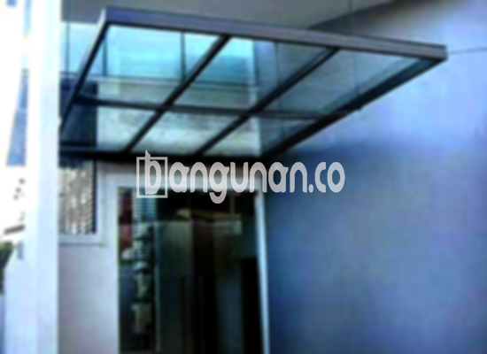

**Jasa Pasang Kanopi Rumah Minimalis di Leuwiliang** – Mitra Bangunan di Leuwiliang yang ingin mempercantik dan melindungi properti Anda? Kanopi adalah solusi terbaik untuk memberikan naungan dari cuaca ekstrem sekaligus meningkatkan estetika bangunan. Kami menyediakan jasa pembuatan dan pemasangan kanopi dengan berbagai pilihan material dan desain yang sesuai dengan kebutuhan Anda. Dengan pengalaman bertahun-tahun, kami berkomitmen untuk memberikan hasil yang kokoh, rapi, dan tahan lama.

Kanopi hadir dalam beragam material, seperti galvalum dan besi hollo. Setiap material menawarkan kelebihan dan kekurangan yang unik. Pemilihan material yang tepat akan sangat memengaruhi kekuatan, tampilan, dan tentu saja, anggaran Anda. 

Pemasangan kanopi tidak hanya memberikan perlindungan, tetapi juga menambahkan nilai estetika pada bangunan Anda. Rumah dengan kanopi yang baik akan terlihat lebih menarik dan terawat.



## Harga Kanopi Rumah Minimalis di Leuwiliang

Berencana untuk memasang kanopi di Leuwiliang? Memahami perkiraan biaya akan membantu Anda dalam perencanaan anggaran. Sebelum menentukan pilihan, ada baiknya Anda mempertimbangkan beberapa faktor yang memengaruhi harga kanopi.

Harga kanopi bervariasi tergantung pada beberapa aspek penting, di antaranya:

### – Material yang Digunakan oleh Jasa Pasang Kanopi Rumah Minimalis di Leuwiliang

Material merupakan faktor utama yang menentukan harga kanopi. Bahan-bahan seperti besi, baja ringan, dan polycarbonate memiliki harga yang berbeda-beda. Anda dapat memilih material yang paling sesuai dengan anggaran dan kebutuhan Anda.

### – Model Kanopi dari Jasa Pasang Kanopi Rumah Minimalis di Leuwiliang

Model kanopi juga memengaruhi harga. Semakin kompleks desainnya, biasanya semakin tinggi biayanya. Kami menawarkan berbagai pilihan model kanopi untuk memenuhi selera Anda.

### – Ukuran Kanopi 

Ukuran kanopi, baik panjang maupun lebar, tentu saja akan memengaruhi biaya. Semakin besar ukuran kanopi yang Anda butuhkan, semakin banyak material yang diperlukan dan semakin tinggi biaya pemasangannya.  Anda dapat menyesuaikan ukuran kanopi dengan area yang ingin Anda lindungi. 

Setelah mempertimbangkan faktor-faktor tersebut, Anda akan lebih mudah menentukan pilihan kanopi yang sesuai dengan anggaran dan harapan Anda. Kualitas yang lebih baik tentu membutuhkan investasi yang lebih besar.

## Saran Ragam Kanopi Rumah Minimalis di Leuwiliang



Bagi Anda yang sedang mencari referensi, ada banyak sekali jenis kanopi yang bisa Anda pertimbangkan untuk rumah Anda di Leuwiliang. Salah satu pilihan yang sangat direkomendasikan adalah kanopi berbahan baja ringan. Material ini menawarkan sejumlah keunggulan dibandingkan material lainnya.

### – Kekuatan dan Ketahanan sebagai Prioritas Utama

Kekuatan adalah hal yang paling dicari ketika Anda membeli kanopi rumah. Kanopi yang terbuat dari baja ringan dikenal akan kualitasnya yang sangat baik. Anda dapat yakin bahwa kanopi ini akan kokoh dan tahan lama. 

Banyak pengguna telah membuktikan ketahanan kanopi baja ringan. Dengan perawatan yang tepat, kanopi ini dapat bertahan selama bertahun-tahun.

### – Desain yang Bervariasi dari Jasa Pasang Kanopi Rumah Minimalis di Leuwiliang

Jika Anda ingin kanopi yang sesuai dengan gaya arsitektur rumah Anda, baja ringan adalah pilihan yang tepat. Material ini sangat fleksibel dan mudah dibentuk, sehingga Anda dapat memilih dari berbagai desain yang tersedia. Keunggulan ini membuat banyak orang tertarik untuk menggunakan kanopi baja ringan.

### – Keamanan yang Terjamin dari Jasa Pasang Kanopi Rumah Minimalis di Leuwiliang

Baja ringan memiliki tingkat kekuatan yang tinggi, sehingga Anda tidak perlu khawatir tentang keamanannya. Anda akan mendapatkan perlindungan maksimal jika menggunakan kanopi baja ringan. Risiko kerusakan atau roboh sangat kecil jika material ini dipasang dengan benar.

Sebagai alternatif, kanopi berbahan galvalum juga bisa menjadi pilihan yang baik. Material ini menawarkan sejumlah keunggulan yang dapat memenuhi kebutuhan Anda. 

Semoga informasi ini bermanfaat bagi Mitra Bangunan yang sedang mencari jasa pasang kanopi di Leuwiliang. Jangan ragu untuk menghubungi kami melalui tombol WhatsApp atau Telepon di halaman ini untuk mendapatkan penawaran terbaik dan layanan berkualitas. Kami siap membantu Anda mewujudkan kanopi impian Anda.

**Ref by:**  [Kanopi Rumah Minimalis Leuwiliang](https://id.wikipedia.org/wiki/Kanopi)