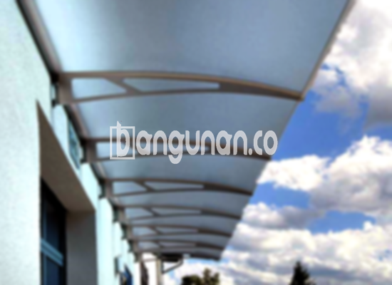

**Jasa Pasang Kanopi Rumah Minimalis di Leuwinanggung Depok** – Memiliki area luar rumah yang nyaman dan terlindungi adalah prioritas utama bagi Mitra Bangunan di Leuwinanggung Depok. Kanopi menjadi solusi praktis untuk melindungi teras, garasi, atau area lainnya dari cuaca ekstrem. Kami menyediakan layanan pemasangan kanopi berkualitas dengan harga terjangkau, disesuaikan dengan kebutuhan dan anggaran Anda.

Kanopi hadir dalam berbagai material, seperti galvalum dan besi hollo, masing-masing dengan keunggulan dan pertimbangan tersendiri. Memilih material yang tepat akan sangat memengaruhi estetika dan ketahanan kanopi Anda.



Dengan memasang kanopi, Anda tidak hanya terhindar dari sengatan matahari dan guyuran hujan, tetapi juga meningkatkan nilai estetika rumah Anda. Kanopi juga memiliki fungsi lain yang sangat bermanfaat bagi hunian Anda. 

## Harga Kanopi Rumah Minimalis di Leuwinanggung Depok

Tertarik untuk memasang kanopi di rumah Anda di Leuwinanggung Depok? Sebelum memesan, penting untuk memahami faktor-faktor yang memengaruhi harga kanopi. Informasi ini membantu Anda dalam memperkirakan biaya dan memilih opsi yang paling sesuai dengan anggaran Anda.

Berikut beberapa faktor utama yang memengaruhi harga kanopi:

### – Bahan yang Digunakan 

Material merupakan salah satu aspek penting yang perlu Anda pertimbangkan. Terdapat berbagai pilihan material untuk pembuatan kanopi, seperti besi, baja ringan, dan lain-lain. Setiap material memiliki karakteristik dan harga yang berbeda. Anda dapat memilih material yang paling sesuai dengan kebutuhan dan preferensi estetika Anda.

### – Model Kanopi

Model kanopi juga menjadi salah satu penentu harga. Pilihlah model yang sesuai dengan gaya arsitektur rumah Anda dan kebutuhan fungsional. Kami menyediakan beragam pilihan model kanopi minimalis yang dapat Anda pilih sebagai referensi.

### – Ukuran Kanopi

Ukuran kanopi yang Anda butuhkan juga akan memengaruhi total biaya. Lakukan pengukuran yang akurat untuk menentukan ukuran kanopi yang paling sesuai dengan area yang ingin Anda lindungi.

Untuk informasi lebih detail mengenai harga, Anda dapat melihat tabel harga yang tersedia  atau menghubungi tim kami untuk mendapatkan penawaran yang dipersonalisasi.

## Rekomendasi Macam Kanopi Rumah Minimalis di Leuwinanggung Depok

**Ref by:**  [Kanopi Rumah Minimalis Leuwinanggung Depok](https://id.wikipedia.org/wiki/Kanopi)

Jika Anda sedang mempertimbangkan untuk memasang kanopi di kediaman Anda, terdapat berbagai opsi yang tersedia. Salah satu yang paling populer adalah kanopi yang terbuat dari baja ringan. Material ini menawarkan sejumlah keunggulan dibandingkan material lain. 

### – Kekuatan dan Ketahanan

Salah satu pertimbangan utama saat memilih kanopi adalah kekuatannya. Kanopi yang terbuat dari baja ringan dikenal memiliki kualitas yang sangat baik. Kekuatan material ini memastikan kanopi Anda tahan lama dan mampu menahan berbagai kondisi cuaca.

Banyak bukti menunjukkan bahwa kanopi baja ringan dapat bertahan selama bertahun-tahun tanpa kehilangan kekuatannya.

### – Variasi Model yang Luas

Selain kekuatannya, kanopi baja ringan juga menawarkan berbagai pilihan model. Anda dapat memilih model yang paling sesuai dengan gaya arsitektur rumah Anda dan preferensi pribadi. Variasi model ini memberikan Anda fleksibilitas dalam menciptakan tampilan yang unik dan menarik.

### – Keamanan Terjamin

Baja ringan adalah material yang kuat dan tahan lama, sehingga memberikan tingkat keamanan yang tinggi. Anda dapat merasa tenang karena kanopi Anda akan melindungi Anda dari cuaca buruk dan potensi bahaya lainnya.

Kanopi baja ringan menjadi pilihan ideal bagi Anda yang mencari solusi praktis, tahan lama, dan aman untuk melindungi area luar rumah Anda di Leuwinanggung Depok.

Dengan berbagai pilihan material dan model yang tersedia, Kami siap membantu Anda menemukan kanopi yang sempurna untuk hunian Anda. Jangan ragu untuk menghubungi Kami melalui tombol WhatsApp atau Telepon di halaman ini untuk konsultasi dan pemesanan. Mitra Bangunan siap mewujudkan kenyamanan dan keindahan rumah Anda di Leuwinanggung Depok.