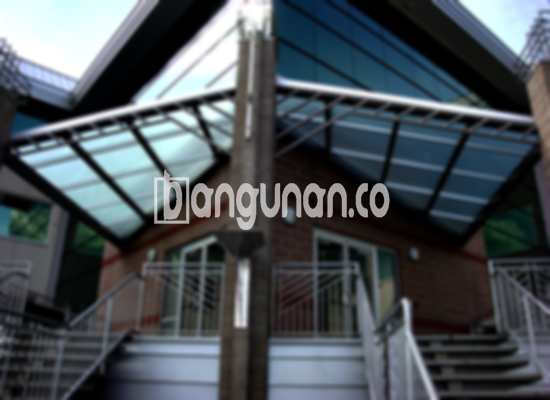

**Jasa Pasang Kanopi Rumah Minimalis di Leuwisadeng** – Memiliki area luar rumah yang nyaman dan terlindungi adalah impian setiap pemilik rumah. Mitra Bangunan di Leuwisadeng tidak perlu lagi khawatir mencari solusi perlindungan optimal untuk teras atau garasi. Kami hadir sebagai penyedia jasa pembuatan dan pemasangan kanopi berkualitas dengan harga terjangkau. Dengan kanopi yang tepat, halaman depan rumah ataupun jendela Anda akan terlindungi dari panas matahari dan hujan.

Kanopi hadir dalam beragam pilihan material, seperti baja ringan dan besi hollo. Anda dapat memilih jenis kanopi yang paling sesuai dengan kebutuhan dan anggaran Anda. Setiap material memiliki keunggulan dan kekurangan masing-masing, menawarkan keunikan tersendiri dalam desain dan performa.

Bagi Anda yang berencana memasang kanopi untuk rumah, terdapat banyak manfaat yang dapat diperoleh. Tak hanya melindungi dari cuaca ekstrem, kanopi juga meningkatkan nilai estetika dan kenyamanan rumah Anda. 



## Harga Kanopi Rumah Minimalis di Leuwisadeng

Apakah Anda ingin mempercantik hunian dengan kanopi? Sebelum melakukan pemesanan, penting untuk memahami kisaran harga kanopi rumah terlebih dahulu. Anda dapat membandingkan berbagai opsi agar mendapatkan kanopi yang paling sesuai dengan kebutuhan dan anggaran Anda.

Harga kanopi ditentukan oleh beberapa faktor utama, antara lain:

### – Material yang Digunakan

Material adalah pertimbangan penting dalam memilih kanopi. Terdapat berbagai jenis bahan yang dapat digunakan, seperti besi, baja ringan, dan lainnya. Pemilihan material akan memengaruhi tampilan dan ketahanan kanopi, sekaligus berdampak pada harganya.

### – Model Kanopi

Model kanopi juga berperan dalam menentukan harga. Anda dapat memilih berbagai jenis model yang tersedia, dari desain sederhana hingga yang lebih kompleks. Sesuaikan model kanopi dengan gaya arsitektur rumah Anda untuk hasil yang harmonis.

### – Luas Kanopi

Selain jenis dan material, luas kanopi juga memengaruhi harga. Ukur area yang akan ditutupi kanopi dengan cermat agar Anda mendapatkan penawaran harga yang akurat.

Dengan memahami faktor-faktor di atas, Anda akan lebih mudah menemukan kanopi yang sesuai dengan preferensi dan anggaran Anda. Kualitas yang lebih baik biasanya akan sebanding dengan harga yang lebih tinggi.

## Rekomendasi Tipe Kanopi Rumah Minimalis di Leuwisadeng



Untuk Anda yang mencari kanopi untuk rumah atau bangunan komersial, kanopi berbahan baja ringan adalah pilihan yang sangat tepat. Material ini menawarkan sejumlah keunggulan dibandingkan material lain. Berikut beberapa keunggulannya:

### – Keawetan Sebagai Prioritas Utama

Ketika memilih kanopi, keawetan adalah faktor penting yang perlu dipertimbangkan. Kanopi yang terbuat dari baja ringan dikenal memiliki kualitas yang sangat baik. Keawetannya terjamin dan tahan lama.

Banyak pengguna yang telah membuktikan kekokohan kanopi berbahan baja ringan dan galvalum. Bahkan, dapat bertahan puluhan tahun tanpa kehilangan kekuatannya.

### – Pilihan Model yang Beragam

Bagi Anda yang menginginkan kanopi untuk ruko atau bangunan lain, Anda dapat memilih dari berbagai model yang tersedia. Kanopi baja ringan menawarkan fleksibilitas desain yang tinggi, memungkinkan Anda menciptakan tampilan yang sesuai dengan gaya bangunan Anda.

### – Tingkat Keamanan yang Tinggi

Baja ringan merupakan material yang memiliki tingkat kekokohan tinggi, menjamin keamanan yang optimal. Anda akan mendapatkan perlindungan yang baik dengan menggunakan kanopi baja ringan. Risiko kerusakan atau roboh akan sangat minim.

Bagi Anda yang ingin memesan kanopi untuk hunian, kanopi dari bahan baja ringan merupakan pilihan yang sangat efektif. Banyak keunggulan yang dapat Anda nikmati dengan memilih jenis kanopi ini.

Mitra Bangunan yang mencari jasa pemasangan kanopi di Leuwisadeng, jangan ragu untuk menghubungi kami melalui tombol WhatsApp atau Telepon yang tersedia di halaman ini. Kami siap membantu Anda menemukan solusi kanopi yang tepat untuk kebutuhan Anda. 

**Ref by:**  [Kanopi Rumah Minimalis Leuwisadeng](https://id.wikipedia.org/wiki/Kanopi)