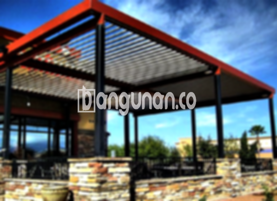

**Jasa Pasang Kanopi Rumah Minimalis di Limo Depok** – Memiliki area luar rumah yang nyaman dan terlindungi adalah impian setiap pemilik rumah di Limo Depok. Kanopi hadir sebagai solusi praktis untuk menjaga teras, garasi, atau area lainnya dari panas matahari dan hujan. Mitra Bangunan memahami pentingnya perlindungan ini dan hadir untuk membantu Anda mewujudkannya. Kami adalah penyedia jasa borongan pembuatan dan pemasangan kanopi terpercaya di Limo Depok, dengan layanan yang cepat, profesional, dan harga yang kompetitif.

Kanopi tidak hanya berfungsi sebagai pelindung, tetapi juga meningkatkan estetika rumah Anda. Tersedia beragam pilihan material, mulai dari baja ringan yang ekonomis hingga kaca yang elegan. Pemilihan material yang tepat akan sangat memengaruhi tampilan dan performa kanopi Anda. 



## Harga Kanopi Rumah Minimalis di Limo Depok

Banyak pertanyaan muncul mengenai perkiraan biaya pemasangan kanopi, dan kami memahami pentingnya informasi ini bagi Anda. Sebelum memutuskan, mengetahui kisaran harga kanopi rumah akan membantu Anda dalam perencanaan anggaran. Anda dapat membandingkan berbagai opsi untuk menemukan solusi yang sesuai dengan kebutuhan dan anggaran Anda.

Harga kanopi sangat bervariasi, bergantung pada beberapa faktor utama:

### - Material yang Digunakan oleh Jasa Pasang Kanopi Rumah Minimalis di Limo Depok

Pilihan material adalah salah satu penentu harga yang paling signifikan. Kami menawarkan berbagai material berkualitas tinggi seperti besi, baja ringan, dan polycarbonate. Setiap material memiliki karakteristik unik dan rentang harga yang berbeda. Anda dapat memilih material yang paling sesuai dengan preferensi dan kebutuhan Anda.

### - Desain Kanopi dari Jasa Pasang Kanopi Rumah Minimalis di Limo Depok

Model dan desain kanopi juga memengaruhi harga. Kami menawarkan berbagai desain, mulai dari yang sederhana hingga yang lebih kompleks. Semakin rumit desainnya, semakin banyak material dan tenaga kerja yang dibutuhkan, dan akibatnya, harga juga akan meningkat.

### - Ukuran Kanopi

Luas area yang akan ditutupi oleh kanopi juga menjadi faktor penentu harga. Semakin besar luas area, semakin banyak material yang dibutuhkan, dan semakin tinggi pula biayanya. Penting untuk melakukan pengukuran yang akurat sebelum memesan kanopi.

Untuk informasi lebih detail mengenai harga, kami menyarankan Anda untuk melihat tabel harga di . Tim kami juga siap membantu Anda menghitung perkiraan biaya sesuai dengan kebutuhan spesifik Anda.

## Rekomendasi Jenis Kanopi Rumah Minimalis di Limo Depok

Kami menawarkan berbagai jenis kanopi untuk memenuhi kebutuhan dan preferensi Anda. Salah satu pilihan yang populer adalah kanopi baja ringan, yang dikenal karena keawetannya dan efisiensinya. Berikut adalah beberapa keunggulan kanopi baja ringan:

### - Keawetan yang Menjadi Prioritas Utama

Ketika memilih kanopi, kekuatan dan daya tahan adalah hal yang paling penting. Kanopi yang terbuat dari baja ringan memiliki kualitas yang sangat baik dan mampu menahan berbagai kondisi cuaca ekstrem. Anda dapat mengandalkan kanopi baja ringan untuk melindungi properti Anda selama bertahun-tahun.

Banyak pengguna telah membuktikan keawetan kanopi baja ringan. Dengan perawatan yang tepat, kanopi ini dapat bertahan hingga puluhan tahun tanpa kehilangan kekokohannya.

### - Pilihan Desain yang Beragam dari Jasa Pasang Kanopi Rumah Minimalis di Limo Depok

Selain kekuatan, kanopi baja ringan juga menawarkan fleksibilitas desain yang tinggi. Anda dapat memilih dari berbagai model dan desain yang tersedia, atau bahkan menyesuaikannya sesuai dengan gaya arsitektur rumah Anda. Keunggulan ini menjadikan kanopi baja ringan sebagai pilihan yang populer di kalangan pemilik rumah di Limo Depok.

### - Tingkat Keamanan yang Tinggi dari Jasa Pasang Kanopi Rumah Minimalis di Limo Depok

Baja ringan merupakan material yang sangat kokoh dan aman. Keamanannya sudah teruji dan tidak diragukan lagi. Anda akan mendapatkan perlindungan maksimal dari berbagai risiko seperti kerusakan akibat angin kencang atau hujan deras. Dengan kanopi baja ringan, Anda dapat merasa tenang dan nyaman.

Sebagai penyedia jasa kanopi terpercaya di Limo Depok, kami berkomitmen untuk memberikan solusi terbaik bagi Anda. Kami menawarkan berbagai jenis kanopi, termasuk kanopi baja ringan, yang sesuai dengan kebutuhan dan anggaran Anda.

**Ref by:**  [Kanopi Rumah Minimalis Limo Depok](https://id.wikipedia.org/wiki/Kanopi)

Mitra Bangunan siap membantu Anda mewujudkan kanopi impian di Limo Depok. Jangan ragu untuk menghubungi kami melalui tombol WhatsApp atau Telepon di halaman ini untuk konsultasi gratis dan penawaran terbaik. Kami akan dengan senang hati membantu Anda menemukan solusi kanopi yang sempurna untuk rumah Anda.