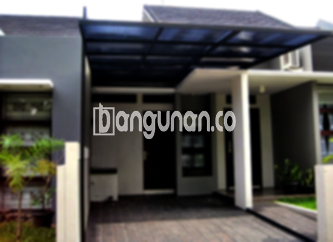

**Jasa Pasang Kanopi Rumah Minimalis di Loji Bogor** – Memiliki area luar rumah yang nyaman dan terlindungi adalah impian setiap warga Loji Bogor. Kanopi hadir sebagai solusi praktis untuk menjaga teras, garasi, atau halaman Anda dari terik matahari dan hujan deras. Mitra Bangunan memahami kebutuhan ini dan menyediakan jasa pemasangan kanopi berkualitas dengan harga terjangkau. 

Kanopi tidak hanya berfungsi sebagai pelindung, tetapi juga dapat meningkatkan estetika rumah Anda. Kami menawarkan berbagai pilihan material dan desain yang dapat disesuaikan dengan gaya arsitektur dan preferensi Anda. Apakah Anda menginginkan tampilan yang modern, minimalis, atau klasik, kami siap mewujudkannya.

Dengan menggunakan kanopi, Anda dapat memperpanjang umur bangunan dan melindungi perabotan luar ruangan dari kerusakan akibat cuaca ekstrem. Investasi pada kanopi adalah investasi pada kenyamanan dan keawetan properti Anda.



## Harga Kanopi Rumah Minimalis di Loji Bogor

Anda sedang mempertimbangkan untuk memasang kanopi di rumah Anda di Loji Bogor? Memahami perkiraan biaya adalah langkah awal yang tepat. Kami menyediakan beragam pilihan kanopi dengan harga yang kompetitif dan transparan. Anda dapat melihat perkiraan biaya berdasarkan material dan ukuran yang Anda inginkan.

Harga kanopi dapat bervariasi tergantung pada beberapa faktor penting yang perlu Anda ketahui:

### – Material yang Digunakan oleh Jasa Pasang Kanopi Rumah Minimalis di Loji Bogor

Pemilihan material merupakan keputusan penting dalam menentukan tampilan dan kualitas kanopi Anda. Material yang umum digunakan meliputi besi, baja ringan, kaca, dan polycarbonate. Setiap material memiliki karakteristik dan rentang harga yang berbeda. Menentukan material yang sesuai dengan kebutuhan dan anggaran Anda adalah langkah pertama yang bijaksana.

### – Model Kanopi dari Jasa Pasang Kanopi Rumah Minimalis di Loji Bogor

Model kanopi juga memengaruhi harga secara signifikan. Kami menawarkan berbagai pilihan desain, mulai dari model minimalis yang sederhana hingga desain yang lebih kompleks. Anda dapat memilih model yang paling sesuai dengan gaya rumah Anda dan anggaran yang tersedia.

### – Ukuran Kanopi

Ukuran kanopi yang Anda butuhkan juga akan memengaruhi biaya yang dikeluarkan. Luas area yang akan ditutupi kanopi akan menentukan jumlah material yang dibutuhkan dan waktu pengerjaan. Pastikan Anda mengukur area yang akan ditutupi kanopi dengan akurat sebelum melakukan pemesanan.

Untuk informasi harga yang lebih rinci dan penawaran khusus, jangan ragu untuk menghubungi kami. Kami akan dengan senang hati memberikan konsultasi gratis dan membantu Anda menemukan solusi kanopi yang paling sesuai dengan kebutuhan Anda.

## Rekomendasi Jenis Kanopi Rumah Minimalis di Loji Bogor



Saat Anda hendak memilih kanopi untuk rumah Anda, ada banyak jenis yang bisa dipertimbangkan. Salah satu pilihan yang paling populer dan direkomendasikan adalah kanopi yang terbuat dari material baja ringan. Jenis kanopi ini menawarkan sejumlah keunggulan yang menjadikannya pilihan ideal bagi banyak pemilik rumah di Loji Bogor.

### – Kekuatan dan Keawetan sebagai Prioritas Utama

Keawetan adalah faktor penting yang perlu Anda pertimbangkan saat memilih kanopi. Kanopi yang terbuat dari baja ringan dikenal karena kekuatannya yang luar biasa dan ketahanannya terhadap berbagai kondisi cuaca. Material ini mampu menahan beban berat, seperti salju atau angin kencang, tanpa mengalami kerusakan.

Banyak pengguna telah membuktikan bahwa kanopi baja ringan dapat bertahan selama bertahun-tahun tanpa perlu perawatan khusus. Ini menjadikannya investasi yang sangat baik untuk melindungi rumah Anda dalam jangka panjang.

### – Variasi Model dari Jasa Pasang Kanopi Rumah Minimalis di Loji Bogor

Selain kekuatannya, kanopi baja ringan juga menawarkan variasi model yang luas. Anda dapat memilih dari berbagai desain dan gaya yang berbeda untuk menciptakan tampilan yang sesuai dengan selera Anda. Baik Anda menginginkan kanopi dengan desain minimalis, modern, atau klasik, kami dapat mewujudkannya.

Kami akan membantu Anda menemukan model kanopi yang sempurna untuk melengkapi estetika rumah Anda di Loji Bogor.

### – Keamanan yang Terjamin dari Jasa Pasang Kanopi Rumah Minimalis di Loji Bogor

Keamanan adalah prioritas utama kami. Kanopi baja ringan memiliki tingkat kekokohan yang tinggi, sehingga dapat memberikan perlindungan yang optimal bagi Anda dan keluarga. Material ini tahan terhadap benturan dan tidak mudah rusak, sehingga Anda dapat merasa tenang dan aman di bawahnya.

Dengan memilih kanopi baja ringan, Anda mendapatkan solusi yang aman, kuat, dan tahan lama untuk melindungi rumah Anda.

Kami menawarkan berbagai jenis kanopi, antara lain:

*   **Kanopi Baja Ringan:** Ringan, kuat, dan tahan karat. Cocok untuk carport, teras, dan area komersial.
*   **Kanopi Galvalum:** Mirip dengan baja ringan, namun lebih tebal dan tahan lama.
*   **Kanopi Kaca:** Memberikan tampilan modern dan mewah. Cocok untuk area yang membutuhkan pencahayaan alami.
*   **Kanopi Polycarbonate:** Kuat, ringan, dan tahan panas. Tersedia dalam berbagai warna dan tekstur.
*   **Kanopi Minimalis:** Desain sederhana dan elegan. Cocok untuk berbagai jenis rumah.

**Ref by:**  [Kanopi Rumah Minimalis Loji Bogor](https://id.wikipedia.org/wiki/Kanopi)

Mitra Bangunan siap membantu Anda mewujudkan hunian yang nyaman dan terlindungi di Loji Bogor. Hubungi kami melalui tombol WhatsApp atau Telepon di halaman ini untuk mendapatkan konsultasi gratis, penawaran harga terbaik, dan layanan pemasangan kanopi yang profesional. Kami menjamin kepuasan Anda.