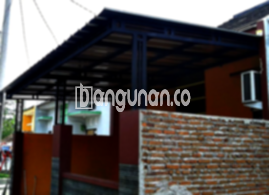

**Jasa Pasang Kanopi Rumah Minimalis di Lubang Buaya Jakarta** – Mitra Bangunan di Lubang Buaya Jakarta pasti menginginkan perlindungan optimal untuk rumah, sekaligus sentuhan estetika yang mempercantik tampilan. Kami hadir sebagai solusi terpercaya untuk pemasangan kanopi berkualitas tinggi, menawarkan pilihan yang beragam sesuai kebutuhan dan anggaran Anda. Dengan layanan profesional, kami memastikan kanopi rumah Anda kokoh, tahan lama, dan memberikan kenyamanan maksimal.

Kanopi merupakan elemen penting dalam desain eksterior rumah modern. Selain melindungi dari panas matahari dan hujan, kanopi juga meningkatkan nilai estetika bangunan. Tersedia berbagai material yang dapat digunakan, mulai dari baja ringan hingga kaca, masing-masing menawarkan keunggulan unik.



## Harga Kanopi Rumah Minimalis di Lubang Buaya Jakarta

Bagi Anda yang berencana memasang kanopi, memahami kisaran harga menjadi pertimbangan penting. Harga kanopi rumah minimalis di Lubang Buaya Jakarta bervariasi, tergantung pada sejumlah faktor. Untuk mendapatkan penawaran terbaik dan sesuai dengan kebutuhan Anda, kami sarankan untuk berkonsultasi langsung dengan tim kami atau melihat tabel harga yang tersedia .

Beberapa faktor utama yang memengaruhi harga kanopi meliputi:

### - Bahan yang Digunakan Oleh Jasa Pasang Kanopi Rumah Minimalis di Lubang Buaya Jakarta

Pilihan material sangat memengaruhi biaya pembuatan kanopi. Material seperti besi, baja ringan, dan polycarbonate memiliki harga yang berbeda. Tentunya, Anda dapat memilih material yang paling sesuai dengan anggaran dan preferensi estetika Anda.

### - Model Kanopi dari Jasa Pasang Kanopi Rumah Minimalis di Lubang Buaya Jakarta

Desain dan kompleksitas model kanopi juga memengaruhi harga. Model yang lebih rumit atau khusus akan membutuhkan lebih banyak material dan tenaga kerja, sehingga biaya pembuatannya pun lebih tinggi.

### - Ukuran Kanopi

Luas area yang akan ditutupi kanopi secara langsung memengaruhi jumlah material yang dibutuhkan. Semakin besar ukuran kanopi, semakin tinggi pula biayanya.

Dengan mempertimbangkan faktor-faktor di atas, Anda dapat memperkirakan anggaran yang diperlukan untuk pemasangan kanopi rumah minimalis di Lubang Buaya Jakarta.

## Pilihan Model Kanopi Rumah Minimalis di Lubang Buaya Jakarta

**Ref by:**  [Kanopi Rumah Minimalis Lubang Buaya Jakarta](https://id.wikipedia.org/wiki/Kanopi)

Kami menawarkan beragam pilihan model kanopi rumah minimalis di Lubang Buaya Jakarta untuk memenuhi kebutuhan dan selera Anda. Salah satu pilihan yang populer adalah kanopi baja ringan, yang dikenal karena keunggulannya yang signifikan. Berikut beberapa keunggulan kanopi baja ringan:

### - Keawetan yang Terjamin

Kanopi yang terbuat dari baja ringan memiliki daya tahan tinggi dan mampu menahan berbagai kondisi cuaca ekstrem. Material ini tidak mudah berkarat atau lapuk, sehingga menjamin keawetan kanopi dalam jangka waktu yang lama.

### - Desain yang Fleksibel

Kanopi baja ringan dapat dirancang dalam berbagai bentuk dan ukuran sesuai dengan keinginan Anda. Fleksibilitas desain ini memungkinkan Anda menciptakan kanopi yang sesuai dengan gaya arsitektur rumah Anda.

### - Keamanan yang Optimal

Baja ringan merupakan material yang kuat dan kokoh, sehingga mampu memberikan perlindungan maksimal terhadap rumah Anda. Kanopi baja ringan dapat menahan beban berat dan melindungi dari risiko kerusakan akibat cuaca buruk.

Selain kanopi baja ringan, kami juga menyediakan pilihan kanopi dari bahan lain, seperti galvalum, kaca, dan polycarbonate. Masing-masing material menawarkan kelebihan dan kekurangan tersendiri, sehingga Anda dapat memilih yang paling sesuai dengan kebutuhan Anda. [Jasa Pasang Kanopi Rumah Minimalis di Rawa Buaya Jakarta](/jasa-pasang-kanopi-rumah-minimalis-di-rawa-buaya-jakarta/) menawarkan solusi serupa.

Kanopi kaca memberikan tampilan yang elegan dan modern, sementara kanopi polycarbonate memberikan perlindungan terhadap sinar UV dan tahan terhadap benturan.

Dengan berbagai pilihan model dan material yang tersedia, kami yakin dapat membantu Anda menemukan kanopi rumah minimalis yang sempurna di Lubang Buaya Jakarta.

Mitra Bangunan yang ingin menciptakan hunian yang nyaman dan terlindungi di Lubang Buaya Jakarta, jangan ragu untuk menghubungi kami melalui tombol WhatsApp atau Telepon yang tersedia di halaman ini. Tim kami siap memberikan konsultasi gratis dan membantu Anda memilih kanopi yang tepat sesuai dengan kebutuhan dan anggaran Anda.