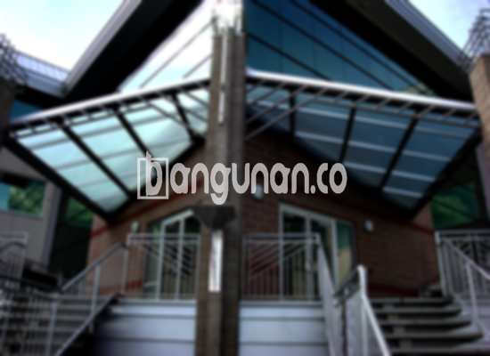

**Jasa Pasang Kanopi Rumah Minimalis di Magetan** – Memiliki area luar ruangan yang nyaman dan terlindungi adalah impian setiap pemilik rumah di Magetan. Kanopi adalah solusi praktis untuk menjaga teras, garasi, atau area lain dari sengatan matahari dan hujan deras. Mitra Bangunan di Magetan siap membantu mewujudkan hunian yang lebih nyaman dengan layanan pemasangan kanopi berkualitas dan terjangkau. Kami menyediakan beragam pilihan kanopi yang sesuai dengan gaya dan kebutuhan Anda.

Kanopi hadir dalam berbagai material, mulai dari baja ringan yang ekonomis hingga kaca yang elegan. Masing-masing jenis memiliki karakteristik unik yang dapat disesuaikan dengan preferensi Anda. Pilihan yang tepat akan memberikan perlindungan optimal sekaligus menambah nilai estetika pada bangunan Anda.

Selain untuk rumah tinggal, pemasangan kanopi juga sangat bermanfaat bagi pemilik ruko atau bangunan komersial di Magetan. Kanopi melindungi area depan bisnis Anda, menciptakan kesan lebih menarik bagi pelanggan, dan membantu menjaga aset Anda dari kerusakan akibat cuaca.



## Harga Kanopi Rumah Minimalis di Magetan

Tertarik untuk memasang kanopi di rumah atau bangunan Anda di Magetan? Sebelum membuat keputusan, penting untuk memahami faktor-faktor yang memengaruhi harga kanopi. Dengan mengetahui hal ini, Anda dapat merencanakan anggaran dengan lebih baik dan memilih kanopi yang sesuai dengan kebutuhan dan kemampuan finansial Anda.

Harga kanopi dapat bervariasi tergantung pada beberapa aspek, di antaranya:

### – Material yang Digunakan

Jenis material yang dipilih sangat berpengaruh pada harga kanopi. Material seperti besi, baja ringan, dan kaca memiliki tingkat harga yang berbeda. Anda dapat memilih material yang paling sesuai dengan anggaran dan gaya desain Anda.

### – Model Kanopi

Model kanopi juga menjadi salah satu faktor penentu harga. Semakin kompleks desainnya, semakin tinggi biaya pembuatannya. Tersedia berbagai pilihan model kanopi yang dapat Anda sesuaikan dengan preferensi Anda.

### – Luas Area yang Ditutupi

Luas area yang akan ditutupi kanopi secara langsung memengaruhi harga. Semakin luas area yang ditutupi, semakin banyak material yang dibutuhkan, sehingga biaya pemasangan juga akan meningkat.

Untuk informasi harga yang lebih detail dan penawaran terbaik, silakan lihat tabel harga di bawah ini atau hubungi tim kami untuk konsultasi gratis.



## Rekomendasi Jenis Kanopi Rumah Minimalis di Magetan

Bagi Anda yang berencana memasang kanopi untuk hunian di Magetan, terdapat berbagai jenis kanopi yang dapat Anda pertimbangkan. Salah satu jenis kanopi yang populer dan direkomendasikan adalah kanopi berbahan baja ringan. Berikut adalah beberapa keunggulan kanopi baja ringan:

### – Keawetan yang Terjamin

Keawetan merupakan salah satu aspek penting yang perlu diperhatikan saat memilih kanopi. Kanopi berbahan galvalum dikenal karena kualitasnya yang sangat baik dan tahan lama. Material ini mampu menahan berbagai kondisi cuaca ekstrem sehingga dapat digunakan untuk jangka waktu yang panjang.

### – Pilihan Model yang Beragam

Kanopi baja ringan hadir dalam berbagai model dan desain, sehingga Anda dapat memilih yang paling sesuai dengan gaya arsitektur rumah Anda. Keberagaman model ini memberikan fleksibilitas dalam menciptakan tampilan visual yang menarik.

### – Keamanan yang Optimal

Baja ringan adalah material yang memiliki tingkat kekokohan tinggi, sehingga memberikan keamanan yang optimal. Anda tidak perlu khawatir dengan risiko kerusakan atau robohnya kanopi, terutama saat terjadi cuaca buruk. Kanopi baja ringan dirancang untuk memberikan perlindungan maksimal bagi Anda dan keluarga.

Dengan mempertimbangkan berbagai keunggulan tersebut, kanopi berbahan galvalum menjadi pilihan yang ideal bagi Anda yang menginginkan kanopi yang kuat, tahan lama, dan aman.

**Ref by:**  [Kanopi Rumah Minimalis Magetan](https://id.wikipedia.org/wiki/Kanopi)

Mitra Bangunan siap menjadi solusi terbaik untuk kebutuhan kanopi Anda di Magetan. Jangan ragu untuk menghubungi kami melalui tombol WhatsApp atau Telepon yang tersedia di halaman ini. Tim kami akan dengan senang hati membantu Anda memilih kanopi yang tepat dan memberikan pelayanan yang profesional.