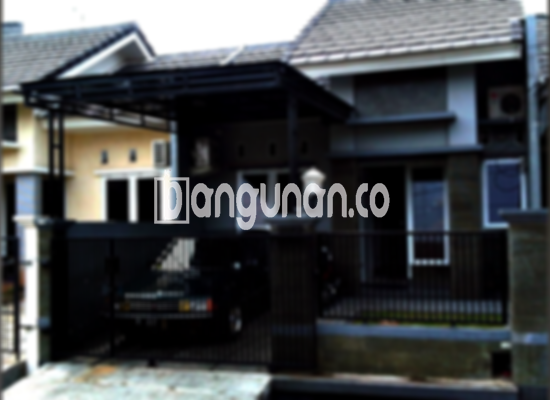

**Jasa Pasang Kanopi Rumah Minimalis di Majalaya Karawang** – Apakah Anda membayangkan memiliki pelindung atap yang elegan untuk teras depan rumah atau jendela Anda? Kanopi adalah solusi ideal, memberikan perlindungan dari panas terik matahari maupun guyuran hujan lebat. Mitra Bangunan di Majalaya Karawang dapat menikmati kenyamanan rumah yang terlindungi dengan kanopi yang tepat. Kami hadir sebagai solusi terpercaya untuk pembuatan dan pemasangan kanopi berkualitas tinggi, dirancang khusus untuk memenuhi kebutuhan hunian Anda.

Kanopi tersedia dalam berbagai jenis, termasuk kanopi baja ringan dan kanopi besi hollo. Anda dapat memilih jenis kanopi yang paling sesuai dengan preferensi desain dan anggaran Anda. Setiap jenis kanopi memiliki karakteristik unik yang akan memberikan nilai estetika tersendiri pada rumah Anda.

Investasi dalam kanopi menawarkan berbagai manfaat signifikan bagi properti Anda, mulai dari perlindungan cuaca hingga peningkatan nilai estetika. Mari kita telaah lebih jauh apa saja keuntungan yang dapat Anda peroleh dari pemasangan kanopi.



## Mengetahui Harga Kanopi Rumah Minimalis di Majalaya Karawang

Apakah Anda sedang berencana membeli kanopi untuk rumah Anda? Salah satu langkah penting sebelum melakukan pembelian adalah memahami secara jelas perkiraan harga kanopi rumah. Dengan mengetahui kisaran harga, Anda dapat melakukan perbandingan yang cerdas dan memastikan bahwa investasi Anda sesuai dengan anggaran yang telah ditetapkan. 

Terdapat beberapa faktor utama yang memengaruhi harga kanopi, di antaranya:

### \- Jenis Bahan yang Digunakan dalam Pembuatan Kanopi

Pemilihan bahan konstruksi kanopi menjadi pertimbangan penting yang memengaruhi harga. Terdapat berbagai pilihan material yang tersedia, seperti besi, baja ringan, dan bahan-bahan lainnya. Setiap jenis material memiliki karakteristik dan biaya yang berbeda, sehingga Anda perlu menyesuaikannya dengan kebutuhan dan anggaran Anda.

### \- Model dan Desain Kanopi yang Dipilih

Model dan desain kanopi juga berperan penting dalam menentukan harga. Pilihan desain yang kompleks atau memiliki fitur khusus mungkin memerlukan biaya tambahan. Anda dapat memilih model yang sesuai dengan gaya arsitektur rumah Anda dan anggaran yang tersedia.

### \- Ukuran dan Luas Area yang Akan Ditutupi

Ukuran dan luas area yang akan dicakup oleh kanopi juga memengaruhi biaya pemasangan. Semakin luas area yang dicakup, maka akan semakin banyak material dan tenaga kerja yang dibutuhkan, sehingga biaya pemasangan akan meningkat. Oleh karena itu, pastikan Anda mengukur area yang akan dipasang kanopi dengan akurat sebelum meminta penawaran harga.

Dengan memahami faktor-faktor tersebut, Anda dapat membuat keputusan yang lebih tepat dan mendapatkan penawaran harga yang sesuai dengan kebutuhan Anda. Anda dapat menemukan tabel harga referensi  atau menghubungi tim kami untuk mendapatkan perhitungan harga khusus sesuai dengan spesifikasi kanopi yang Anda inginkan.

## Rekomendasi Jenis Kanopi Rumah Minimalis di Majalaya Karawang

**Ref by:**  [Kanopi Rumah Minimalis Majalaya Karawang](https://id.wikipedia.org/wiki/Kanopi)

Bagi Anda yang ingin mempercantik hunian dengan kanopi, terdapat berbagai pilihan jenis kanopi yang dapat Anda pertimbangkan. Salah satu opsi yang sangat direkomendasikan adalah kanopi berbahan baja ringan. Jenis kanopi ini menawarkan sejumlah keunggulan dibandingkan dengan material lainnya.

### \- Kekuatan dan Ketahanan yang Luar Biasa

Kekuatan adalah salah satu aspek terpenting yang perlu diperhatikan dalam memilih kanopi. Kanopi yang terbuat dari material galvalum memiliki struktur yang kokoh dan tahan lama. Dengan demikian, Anda dapat yakin bahwa kanopi Anda akan tetap kuat dan berfungsi optimal selama bertahun-tahun.

### \- Beragam Pilihan Model dan Desain

Kanopi baja ringan menawarkan fleksibilitas desain yang tinggi, memungkinkan Anda untuk memilih dari berbagai model dan ukuran yang tersedia. Anda dapat menyesuaikan desain kanopi dengan gaya arsitektur rumah Anda dan preferensi pribadi Anda.

### \- Keamanan yang Terjamin

Keamanan merupakan prioritas utama, dan kanopi baja ringan menawarkan perlindungan yang optimal. Baja ringan adalah material yang kokoh dan tahan terhadap berbagai kondisi cuaca ekstrem, sehingga Anda dapat merasa tenang dan nyaman mengetahui bahwa kanopi Anda aman dan andal.

Dengan mempertimbangkan keunggulan-keunggulan ini, kanopi baja ringan menjadi pilihan yang sangat menarik bagi Anda yang menginginkan solusi perlindungan dan estetika yang optimal untuk rumah Anda di Majalaya Karawang.

Mitra Bangunan yang sedang mencari jasa pemasangan kanopi rumah minimalis berkualitas di Majalaya Karawang, jangan ragu untuk menghubungi kami! Kami siap memberikan solusi kanopi yang paling sesuai dengan kebutuhan dan anggaran Anda. Hubungi kami melalui tombol WhatsApp atau Telepon yang tersedia di halaman ini untuk mendapatkan penawaran menarik dan konsultasi gratis. Percayakan kebutuhan kanopi Anda kepada ahlinya dan nikmati kenyamanan serta keamanan yang tak tertandingi!