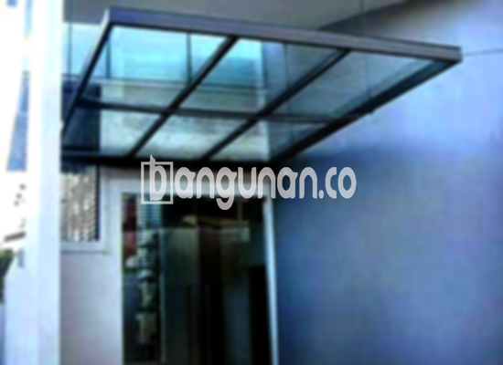

**Jasa Pasang Kanopi Rumah Minimalis di Majalengka** – Memiliki area terbuka yang terlindungi dari cuaca ekstrem adalah dambaan setiap pemilik rumah. Mitra Bangunan di Majalengka tidak perlu lagi khawatir mencari solusi terbaik untuk melindungi teras, garasi, atau area luar ruangan lainnya. Kami hadir sebagai penyedia jasa pembuatan dan pemasangan kanopi yang berkualitas dan terjangkau untuk rumah Anda.

Kanopi bukan hanya sekadar pelengkap bangunan, tetapi juga investasi penting untuk kenyamanan dan keamanan hunian Anda. Dengan kanopi, Anda dapat menikmati waktu di luar ruangan tanpa terganggu oleh panas matahari yang menyengat atau hujan yang tiba-tiba turun. 



## Harga Kanopi Rumah Minimalis di Majalengka

Berencana untuk memasang kanopi untuk rumah Anda di Majalengka? Memahami perkiraan biaya akan membantu Anda merencanakan anggaran dengan lebih baik. Kami menyarankan Anda untuk membandingkan berbagai opsi agar mendapatkan kanopi yang sesuai dengan kebutuhan dan anggaran Anda.

Ada beberapa faktor utama yang memengaruhi harga kanopi, di antaranya:

### – Bahan yang Digunakan oleh Jasa Pasang Kanopi Rumah Minimalis di Majalengka

Pemilihan bahan merupakan langkah krusial dalam menentukan kualitas dan harga kanopi. Kami menawarkan berbagai pilihan bahan, seperti besi, baja ringan, dan lainnya. Setiap bahan memiliki karakteristik dan rentang harga yang berbeda. Anda dapat berkonsultasi dengan tim kami untuk mendapatkan rekomendasi bahan yang paling sesuai dengan kebutuhan Anda.

### – Model Kanopi dari Jasa Pasang Kanopi Rumah Minimalis di Majalengka

Model kanopi juga berdampak signifikan terhadap harga. Kami menyediakan beragam pilihan model yang dapat disesuaikan dengan gaya arsitektur rumah Anda. Anda dapat melihat referensi model kanopi di berbagai sumber untuk mendapatkan inspirasi.

### – Ukuran Kanopi

Ukuran kanopi yang Anda butuhkan akan langsung memengaruhi jumlah material yang digunakan. Oleh karena itu, penting untuk melakukan pengukuran yang akurat sebelum memesan kanopi. Kami siap membantu Anda dalam proses pengukuran untuk memastikan kanopi yang dipasang sesuai dengan kebutuhan Anda.

Dengan mempertimbangkan faktor-faktor di atas, Anda akan dapat memperkirakan biaya yang dibutuhkan dan memilih kanopi yang paling sesuai dengan anggaran Anda. Untuk informasi harga yang lebih detail, silakan lihat tabel harga di bawah ini atau hubungi tim kami untuk mendapatkan penawaran khusus.



Sebagai referensi, berikut adalah beberapa rekomendasi ragam kanopi rumah minimalis yang populer di Majalengka:

### – Kanopi Baja Ringan: Pilihan Kokoh dan Terjangkau

Kanopi baja ringan adalah pilihan yang sangat populer karena kekuatannya, daya tahannya, dan harganya yang terjangkau. Material ini tahan terhadap karat dan cuaca ekstrem, sehingga ideal untuk iklim di Majalengka. Selain itu, baja ringan juga ringan sehingga memudahkan proses pemasangan.

### – Kanopi Galvalum: Alternatif Ekonomis dengan Kualitas Terjamin

Kanopi galvalum merupakan alternatif yang ekonomis dengan kualitas yang tetap terjamin. Material ini memiliki ketahanan yang baik terhadap korosi dan mudah dirawat. Kanopi galvalum cocok untuk Anda yang mencari solusi praktis dan efisien.

### – Kanopi Kaca: Sentuhan Modern dan Elegan

Jika Anda menginginkan tampilan yang modern dan elegan, kanopi kaca adalah pilihan yang tepat. Kanopi kaca memberikan kesan luas dan terbuka, serta memungkinkan cahaya alami masuk ke dalam ruangan. Namun, perlu diingat bahwa kanopi kaca membutuhkan perawatan yang lebih intensif.

### – Kanopi Polycarbonate: Ringan, Kuat, dan Estetis

Kanopi polycarbonate menawarkan kombinasi yang menarik antara kekuatan, ringan, dan estetika. Material ini tahan terhadap benturan dan sinar UV, sehingga ideal untuk melindungi area luar ruangan dari cuaca ekstrem. Polycarbonate juga tersedia dalam berbagai pilihan warna dan desain.

Kami di Majalengka siap membantu Anda memilih jenis kanopi yang paling sesuai dengan kebutuhan dan anggaran Anda.

**Ref by:**  [Kanopi Rumah Minimalis Majalengka](https://id.wikipedia.org/wiki/Kanopi)

Dengan berbagai pilihan material dan model yang tersedia, kami yakin dapat memberikan solusi kanopi yang tepat untuk rumah Anda di Majalengka. Jangan ragu untuk berkonsultasi dengan tim kami untuk mendapatkan saran terbaik dan penawaran harga yang kompetitif. Mitra Bangunan siap menjadi mitra terpercaya Anda dalam menciptakan hunian yang nyaman dan terlindungi. Hubungi kami melalui tombol WhatsApp atau Telepon di halaman ini untuk informasi lebih lanjut atau pemesanan.