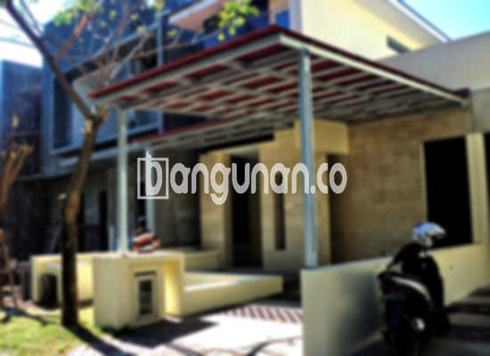

**Jasa Pasang Kanopi Rumah Minimalis di Makassar** – Memiliki area luar rumah yang nyaman dan terlindungi adalah dambaan setiap warga Makassar. Kanopi adalah solusi yang tepat untuk menjaga teras, garasi, atau carport Anda dari sengatan matahari dan guyuran hujan. Sebagai Mitra Bangunan, Anda tidak perlu lagi kesulitan mencari tukang yang handal. Kami menyediakan jasa pembuatan dan pemasangan kanopi berkualitas dengan harga terjangkau di Makassar.

Kanopi hadir dalam berbagai pilihan material, seperti baja ringan, besi hollo, kaca, dan polycarbonate. Setiap jenis memiliki karakteristik unik yang bisa disesuaikan dengan kebutuhan dan gaya arsitektur rumah Anda.

Bagi Anda yang berencana memasang kanopi, terdapat banyak manfaat yang bisa dirasakan. Kanopi tidak hanya melindungi dari cuaca ekstrem, tetapi juga meningkatkan nilai estetika rumah dan menciptakan ruang outdoor yang lebih fungsional.



## Harga Kanopi Rumah Minimalis di Makassar

Anda sedang mempertimbangkan untuk mempercantik dan melindungi properti Anda dengan kanopi? Memahami perkiraan biaya akan membantu Anda dalam mengambil keputusan yang tepat. Kami menyediakan beragam pilihan kanopi di Makassar, disesuaikan dengan anggaran dan preferensi Anda.

Tentu saja, harga kanopi dipengaruhi oleh beberapa faktor penting. Berikut adalah beberapa hal yang perlu Anda pertimbangkan:

### - Material yang Digunakan

Pemilihan material menjadi kunci utama dalam menentukan harga kanopi. Kami menawarkan berbagai opsi, mulai dari baja ringan yang ekonomis, besi hollo yang kokoh, hingga kaca dan polycarbonate yang memberikan kesan modern dan elegan. Setiap material memiliki kelebihan dan kekurangan, serta rentang harga yang berbeda pula.

### - Model Kanopi

Model kanopi juga berperan dalam menentukan harga. Apakah Anda menginginkan model minimalis yang sederhana, atau desain yang lebih rumit dan artistik? Pilihan model akan memengaruhi biaya pembuatan dan pemasangan.

### - Ukuran Kanopi

Ukuran kanopi yang Anda butuhkan akan secara langsung memengaruhi harga. Semakin besar area yang ingin ditutupi, semakin banyak material yang dibutuhkan, dan semakin tinggi biayanya.

Setelah mempertimbangkan faktor-faktor tersebut, Anda akan lebih mudah menemukan kanopi yang sesuai dengan kebutuhan dan anggaran Anda. Kami siap membantu Anda dalam memilih opsi terbaik dan memberikan penawaran harga yang kompetitif.

## Rekomendasi Jenis Kanopi Rumah Minimalis di Makassar



Bagi Anda yang ingin memasang kanopi di Makassar, ada beberapa jenis yang sangat direkomendasikan. Salah satunya adalah kanopi berbahan baja ringan. Material ini menawarkan kombinasi ideal antara kekuatan, harga yang terjangkau, dan kemudahan pemasangan. Berikut adalah beberapa keunggulan yang bisa Anda dapatkan:

### - Ketahanan yang Terjamin

Keawetan adalah faktor penting yang harus dipertimbangkan saat memilih kanopi. Kanopi baja ringan dikenal sangat tahan lama dan tidak mudah berkarat. Material ini mampu bertahan terhadap cuaca ekstrem dan kondisi lingkungan yang keras.

Banyak pelanggan kami di Makassar yang telah membuktikan ketahanan kanopi baja ringan. Bahkan, kanopi berbahan galvalum (sejenis baja ringan) dapat bertahan puluhan tahun tanpa perlu penggantian.

### - Beragam Pilihan Desain

Kanopi baja ringan tersedia dalam berbagai model desain yang menarik. Anda dapat memilih desain yang sesuai dengan gaya arsitektur rumah Anda, baik itu minimalis, modern, atau klasik. Fleksibilitas ini memungkinkan Anda untuk menciptakan tampilan visual yang harmonis dan estetis.

### - Keamanan Tingkat Tinggi

Keamanan adalah prioritas utama dalam pemasangan kanopi. Baja ringan memiliki kekuatan struktural yang tinggi, sehingga dapat menahan beban angin kencang dan hujan deras. Dengan kanopi baja ringan, Anda dapat merasa aman dan nyaman di bawahnya.

Jika Anda mencari solusi kanopi yang kuat, tahan lama, dan ekonomis, kanopi baja ringan adalah pilihan yang tepat untuk properti Anda di Makassar.

**Ref by:**  [Kanopi Rumah Minimalis Makassar](https://id.wikipedia.org/wiki/Kanopi)

Mitra Bangunan yang sedang mencari jasa pasang kanopi di Makassar, jangan ragu untuk menghubungi kami melalui tombol WhatsApp atau Telepon di halaman ini. Tim kami siap memberikan konsultasi gratis, membantu Anda memilih jenis kanopi yang sesuai, dan memberikan penawaran harga terbaik. Kami berkomitmen untuk memberikan pelayanan yang profesional dan hasil yang memuaskan.