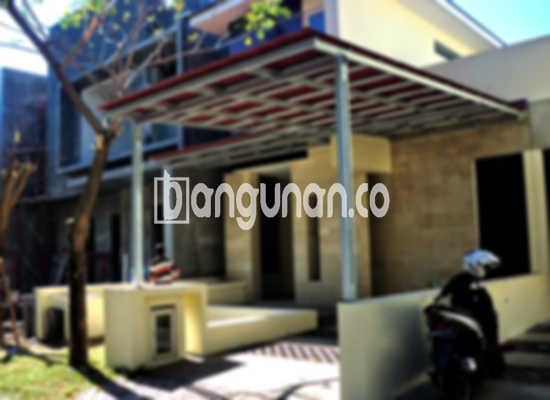

**Jasa Pasang Kanopi Rumah Minimalis di Malang** – Apakah Anda sedang merencanakan pemasangan kanopi untuk rumah di Malang? Kanopi adalah solusi cerdas untuk melindungi teras, garasi, atau area luar rumah lainnya dari sengatan matahari dan guyuran hujan. Dengan kanopi yang tepat, Mitra Bangunan di Malang dapat menikmati ruang luar yang lebih nyaman dan fungsional sepanjang tahun.

Kanopi hadir dalam berbagai material, termasuk galvalum dan besi hollo. Pilihan material akan memengaruhi tampilan, kekuatan, dan tentu saja, biaya kanopi. Memahami perbedaan antara material-material ini akan membantu Anda membuat keputusan terbaik sesuai kebutuhan dan anggaran.

Pemasangan kanopi tidak hanya memberikan perlindungan cuaca, tetapi juga meningkatkan nilai estetika rumah Anda. Kanopi minimalis modern dapat memberikan sentuhan elegan pada fasad rumah, sementara desain yang lebih tradisional dapat melengkapi arsitektur rumah bergaya klasik.



## Harga Kanopi Rumah Minimalis di Malang

Tertarik memasang kanopi minimalis di Malang? Sebelum memutuskan, penting untuk memahami faktor-faktor yang memengaruhi harga kanopi. Pengetahuan ini akan membantu Anda merencanakan anggaran dengan lebih baik dan memilih opsi yang paling sesuai.

Beberapa faktor utama yang menentukan harga kanopi antara lain:

### - Material yang Digunakan

Pemilihan material merupakan pertimbangan penting. Material seperti besi, baja ringan, dan polycarbonate memiliki harga yang berbeda-beda. Setiap material menawarkan keunggulan dan kekurangan tersendiri dalam hal kekuatan, tampilan, dan biaya perawatan.

### - Model Kanopi

Model kanopi yang Anda pilih juga memengaruhi harga. Model yang lebih rumit atau dengan desain khusus umumnya akan lebih mahal daripada model standar. Beberapa pilihan model populer termasuk kanopi datar, kanopi miring, dan kanopi lengkung.

### - Ukuran Kanopi

Ukuran kanopi, baik panjang maupun lebar, merupakan faktor penentu biaya. Semakin besar area yang perlu ditutupi, semakin banyak material yang dibutuhkan dan semakin tinggi biayanya.

Dengan memahami faktor-faktor ini, Anda dapat memperkirakan biaya pemasangan kanopi di Malang. Untuk mendapatkan penawaran harga yang akurat, jangan ragu untuk menghubungi tim kami.

## Rekomendasi Ragam Kanopi Rumah Minimalis di Malang



Ada banyak jenis kanopi yang bisa Anda pertimbangkan untuk rumah Anda di Malang. Salah satu pilihan yang paling populer adalah kanopi berbahan baja ringan. Material ini menawarkan sejumlah keunggulan yang membuatnya menjadi pilihan ideal untuk berbagai kebutuhan.

### - Keawetan yang Terjamin

Kanopi berbahan baja ringan dikenal karena ketahanannya terhadap cuaca ekstrem dan korosi. Material ini dapat bertahan selama bertahun-tahun bahkan dalam kondisi lingkungan yang keras.

### - Variasi Model yang Luas

Anda dapat memilih dari berbagai model kanopi baja ringan yang tersedia. Mulai dari desain minimalis hingga model yang lebih modern dan artistik, ada banyak pilihan yang dapat disesuaikan dengan gaya arsitektur rumah Anda.

### - Keamanan yang Optimal

Baja ringan adalah material yang kuat dan kokoh, sehingga memberikan keamanan yang optimal. Kanopi baja ringan tahan terhadap angin kencang dan beban berat, sehingga Anda dapat merasa tenang dan aman di bawahnya.

Selain baja ringan, Anda juga dapat mempertimbangkan jenis kanopi lainnya seperti kanopi kaca atau polycarbonate. Setiap jenis material memiliki karakteristik unik yang dapat disesuaikan dengan kebutuhan spesifik Anda.

Untuk Anda yang ingin meningkatkan kenyamanan dan perlindungan properti di Malang, kami menyediakan layanan pemasangan kanopi berkualitas dengan harga yang kompetitif. Hubungi kami melalui tombol WhatsApp atau Telepon di halaman ini, dan kami siap membantu Anda menemukan solusi kanopi terbaik untuk rumah Anda. Mitra Bangunan dapat merasakan manfaat jangka panjang dengan investasi pada kanopi berkualitas tinggi.

**Ref by:**  [Kanopi Rumah Minimalis Malang](https://id.wikipedia.org/wiki/Kanopi)