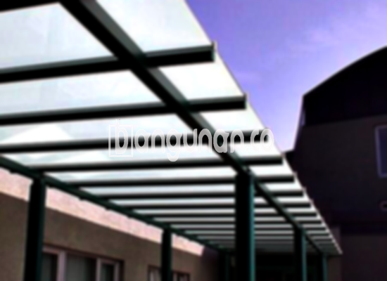

**Jasa Pasang Kanopi Rumah Minimalis di Mangga Besar Jakarta** – Memiliki area terbuka yang nyaman dan terlindungi adalah dambaan setiap pemilik rumah. Mitra Bangunan di Mangga Besar Jakarta menawarkan solusi praktis melalui jasa pemasangan kanopi berkualitas dengan harga terjangkau. Kami memahami pentingnya perlindungan optimal dari cuaca ekstrem, sekaligus mempercantik tampilan fasad rumah Anda.

Kanopi hadir dalam berbagai pilihan material, seperti galvalum dan besi hollo, serta desain yang bisa disesuaikan dengan gaya arsitektur rumah Anda. Memilih jenis kanopi yang tepat akan memberikan manfaat jangka panjang dan meningkatkan nilai estetika properti Anda.

Bagi Anda yang berencana memasang kanopi, ada banyak keuntungan yang bisa didapatkan. Selain melindungi dari paparan sinar matahari dan hujan, kanopi juga dapat menambah nilai artistik pada hunian Anda.



## Informasi Harga Kanopi Rumah Minimalis di Mangga Besar Jakarta

Jika Anda berencana untuk memasang kanopi di rumah, penting untuk mengetahui perkiraan biayanya terlebih dahulu. Dengan memahami faktor-faktor yang memengaruhi harga, Anda dapat membuat keputusan pembelian yang lebih cerdas dan sesuai dengan anggaran. Anda bisa membandingkan penawaran dari berbagai penyedia jasa untuk mendapatkan harga yang kompetitif.

Berikut adalah beberapa faktor utama yang memengaruhi harga kanopi:

### \- Jenis Material yang Digunakan

Pemilihan material adalah aspek krusial yang perlu Anda pertimbangkan. Material seperti besi, baja ringan, dan polycarbonate memiliki karakteristik dan harga yang berbeda-beda. Anda dapat memilih material yang paling sesuai dengan kebutuhan dan preferensi Anda.

### \- Desain dan Model Kanopi

Model kanopi juga turut memengaruhi harga. Ada berbagai pilihan desain, mulai dari yang sederhana hingga yang lebih kompleks. Semakin rumit desainnya, biasanya semakin tinggi biayanya.

### \- Ukuran Kanopi

Luas area yang akan ditutupi kanopi akan memengaruhi jumlah material dan waktu pengerjaan yang dibutuhkan, sehingga memengaruhi harga secara keseluruhan. Pastikan Anda mengukur area dengan tepat sebelum memesan kanopi.

Dengan mempertimbangkan faktor-faktor ini, Anda akan lebih mudah memperkirakan biaya yang dibutuhkan untuk memasang kanopi di rumah Anda. Untuk informasi harga yang lebih spesifik dan detail, silakan lihat tabel harga atau hubungi tim kami untuk konsultasi gratis.

## Pilihan Model Kanopi Rumah Minimalis di Mangga Besar Jakarta



Kami menyediakan beragam pilihan model kanopi yang sesuai dengan selera dan kebutuhan Anda. Salah satu material yang sangat direkomendasikan adalah baja ringan, yang dikenal karena keunggulannya dibandingkan material lain. Berikut beberapa keunggulan kanopi baja ringan:

### \- Kekuatan dan Ketahanan Tinggi

Salah satu pertimbangan utama ketika memilih kanopi adalah kekuatannya. Kanopi baja ringan memiliki mutu yang sangat baik dan mampu menahan beban berat serta tekanan eksternal. Anda dapat mengandalkan kanopi ini untuk melindungi properti Anda selama bertahun-tahun.

Penggunaan baja ringan memastikan kanopi Anda tahan terhadap kondisi cuaca ekstrem dan memiliki umur pakai yang panjang.

### \- Beragam Pilihan Desain

Anda memiliki kebebasan untuk memilih berbagai desain kanopi yang sesuai dengan gaya rumah Anda. Baja ringan sangat fleksibel dan mudah dibentuk, sehingga memungkinkan kami untuk menciptakan kanopi dengan berbagai bentuk dan ukuran.

### \- Keamanan Terjamin

Baja ringan merupakan material yang kuat dan tahan karat, sehingga memberikan keamanan yang optimal bagi Anda dan keluarga. Anda dapat merasa tenang mengetahui bahwa kanopi Anda kokoh dan tidak mudah rusak.

Dengan memilih kanopi baja ringan, Anda tidak hanya mendapatkan perlindungan yang maksimal, tetapi juga investasi jangka panjang yang cerdas untuk rumah Anda. 

Mitra Bangunan di Mangga Besar Jakarta siap membantu Anda memilih kanopi yang tepat sesuai dengan kebutuhan dan anggaran Anda. Jangan ragu untuk menghubungi kami untuk mendapatkan konsultasi gratis dan penawaran terbaik.

**Ref by:**  [Kanopi Rumah Minimalis Mangga Besar Jakarta](https://id.wikipedia.org/wiki/Kanopi)