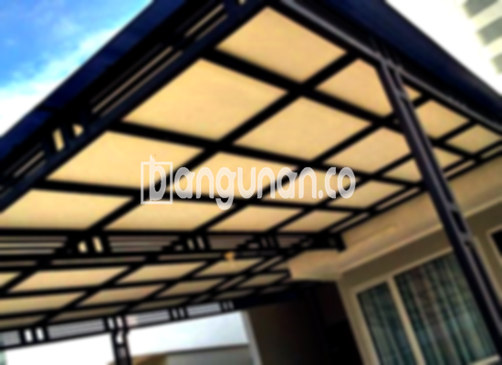

**Jasa Pasang Kanopi Rumah Minimalis di Mangga Dua Jakarta** – Mitra Bangunan yang mencari solusi perlindungan optimal untuk teras, garasi, atau ruko di Mangga Dua Jakarta, kanopi adalah investasi yang tepat. Kami hadir sebagai penyedia jasa pembuatan dan pemasangan kanopi berkualitas tinggi dengan harga terjangkau, memberikan kenyamanan dan nilai estetika pada properti Anda. Dengan beragam pilihan material dan desain modern, kami siap mewujudkan kanopi impian Anda.

Kanopi tidak hanya berfungsi memberikan naungan, melainkan juga berperan penting dalam meningkatkan daya tarik visual sebuah bangunan. Sebagai elemen desain eksterior, pemilihan kanopi yang tepat mampu menyelaraskan keseluruhan tampilan properti Anda. Pilihan material dan desain kanopi memiliki pengaruh signifikan terhadap kekuatan, ketahanan, serta estetika bangunan. Pemahaman yang baik tentang berbagai opsi yang tersedia akan membantu Anda membuat keputusan yang paling tepat.

Bagi Anda yang berencana memasang kanopi untuk ruko, rumah tinggal, atau tempat usaha lain di Mangga Dua Jakarta, manfaat yang didapatkan sangatlah beragam. Kanopi melindungi dari ancaman cuaca buruk, menjaga barang-barang berharga di bawahnya, seperti kendaraan atau stok barang dagangan, tetap aman dan terlindungi.



## Harga Kanopi Rumah Minimalis di Mangga Dua Jakarta

Apakah Anda sedang mempertimbangkan untuk berinvestasi dalam kanopi untuk properti Anda di Mangga Dua Jakarta? Sebelum melakukan pemesanan, sebaiknya Anda terlebih dahulu memahami berbagai faktor yang memengaruhi harga kanopi rumah. Dengan demikian, Anda dapat memperkirakan anggaran yang dibutuhkan secara akurat dan memilih opsi yang sesuai dengan kebutuhan serta kondisi keuangan Anda.

Terdapat beberapa faktor utama yang berperan dalam penentuan harga kanopi, di antaranya:

### – Jenis Material yang Digunakan

Pemilihan material adalah pertimbangan krusial dalam memilih kanopi yang ideal. Terdapat berbagai pilihan material yang tersedia, termasuk besi, baja ringan, dan polycarbonate. Setiap material memiliki karakteristik unik serta tingkat harga yang berbeda-beda. Dengan mempertimbangkan kebutuhan dan anggaran, Anda dapat menentukan material yang paling sesuai untuk proyek kanopi Anda.

### – Desain Model Kanopi

Model desain kanopi juga memengaruhi harga secara signifikan. Beragam model kanopi tersedia, mulai dari desain sederhana hingga yang lebih rumit. Desain yang lebih kompleks umumnya membutuhkan lebih banyak material dan proses pengerjaan, yang berdampak pada peningkatan biaya.

### – Luas Area yang Dicakup Kanopi

Luas area yang akan ditutupi oleh kanopi merupakan faktor penting dalam penentuan harga. Semakin luas area yang membutuhkan perlindungan, semakin banyak material yang diperlukan, dan semakin tinggi pula biayanya. Pastikan Anda mengukur area yang akan ditutupi dengan akurat sebelum melakukan pemesanan.

Dengan pemahaman yang komprehensif mengenai faktor-faktor yang memengaruhi harga, Anda dapat membuat keputusan yang lebih cerdas dalam memilih kanopi yang tepat untuk properti Anda di Mangga Dua Jakarta.  Jangan ragu untuk menghubungi tim kami untuk mendapatkan informasi lebih lanjut mengenai opsi harga yang tersedia.

## Saran Variasi Kanopi Rumah Minimalis di Mangga Dua Jakarta



Bagi Anda yang berencana membuat kanopi untuk ruko atau properti lainnya, banyak sekali variasi material yang dapat Anda pilih. Salah satu opsi yang sangat direkomendasikan adalah baja ringan karena menawarkan keunggulan signifikan dibandingkan material lainnya. Keunggulan-keunggulan ini membuat kanopi baja ringan menjadi pilihan populer bagi banyak pemilik properti. Berikut adalah beberapa kelebihan yang perlu Anda ketahui:

### – Keawetan sebagai Prioritas Utama

Keawetan merupakan pertimbangan penting bagi setiap orang yang mencari kanopi berkualitas. Kanopi yang terbuat dari baja ringan dikenal karena kualitas dan kekuatannya yang sangat baik. Anda dapat percaya bahwa kanopi ini akan memberikan perlindungan jangka panjang untuk properti Anda.

Pengalaman menunjukkan bahwa banyak pengguna telah mengonfirmasi kekuatan dan daya tahan kanopi baja ringan. Struktur ini dirancang untuk tahan terhadap kondisi cuaca ekstrem dan tetap mempertahankan integritasnya selama bertahun-tahun.

### – Fleksibilitas Desain yang Tinggi

Kanopi baja ringan menawarkan fleksibilitas desain yang tak tertandingi. Anda dapat memilih dari berbagai model dan gaya yang tersedia, dan menyesuaikannya dengan preferensi estetika pribadi Anda. Kemampuan untuk menyesuaikan desain ini memungkinkan Anda menciptakan kanopi yang benar-benar unik dan sesuai dengan gaya arsitektur bangunan Anda.

### – Keamanan yang Terjamin Penuh

Sebagai material konstruksi, baja ringan dikenal karena kekokohannya, sehingga memberikan keamanan yang optimal. Dengan kanopi baja ringan, Anda dapat merasa tenang karena properti Anda terlindungi dengan baik. Risiko kerusakan atau keruntuhan akibat kondisi cuaca buruk dapat diminimalkan secara signifikan.

Untuk Anda yang mencari solusi kanopi yang kuat, tahan lama, dan aman untuk properti di Mangga Dua Jakarta, kanopi baja ringan adalah pilihan yang sangat tepat. Dengan semua keunggulan tersebut, Anda dapat yakin bahwa investasi Anda akan memberikan manfaat jangka panjang dan kepuasan yang maksimal.

Dengan berbagai pilihan material dan desain yang kami sediakan, Mitra Bangunan pasti akan menemukan kanopi yang sesuai dengan kebutuhan dan anggaran Anda di Mangga Dua Jakarta. Jangan sungkan untuk menghubungi kami untuk konsultasi dan mendapatkan penawaran terbaik.

**Ref by:**  [Kanopi Rumah Minimalis Mangga Dua Jakarta](https://id.wikipedia.org/wiki/Kanopi)