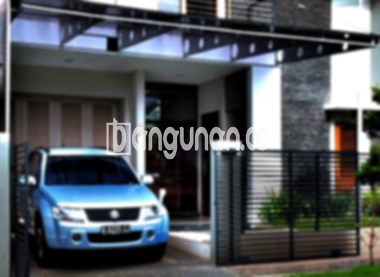

**Jasa Pasang Kanopi Rumah Minimalis di Margaasih** – Apakah Anda sedang merencanakan pemasangan kanopi untuk rumah atau bangunan komersial di Margaasih? Kanopi adalah solusi efektif untuk melindungi area luar ruangan dari cuaca ekstrem, sekaligus menambah nilai estetika. Mitra Bangunan hadir sebagai penyedia jasa pembuatan dan pemasangan kanopi berkualitas dengan harga terjangkau di Margaasih. Kami memahami betul kebutuhan Anda akan kanopi yang kuat, tahan lama, dan sesuai dengan gaya arsitektur bangunan Anda.

Kanopi hadir dalam berbagai material, termasuk galvalum dan besi hollo. Setiap jenis material menawarkan karakteristik unik yang dapat disesuaikan dengan preferensi dan anggaran Anda. Memilih material yang tepat akan menentukan tampilan akhir, kekuatan, dan umur pakai kanopi Anda.



## Harga Kanopi Rumah Minimalis di Margaasih

Mempertimbangkan anggaran adalah hal penting sebelum memesan kanopi. Sebagai referensi, Anda dapat melihat perkiraan harga kanopi rumah di Margaasih. Kami sarankan untuk membandingkan berbagai opsi dan mempertimbangkan kualitas material serta kompleksitas desain.

Harga kanopi dipengaruhi oleh beberapa faktor utama:

### - Material yang Digunakan

Berbagai material tersedia untuk pembuatan kanopi, seperti besi, baja ringan, dan polycarbonate. Setiap material memiliki kelebihan dan kekurangan, serta rentang harga yang berbeda. Pilihan material akan memengaruhi estetika, kekuatan, dan biaya keseluruhan kanopi Anda.

### - Model Kanopi

Pilihan model kanopi juga turut memengaruhi harga. Kami menawarkan beragam model, mulai dari yang sederhana hingga desain yang lebih kompleks dan custom. Memilih model yang sesuai dengan gaya bangunan dan kebutuhan fungsional Anda sangat penting.

### - Ukuran Kanopi

Luas area yang akan ditutupi kanopi secara langsung memengaruhi harga. Semakin luas area, semakin banyak material yang dibutuhkan, dan semakin tinggi pula biayanya. Anda perlu melakukan pengukuran yang akurat sebelum memesan kanopi.

Untuk informasi harga yang lebih detail dan sesuai dengan kebutuhan spesifik Anda, kami sarankan untuk menghubungi tim Kami. Kami akan memberikan penawaran harga yang kompetitif dan transparan.

## Rekomendasi Jenis Kanopi Rumah Minimalis di Margaasih



Ada beragam pilihan jenis kanopi yang bisa Anda pertimbangkan untuk hunian di Margaasih. Salah satu yang paling populer adalah kanopi berbahan baja ringan. Bahan ini menawarkan sejumlah keunggulan yang menjadikannya pilihan yang sangat baik. Berikut adalah beberapa keunggulan kanopi baja ringan:

### - Kekuatan dan Ketahanan Tinggi

Baja ringan dikenal karena kekuatannya yang luar biasa dan kemampuannya menahan beban berat. Kanopi yang terbuat dari baja ringan akan memberikan perlindungan yang andal terhadap cuaca buruk dan kondisi lingkungan yang keras. Anda dapat mengandalkan kanopi ini untuk bertahan lama tanpa perlu khawatir akan kerusakan.

### - Desain Fleksibel

Baja ringan sangat mudah dibentuk dan dimodifikasi, sehingga memungkinkan pembuatan kanopi dengan berbagai desain yang unik dan menarik. Anda dapat menyesuaikan desain kanopi agar sesuai dengan gaya arsitektur bangunan dan preferensi pribadi Anda.

### - Keamanan Terjamin

Material baja ringan memiliki sifat yang tidak mudah terbakar, sehingga meningkatkan keamanan bangunan Anda. Kanopi baja ringan juga tahan terhadap karat dan korosi, sehingga menjamin keawetan dan keamanannya dalam jangka panjang.

**Ref by:**  [Kanopi Rumah Minimalis Margaasih](https://id.wikipedia.org/wiki/Kanopi)

Memilih kanopi yang tepat adalah investasi yang cerdas untuk melindungi properti Anda di Margaasih. Dengan berbagai pilihan material dan desain yang tersedia, Anda dapat menemukan kanopi yang sempurna untuk memenuhi kebutuhan dan anggaran Anda. Mitra Bangunan siap membantu Anda dalam proses pemilihan, pembuatan, dan pemasangan kanopi berkualitas tinggi. Jangan ragu untuk menghubungi Kami melalui tombol WhatsApp atau Telepon di halaman ini untuk konsultasi gratis dan penawaran harga terbaik. Kami siap mewujudkan kanopi impian Anda!