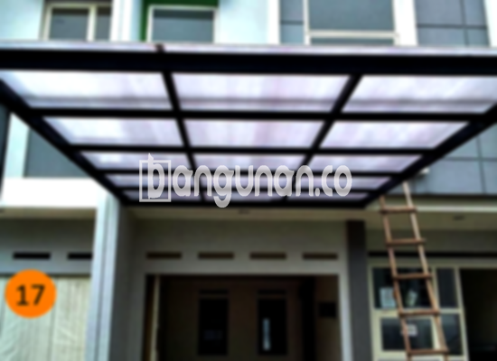

**Jasa Pasang Kanopi Rumah Minimalis di Margajaya Bogor** – Bagi Mitra Bangunan yang ingin mempercantik dan melindungi properti di Margajaya Bogor, kanopi adalah solusi tepat. Kanopi bukan hanya pelengkap estetika rumah, tetapi juga perlindungan fungsional terhadap cuaca ekstrem. Kami hadir sebagai penyedia jasa pemasangan kanopi rumah minimalis yang profesional dan terpercaya di Margajaya Bogor, menawarkan beragam pilihan material dan desain untuk memenuhi kebutuhan Anda.

Kanopi hadir dalam berbagai material, mulai dari baja ringan yang ekonomis hingga kaca yang elegan. Memilih material yang tepat akan sangat memengaruhi tampilan dan ketahanan kanopi Anda. Apakah Anda mencari kanopi untuk garasi, teras, atau area komersial, kami siap memberikan solusi terbaik.

Ada beragam manfaat yang bisa Anda peroleh dengan memasang kanopi pada bangunan Anda, bukan hanya perlindungan dari panas dan hujan. Kanopi juga dapat meningkatkan nilai estetika rumah dan menciptakan ruang luar yang lebih nyaman untuk bersantai.



## Estimasi Biaya Kanopi Rumah Minimalis di Margajaya Bogor

Ingin memperkirakan anggaran untuk pemasangan kanopi? Memahami kisaran harga kanopi rumah di Margajaya Bogor akan membantu Anda dalam perencanaan keuangan. Anda dapat membandingkan berbagai opsi dan memilih yang paling sesuai dengan anggaran serta kebutuhan Anda.

Biaya pemasangan kanopi dapat bervariasi tergantung pada beberapa faktor utama, di antaranya:

### – Jenis Material yang Digunakan

Pilihan material adalah faktor penting yang memengaruhi harga. Material seperti baja ringan, galvalum, kaca, dan polycarbonate memiliki harga yang berbeda-beda. Anda dapat memilih material yang sesuai dengan anggaran dan preferensi estetika Anda.

### – Desain dan Model Kanopi

Desain kanopi yang Anda pilih juga berpengaruh pada biaya. Model yang lebih rumit atau memerlukan konstruksi khusus biasanya akan lebih mahal. Kami menawarkan berbagai pilihan desain yang dapat disesuaikan dengan gaya arsitektur rumah Anda.

### – Ukuran dan Luas Area yang Ditutupi

Ukuran kanopi yang dibutuhkan untuk melindungi area tertentu juga memengaruhi harga. Semakin luas area yang ditutupi, semakin banyak material dan tenaga kerja yang dibutuhkan. Kami menyediakan layanan pengukuran yang akurat untuk memastikan Anda mendapatkan penawaran yang sesuai.

Untuk informasi harga yang lebih detail dan akurat, Anda dapat menghubungi tim kami untuk konsultasi gratis. Kami akan memberikan estimasi biaya yang sesuai dengan kebutuhan spesifik Anda.

## Pilihan Model Kanopi Rumah Minimalis di Margajaya Bogor



Bagi Anda yang berencana memasang kanopi baru, ada banyak pilihan model yang bisa Anda pertimbangkan. Kami menawarkan berbagai jenis kanopi rumah minimalis di Margajaya Bogor yang dapat disesuaikan dengan gaya arsitektur dan kebutuhan Anda. Berikut adalah beberapa pilihan yang populer:

### – Kanopi Baja Ringan: Pilihan Awet dan Ekonomis

Kanopi baja ringan menjadi favorit banyak orang karena keawetannya dan harganya yang relatif terjangkau. Baja ringan tahan terhadap karat dan memiliki kekuatan yang cukup untuk menahan beban cuaca ekstrem. Kelebihan utama kanopi baja ringan adalah daya tahannya yang terjamin selama bertahun-tahun.

### – Kanopi Galvalum: Kekuatan dan Fleksibilitas

Kanopi galvalum menawarkan kombinasi antara kekuatan dan fleksibilitas desain. Material ini tahan terhadap korosi dan memberikan perlindungan optimal terhadap cuaca. Anda dapat memilih berbagai bentuk dan ukuran kanopi galvalum sesuai dengan kebutuhan properti Anda.

### – Kanopi Kaca: Tampilan Modern dan Elegan

Kanopi kaca memberikan tampilan yang modern dan elegan pada bangunan Anda. Kaca memungkinkan cahaya alami masuk, menciptakan suasana yang lebih cerah dan terbuka. Kanopi kaca cocok untuk area yang membutuhkan pencahayaan alami, seperti teras atau area komersial.

Kami akan membantu Anda memilih model kanopi yang paling sesuai dengan kebutuhan dan anggaran Anda. Tim kami akan memberikan saran profesional dan memastikan pemasangan kanopi yang rapi dan berkualitas.

Dengan berbagai pilihan material dan desain yang tersedia, Anda dapat menemukan kanopi yang sempurna untuk meningkatkan nilai dan kenyamanan properti Anda di Margajaya Bogor. 

**Ref by:**  [Kanopi Rumah Minimalis Margajaya Bogor](https://id.wikipedia.org/wiki/Kanopi)

Mitra Bangunan yang sedang mencari jasa pemasangan kanopi berkualitas di Margajaya Bogor, jangan ragu untuk menghubungi kami melalui tombol WhatsApp atau Telepon yang tersedia di halaman ini. Kami siap memberikan layanan terbaik dan solusi kanopi yang sesuai dengan kebutuhan Anda.