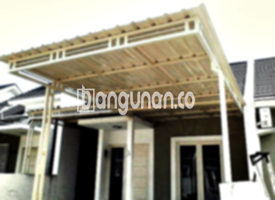

**Jasa Pasang Kanopi Rumah Minimalis di Marunda Jakarta** – Mencari solusi untuk melindungi teras atau garasi dari panas dan hujan di Marunda Jakarta? Kanopi adalah jawabannya, dan Mitra Bangunan siap membantu Anda mewujudkannya. Kami menyediakan jasa pemasangan kanopi berkualitas dengan harga terjangkau, memberikan kenyamanan dan estetika pada hunian Anda.

Kanopi hadir dalam berbagai material, seperti galvalum dan besi hollo. Pilihan material ini memungkinkan Anda menyesuaikan kanopi dengan kebutuhan dan anggaran. Setiap material menawarkan kelebihan dan kekurangan tersendiri yang perlu dipertimbangkan.

Untuk Anda yang memiliki ruko atau bangunan komersial di Marunda Jakarta, pemasangan kanopi memberikan manfaat signifikan. Kanopi melindungi dari sengatan matahari dan guyuran hujan, menciptakan lingkungan yang lebih nyaman bagi pelanggan dan karyawan.



## Estimasi Biaya Kanopi Rumah Minimalis di Marunda Jakarta

Apakah Anda berencana memasang kanopi untuk rumah Anda di Marunda Jakarta? Sebelum memutuskan, penting untuk memahami perkiraan biaya yang dibutuhkan. Dengan memahami kisaran harga, Anda dapat merencanakan anggaran dengan lebih baik dan memilih kanopi yang paling sesuai dengan kebutuhan Anda.

Beberapa faktor utama memengaruhi harga pemasangan kanopi, antara lain:

### \- Jenis Material yang Digunakan

Material adalah faktor kunci penentu harga kanopi. Berbagai pilihan material tersedia, seperti besi, baja ringan, dan polycarbonate. Setiap material memiliki karakteristik dan harga yang berbeda. Tentunya, Anda dapat memilih material yang paling sesuai dengan anggaran dan preferensi estetika Anda.

### \- Model dan Desain Kanopi

Model dan desain kanopi juga memengaruhi harga. Model kanopi yang lebih rumit atau custom biasanya membutuhkan biaya lebih tinggi dibandingkan model standar. Anda dapat berkonsultasi dengan kami untuk mendapatkan desain kanopi yang sesuai dengan gaya rumah Anda di Marunda Jakarta.

### \- Ukuran Kanopi

Ukuran kanopi, baik panjang maupun lebar, juga berpengaruh pada harga. Semakin besar ukuran kanopi, semakin banyak material yang dibutuhkan dan semakin tinggi biayanya. Pastikan Anda mengukur area yang akan dipasang kanopi dengan akurat sebelum meminta penawaran harga.

Dengan mempertimbangkan faktor-faktor di atas, Anda akan lebih mudah memperkirakan biaya yang dibutuhkan untuk pemasangan kanopi. Untuk penawaran harga yang lebih detail dan akurat, jangan ragu untuk menghubungi kami.

## Pilihan Material Kanopi Rumah Minimalis di Marunda Jakarta



Bagi Anda yang berencana memasang kanopi, terdapat beragam pilihan material yang tersedia, masing-masing dengan keunggulan uniknya. Salah satu material yang paling populer adalah baja ringan. Kanopi baja ringan menawarkan sejumlah keuntungan dibandingkan material lain.

### \- Daya Tahan dan Keawetan

Salah satu keunggulan utama kanopi baja ringan adalah daya tahan dan keawetannya. Material ini tahan terhadap karat dan korosi, sehingga dapat bertahan lama meskipun terpapar cuaca ekstrem di Marunda Jakarta. Banyak pengguna melaporkan kanopi baja ringan mereka bertahan puluhan tahun tanpa masalah.

### \- Fleksibilitas Desain

Kanopi baja ringan menawarkan fleksibilitas desain yang tinggi. Anda dapat memilih dari berbagai model dan desain yang tersedia, atau bahkan membuat desain custom sesuai dengan preferensi Anda. Keunggulan ini memungkinkan Anda menciptakan kanopi yang unik dan sesuai dengan gaya rumah Anda.

### \- Keamanan Terjamin

Baja ringan merupakan material yang kuat dan kokoh, sehingga memberikan keamanan yang optimal. Anda dapat merasa tenang karena kanopi baja ringan dapat menahan beban berat dan tahan terhadap angin kencang. Hal ini meminimalkan risiko kerusakan atau robohnya kanopi.

Dengan mempertimbangkan keunggulan-keunggulan ini, kanopi baja ringan menjadi pilihan yang tepat untuk melindungi rumah Anda di Marunda Jakarta.

Semoga informasi ini bermanfaat bagi Anda. Mitra Bangunan siap membantu Anda mewujudkan kanopi impian Anda di Marunda Jakarta. Jangan ragu untuk menghubungi kami melalui tombol WhatsApp atau Telepon di halaman ini untuk konsultasi dan penawaran harga terbaik.

**Ref by:**  [Kanopi Rumah Minimalis Marunda Jakarta](https://id.wikipedia.org/wiki/Kanopi)