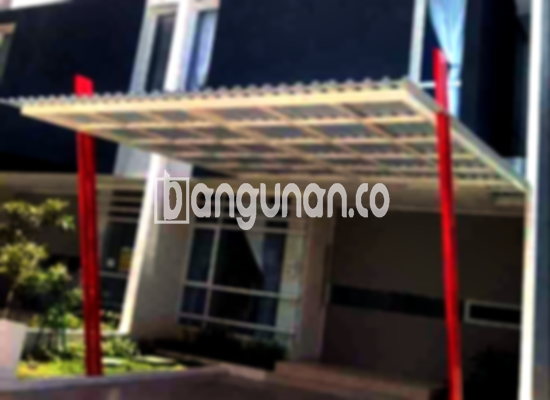

**Jasa Pasang Kanopi Rumah Minimalis di Matraman Jakarta** – Menciptakan area luar ruangan yang nyaman dan terlindungi dari berbagai kondisi cuaca merupakan dambaan setiap pemilik rumah di Matraman Jakarta. Mitra Bangunan hadir sebagai solusi terpercaya untuk mewujudkan impian tersebut. Kami menyediakan jasa pemasangan kanopi rumah minimalis yang berkualitas tinggi dan terjangkau untuk memenuhi kebutuhan Anda.

Kanopi bukan sekadar elemen tambahan pada bangunan, melainkan sebuah investasi penting untuk meningkatkan kenyamanan dan nilai estetika hunian Anda. Dengan kanopi yang tepat, Anda dapat menikmati ruang luar ruangan tanpa terganggu oleh panas matahari atau hujan lebat.



## Harga Kanopi Rumah Minimalis di Matraman Jakarta

Bagi Anda yang berencana memasang kanopi untuk rumah, pemahaman mengenai kisaran harga adalah langkah awal yang bijaksana. Kami memahami pentingnya perencanaan anggaran yang matang, dan menyediakan informasi yang jelas mengenai faktor-faktor yang memengaruhi harga kanopi. Untuk mendapatkan perkiraan biaya yang sesuai dengan kebutuhan Anda, mari kita simak lebih lanjut mengenai penentuan harga kanopi.

Biaya pemasangan kanopi dapat bervariasi tergantung pada beberapa faktor kunci, antara lain:

### \- Material yang Digunakan oleh Jasa Pasang Kanopi Rumah Minimalis di Matraman Jakarta

Pilihan material konstruksi kanopi merupakan salah satu penentu harga utama. Kami menawarkan berbagai pilihan material, seperti baja ringan, besi hollow, dan polycarbonate, masing-masing dengan kelebihan dan kekurangan unik. Pemilihan material yang tepat akan disesuaikan dengan preferensi Anda dan kebutuhan spesifik properti Anda.

### \- Model Kanopi

Desain atau model kanopi juga berperan signifikan dalam menentukan harga. Kami menyediakan beragam desain kanopi minimalis yang dapat Anda sesuaikan dengan gaya arsitektur rumah Anda. Semakin kompleks desain yang dipilih, kemungkinan besar akan berpengaruh pada biaya pemasangan.

### \- Dimensi Kanopi

Luas area yang akan ditutupi oleh kanopi secara langsung memengaruhi besaran biaya yang dibutuhkan. Kami akan melakukan pengukuran yang akurat untuk memastikan perkiraan harga yang kami berikan sesuai dengan kebutuhan Anda.

Dengan mempertimbangkan faktor-faktor tersebut, Anda dapat memperoleh penawaran harga yang transparan dan sesuai dengan anggaran Anda. Detail informasi mengenai harga dapat Anda temukan pada tabel  atau dengan menghubungi tim kami untuk konsultasi lebih lanjut.

## Ragam Pilihan Kanopi Rumah Minimalis di Matraman Jakarta

**Ref by:**  [Kanopi Rumah Minimalis Matraman Jakarta](https://id.wikipedia.org/wiki/Kanopi)

Kami menyediakan beragam pilihan kanopi rumah minimalis di Matraman Jakarta untuk melengkapi desain rumah Anda. Salah satu material yang sangat populer di kalangan konsumen adalah baja ringan. Baja ringan menawarkan keunggulan dalam hal kekuatan, ketahanan, dan biaya yang relatif terjangkau.

### \- Kekuatan dan Keawetan yang Optimal

Ketika Anda berinvestasi dalam suatu produk, aspek kekuatan dan keawetan tentu menjadi prioritas utama. Kanopi berbahan baja ringan dikenal karena kekuatan strukturalnya yang unggul dan kemampuannya untuk menahan berbagai kondisi cuaca yang ekstrem. Dengan perawatan yang minimal, kanopi baja ringan dapat bertahan selama bertahun-tahun.

### \- Fleksibilitas Desain yang Luas

Selain kekuatannya, kanopi baja ringan juga menawarkan fleksibilitas desain yang tinggi. Anda dapat memilih dari berbagai desain kanopi minimalis yang tersedia, atau bahkan menggabungkan beberapa elemen desain untuk menciptakan kanopi yang unik dan sesuai dengan gaya rumah Anda.

### \- Tingkat Keamanan yang Tinggi

Keamanan merupakan faktor penting yang perlu dipertimbangkan ketika memilih material konstruksi. Baja ringan memiliki tingkat keamanan yang tinggi dan tidak mudah terbakar, sehingga Anda dapat merasa tenang dan nyaman.

Dengan memilih kanopi baja ringan, Anda tidak hanya mendapatkan perlindungan yang optimal, tetapi juga nilai estetika yang tinggi untuk rumah Anda di Matraman Jakarta. Kami siap membantu Anda memilih jenis kanopi yang paling sesuai dengan kebutuhan dan anggaran Anda. 

Memilih kanopi yang tepat adalah kunci untuk menciptakan ruang luar ruangan yang nyaman dan fungsional. Pertimbangkanlah manfaat tambahan seperti perlindungan dari sinar UV dan pengurangan panas di dalam rumah. Kami di Matraman Jakarta siap membantu Anda mewujudkan kanopi idaman Anda.

Mitra Bangunan yang sedang mencari jasa pemasangan kanopi terpercaya di Matraman Jakarta, jangan ragu untuk menghubungi kami melalui tombol WhatsApp atau Telepon yang tersedia di halaman ini. Kami siap memberikan layanan terbaik dan memastikan kepuasan Anda.