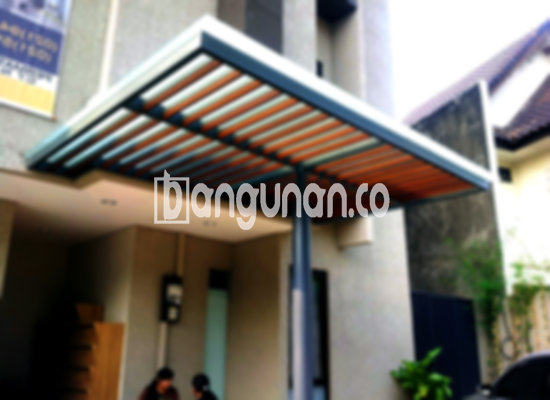

**Jasa Pasang Kanopi Rumah Minimalis di Mauk Tangerang** – Memiliki area luar rumah yang nyaman dan terlindungi adalah dambaan setiap pemilik hunian di Mauk Tangerang. Kanopi menjadi solusi praktis untuk melindungi teras, garasi, atau area lain dari terpaan cuaca. Mitra Bangunan hadir sebagai penyedia jasa pemasangan kanopi berkualitas dengan harga terjangkau, sehingga Anda tak perlu khawatir lagi soal perlindungan dan estetika rumah. Kami berkomitmen memberikan solusi terbaik untuk kebutuhan kanopi Anda.

Kanopi hadir dalam beragam material, seperti baja ringan dan besi hollo. Setiap material memiliki karakteristik unik yang dapat disesuaikan dengan preferensi dan anggaran Anda. Pemilihan material yang tepat akan memastikan kanopi berfungsi optimal dan tahan lama.

Penerapan kanopi pada hunian memberikan banyak manfaat, mulai dari melindungi dari sengatan matahari hingga menjaga area luar ruangan tetap kering saat hujan. Lebih dari itu, kanopi juga dapat meningkatkan nilai estetika rumah Anda. 



## Informasi Harga Kanopi Rumah Minimalis di Mauk Tangerang

Bagi Anda yang berencana memasang kanopi untuk rumah di Mauk Tangerang, memahami perkiraan harga merupakan langkah awal yang bijak. Informasi harga ini membantu Anda dalam merencanakan anggaran dengan lebih efektif. Anda dapat membandingkan berbagai opsi dan memilih yang paling sesuai dengan kebutuhan dan kemampuan finansial.

Terdapat beberapa faktor utama yang memengaruhi harga kanopi, di antaranya:

### - Jenis Material yang Digunakan

Material merupakan aspek krusial dalam menentukan harga kanopi. Beberapa material umum yang digunakan antara lain besi, baja ringan, dan lainnya. Anda dapat memilih jenis material yang paling sesuai dengan gaya rumah dan anggaran yang tersedia. Setiap material memiliki keunggulan dan kekurangan, serta rentang harga yang berbeda-beda.

### - Desain dan Model Kanopi

Desain kanopi juga berperan penting dalam menentukan harga akhir. Kanopi dengan desain yang kompleks dan rumit cenderung memiliki harga yang lebih tinggi dibandingkan dengan model yang sederhana. Anda dapat memilih desain yang sesuai dengan gaya arsitektur rumah Anda dan preferensi pribadi.

### - Ukuran dan Luas Area

Ukuran dan luas area yang akan ditutupi kanopi juga memengaruhi harga. Semakin besar ukuran kanopi, semakin banyak material yang dibutuhkan, sehingga harga akan semakin tinggi. Pastikan Anda mengukur area yang akan ditutupi kanopi dengan akurat sebelum melakukan pemesanan.

Dengan memahami faktor-faktor ini, Anda dapat memperkirakan biaya yang dibutuhkan untuk pemasangan kanopi rumah Anda. Untuk informasi harga yang lebih detail, Anda dapat menghubungi tim kami untuk mendapatkan penawaran yang sesuai dengan kebutuhan Anda.

## Pilihan Model Kanopi Rumah Minimalis di Mauk Tangerang



Bagi Anda yang ingin mempercantik tampilan rumah dengan kanopi, ada banyak pilihan model yang bisa Anda pertimbangkan. Salah satu pilihan populer adalah kanopi dari material baja ringan. Material ini menawarkan sejumlah keunggulan dibandingkan material lain. Berikut beberapa keunggulannya:

### - Kekuatan dan Ketahanan yang Terjamin

Kekuatan merupakan faktor utama yang dipertimbangkan saat memilih kanopi. Kanopi yang terbuat dari baja ringan memiliki kekuatan yang sangat baik dan mampu menahan berbagai kondisi cuaca ekstrem. Material ini juga tahan terhadap karat dan korosi, sehingga awet dan tahan lama.

Banyak pengguna telah membuktikan keawetan kanopi baja ringan, bahkan hingga puluhan tahun. Hal ini menjadikan baja ringan sebagai pilihan yang ekonomis dan praktis dalam jangka panjang.

### - Desain yang Fleksibel dan Variatif

Baja ringan memungkinkan Anda untuk mengeksplorasi berbagai desain kanopi yang sesuai dengan selera Anda. Anda dapat memilih model yang sederhana atau yang lebih kompleks, tergantung pada gaya arsitektur rumah Anda. Dengan fleksibilitas desain yang tinggi, Anda dapat menciptakan kanopi yang unik dan menarik.

### - Keamanan yang Optimal

Keamanan merupakan prioritas utama dalam memilih kanopi. Baja ringan memiliki tingkat kekuatan yang tinggi, sehingga dapat memberikan perlindungan yang optimal terhadap berbagai ancaman, seperti angin kencang atau hujan deras. Dengan kanopi baja ringan, Anda dapat merasa lebih aman dan nyaman di area luar rumah Anda.

Jika Anda mencari jasa pasang kanopi rumah minimalis di Mauk Tangerang, kami siap membantu Anda. Kami menawarkan berbagai pilihan model kanopi baja ringan dengan kualitas terjamin dan harga yang kompetitif.

Mitra Bangunan yang berencana memasang kanopi di Mauk Tangerang, segera hubungi kami melalui tombol WhatsApp atau Telepon yang tersedia di halaman ini, dan kami akan dengan senang hati memberikan konsultasi serta penawaran terbaik. 

**Ref by:**  [Kanopi Rumah Minimalis Mauk Tangerang](https://id.wikipedia.org/wiki/Kanopi)