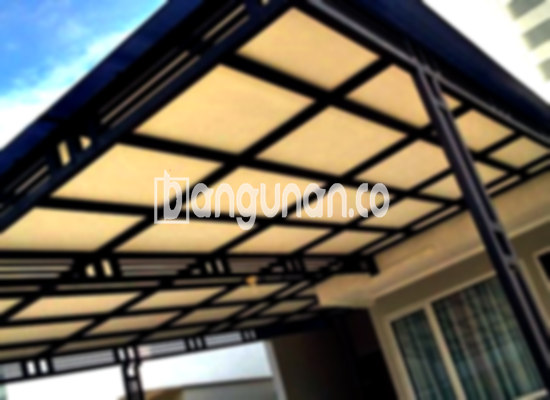

**Jasa Pasang Kanopi Rumah Minimalis di Medan Satria Bekasi** – Menciptakan kenyamanan dan perlindungan di area luar rumah adalah prioritas utama bagi setiap pemilik properti di Medan Satria Bekasi. Kanopi hadir sebagai solusi efektif untuk melindungi teras, garasi, atau area terbuka lainnya dari sengatan matahari dan guyuran hujan. Sebagai Mitra Bangunan, kami hadir untuk menyediakan layanan pemasangan kanopi berkualitas tinggi dengan harga terjangkau.

Kanopi bukan sekadar pelengkap desain, melainkan investasi penting untuk menjaga keindahan dan fungsionalitas properti Anda. Dengan berbagai pilihan material dan desain, Anda dapat menemukan kanopi yang paling sesuai dengan gaya arsitektur rumah dan kebutuhan spesifik Anda. 



## Investasi Cerdas: Harga Kanopi Rumah Minimalis di Medan Satria Bekasi

Sebelum memutuskan untuk memasang kanopi, penting untuk memahami faktor-faktor yang memengaruhi harga. Dengan memahami hal ini, Anda dapat membuat keputusan yang tepat dan sesuai dengan anggaran Anda. Anda dapat membandingkan opsi yang berbeda dan memilih solusi yang paling efisien.

Berikut adalah beberapa faktor utama yang memengaruhi harga kanopi:

### Material Kanopi: Fondasi Utama Penentuan Harga

Pilihan material merupakan pertimbangan utama dalam menentukan harga kanopi. Material yang umum digunakan antara lain baja ringan, galvalum, kaca, dan polycarbonate. Setiap material memiliki karakteristik dan rentang harga yang berbeda. Pilihlah material yang paling sesuai dengan kebutuhan, anggaran, dan preferensi estetika Anda.

### Desain Kanopi: Sentuhan Personal yang Mempengaruhi Biaya

Desain kanopi juga memainkan peran penting dalam menentukan harga. Desain yang rumit atau membutuhkan teknik pemasangan khusus cenderung lebih mahal dibandingkan dengan desain yang sederhana. Anda dapat memilih dari berbagai model yang tersedia atau mendiskusikan desain khusus dengan tim ahli kami.

### Luas Area Pemasangan: Ukuran yang Menentukan Investasi

Luas area yang akan dipasang kanopi secara langsung memengaruhi jumlah material yang dibutuhkan dan kompleksitas pemasangan. Semakin luas area pemasangan, semakin tinggi pula biaya yang dikeluarkan. Oleh karena itu, lakukan pengukuran yang akurat sebelum memesan kanopi.

Dengan mempertimbangkan faktor-faktor ini, Anda dapat memperkirakan biaya pemasangan kanopi dan membuat perencanaan anggaran yang lebih efektif.

## Pilihan Terbaik: Ragam Kanopi Rumah Minimalis di Medan Satria Bekasi



Untuk Anda yang menginginkan perlindungan maksimal dan estetika yang menarik, berbagai pilihan kanopi tersedia untuk memenuhi kebutuhan Anda. Salah satu material yang paling direkomendasikan adalah baja ringan. Bahan ini menawarkan kombinasi keunggulan yang tak tertandingi.

### Keawetan yang Terjamin: Investasi Jangka Panjang

Keawetan adalah faktor penting yang perlu dipertimbangkan saat memilih kanopi. Kanopi yang terbuat dari baja ringan dikenal memiliki daya tahan yang luar biasa. Material ini tahan terhadap karat, korosi, dan berbagai kondisi cuaca ekstrem, sehingga dapat bertahan selama bertahun-tahun tanpa memerlukan perawatan intensif.

### Fleksibilitas Desain: Sesuaikan dengan Gaya Rumah Anda

Dengan baja ringan, Anda dapat mewujudkan berbagai desain kanopi yang sesuai dengan gaya arsitektur rumah Anda. Material ini mudah dibentuk dan dapat disesuaikan dengan berbagai bentuk dan ukuran. Anda dapat memilih desain minimalis, modern, atau klasik sesuai dengan preferensi Anda.

### Keamanan Terjamin: Perlindungan Optimal untuk Keluarga Anda

Keamanan adalah prioritas utama. Baja ringan memiliki kekuatan struktural yang tinggi, sehingga mampu menahan beban angin kencang dan hujan deras. Dengan kanopi baja ringan, Anda dapat merasa tenang dan nyaman mengetahui bahwa keluarga Anda terlindungi dengan baik.

Memilih kanopi baja ringan adalah investasi cerdas yang akan memberikan manfaat jangka panjang bagi Anda dan keluarga. Dengan keawetan, fleksibilitas desain, dan keamanan yang terjamin, kanopi ini adalah solusi ideal untuk melindungi rumah Anda di Medan Satria Bekasi.

**Ref by:**  [Kanopi Rumah Minimalis Medan Satria Bekasi](https://id.wikipedia.org/wiki/Kanopi)

Sebagai penyedia jasa pemasangan kanopi terpercaya di Medan Satria Bekasi, kami berkomitmen untuk memberikan layanan terbaik kepada Mitra Bangunan. Hubungi kami sekarang juga melalui tombol WhatsApp atau Telepon yang tersedia di halaman ini untuk konsultasi gratis dan penawaran terbaik. Jangan tunda lagi, lindungi rumah Anda dengan kanopi berkualitas dari kami!