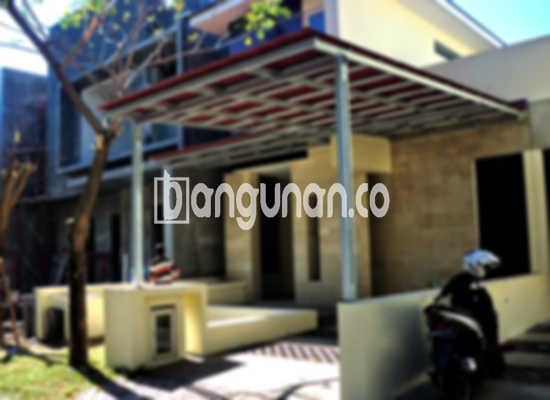

**Jasa Pasang Kanopi Rumah Minimalis di Megamendung** – Apakah Anda sedang merencanakan pemasangan kanopi untuk rumah atau bangunan komersial di Megamendung? Kanopi merupakan solusi praktis untuk melindungi teras, garasi, atau area luar ruangan lainnya dari sengatan matahari dan guyuran hujan. Dengan kanopi yang tepat, Anda dapat menikmati ruang luar secara nyaman sepanjang tahun. Mitra Bangunan hadir untuk memberikan solusi kanopi berkualitas dengan harga terjangkau di wilayah Megamendung.

Kanopi hadir dalam berbagai material, seperti baja ringan dan besi hollo, masing-masing menawarkan keunggulan tersendiri. Pilihan material yang tepat akan sangat memengaruhi estetika dan daya tahan kanopi Anda.

Untuk bisnis seperti ruko, manfaat kanopi sangat signifikan, melindungi area depan dari cuaca buruk sekaligus memberikan kesan profesional. Kanopi juga memiliki fungsi penting lainnya yang akan meningkatkan kenyamanan dan nilai properti Anda.



## Estimasi Biaya Kanopi Rumah Minimalis di Megamendung

Apakah Anda ingin mengetahui perkiraan biaya pemasangan kanopi untuk rumah Anda di Megamendung? Memahami estimasi harga kanopi rumah sangat penting sebelum Anda memutuskan untuk memesan. Dengan membandingkan harga dari berbagai penyedia, Anda dapat menemukan solusi yang sesuai dengan anggaran dan kebutuhan Anda.

Beberapa faktor utama yang memengaruhi harga kanopi meliputi:

### \- Jenis Material yang Digunakan

Material adalah pertimbangan utama dalam menentukan biaya kanopi. Bahan seperti besi, baja ringan, dan polycarbonate memiliki harga yang bervariasi. Anda dapat memilih material yang paling sesuai dengan preferensi Anda, dengan mempertimbangkan estetika, daya tahan, dan anggaran.

### \- Desain Kanopi

Desain kanopi juga berperan dalam menentukan harga akhir. Model yang lebih kompleks atau dengan detail tambahan biasanya akan membutuhkan biaya yang lebih tinggi. Kami di sini siap membantu Anda memilih desain yang optimal untuk properti Anda di Megamendung.

### \- Ukuran Kanopi

Ukuran kanopi secara langsung memengaruhi jumlah material yang dibutuhkan dan biaya tenaga kerja. Ukur area yang ingin ditutupi dengan tepat sebelum meminta penawaran harga. Hal ini akan membantu Anda mendapatkan estimasi yang akurat.

Setelah mempertimbangkan faktor-faktor tersebut, Anda akan lebih mudah menentukan kanopi yang ideal untuk memenuhi kebutuhan Anda. Semakin berkualitas material yang digunakan, semakin tinggi pula nilai investasinya.

## Rekomendasi Jenis Kanopi Rumah Minimalis di Megamendung



Bagi Anda yang berencana memasang kanopi untuk rumah atau bangunan komersial di Megamendung, ada banyak pilihan yang tersedia. Salah satu opsi yang sangat direkomendasikan adalah kanopi berbahan baja ringan. Material ini menawarkan sejumlah keunggulan dibandingkan bahan lainnya. Berikut beberapa kelebihannya:

### \- Kekuatan dan Ketahanan

Kanopi berbahan galvalum dikenal dengan kekuatan dan ketahanannya yang luar biasa. Material ini mampu menahan beban berat dan tahan terhadap cuaca ekstrem, menjamin investasi jangka panjang Anda.

Penggunaan baja ringan dalam konstruksi kanopi telah terbukti memberikan perlindungan yang tahan lama selama bertahun-tahun.

### \- Variasi Model yang Luas

Kanopi berbahan galvalum tersedia dalam berbagai model dan desain, memungkinkan Anda untuk menyesuaikannya dengan gaya arsitektur bangunan Anda di Megamendung. Fleksibilitas ini memungkinkan Anda untuk menciptakan tampilan yang unik dan menarik.

### \- Keamanan Terjamin

Galvalum merupakan material yang kokoh dan aman, memberikan perlindungan optimal terhadap berbagai risiko seperti kerusakan akibat angin kencang atau hujan deras. Dengan kanopi baja ringan, Anda dapat merasa tenang dan nyaman.

Kanopi berbahan baja ringan adalah pilihan cerdas bagi Anda yang menginginkan solusi yang kuat, tahan lama, dan terjangkau di Megamendung. Banyak orang telah membuktikan keunggulan material ini.

Dengan berbagai pilihan bahan dan desain yang tersedia, Kami siap membantu Anda menciptakan kanopi yang sempurna untuk kebutuhan Anda. Jangan ragu untuk berkonsultasi dengan tim Kami untuk mendapatkan rekomendasi terbaik.

**Ref by:**  [Kanopi Rumah Minimalis Megamendung](https://id.wikipedia.org/wiki/Kanopi)

Mitra Bangunan siap menjadi mitra Anda dalam menciptakan ruang luar yang nyaman dan terlindungi di Megamendung. Hubungi Kami melalui tombol WhatsApp atau Telepon yang terdapat di halaman ini untuk konsultasi gratis dan penawaran harga terbaik.