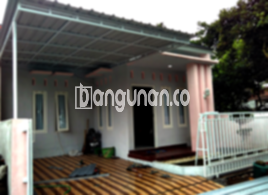

**Jasa Pasang Kanopi Rumah Minimalis di Mejayan** – Apakah Anda mempertimbangkan perlindungan optimal untuk teras atau garasi rumah Anda di Mejayan? Kanopi adalah solusi tepat yang tidak hanya melindungi dari cuaca buruk, tetapi juga meningkatkan nilai estetika properti Anda. Mitra Bangunan di Mejayan hadir sebagai penyedia jasa pemasangan kanopi berkualitas dengan harga terjangkau, siap membantu Anda mewujudkan hunian yang nyaman dan terlindungi.

Berbagai jenis kanopi tersedia untuk memenuhi kebutuhan Anda, mulai dari baja ringan yang ringan dan ekonomis, hingga besi hollo yang kokoh dan tahan lama. Pilihan material yang tepat akan sangat memengaruhi tampilan dan fungsionalitas kanopi Anda.

Tak hanya melindungi dari hujan dan panas, pemasangan kanopi juga memberikan manfaat tambahan bagi rumah Anda. Perlindungan terhadap kerusakan akibat cuaca ekstrem, peningkatan nilai properti, dan menciptakan ruang outdoor yang nyaman adalah beberapa keunggulan yang bisa Anda nikmati.



## Perkiraan Biaya Pemasangan Kanopi Rumah Minimalis di Mejayan

Anda mungkin bertanya-tanya mengenai perkiraan biaya yang dibutuhkan untuk memasang kanopi di rumah Anda. Sebelum melakukan pemesanan, sangat disarankan untuk mengetahui kisaran harga agar Anda dapat mempersiapkan anggaran dengan baik. Kami berkomitmen untuk memberikan transparansi harga dan penawaran terbaik bagi Anda.

Ada beberapa faktor utama yang memengaruhi besaran biaya pemasangan kanopi, antara lain:

### \- Pemilihan Material Konstruksi

Jenis material yang dipilih akan sangat berpengaruh terhadap harga kanopi. Material seperti baja ringan, besi, galvalum, dan polycarbonate memiliki tingkat harga yang berbeda-beda. Pastikan Anda memilih material yang sesuai dengan anggaran dan preferensi Anda.

### \- Kompleksitas Desain dan Model Kanopi

Desain kanopi yang lebih rumit atau custom biasanya memerlukan biaya tambahan. Semakin kompleks desainnya, semakin banyak waktu dan tenaga yang dibutuhkan untuk proses pemasangan.

### \- Luas Area yang Akan Ditutupi

Luas area yang akan ditutupi oleh kanopi juga menjadi faktor penentu harga. Semakin luas area yang ditutupi, semakin banyak material yang dibutuhkan dan semakin tinggi biayanya.

Kami menyarankan Anda untuk berkonsultasi dengan tim kami untuk mendapatkan estimasi biaya yang akurat berdasarkan kebutuhan spesifik Anda.

## Rekomendasi Jenis Kanopi Rumah Minimalis di Mejayan



Bagi Anda yang sedang mencari referensi jenis kanopi untuk rumah minimalis di Mejayan, kanopi baja ringan merupakan pilihan yang sangat populer. Material ini menawarkan kombinasi ideal antara kekuatan, harga terjangkau, dan kemudahan pemasangan.

### \- Keunggulan Kekuatan dan Ketahanan

Kanopi baja ringan dikenal karena konstruksinya yang ringan namun kuat. Material ini mampu menahan beban angin kencang dan cuaca ekstrem lainnya, sehingga ideal untuk iklim tropis seperti di Indonesia.

### \- Fleksibilitas Desain yang Tinggi

Kanopi baja ringan dapat dibentuk menjadi berbagai desain yang menarik dan sesuai dengan gaya arsitektur rumah Anda. Anda dapat memilih dari berbagai pilihan model, mulai dari yang sederhana hingga yang lebih kompleks.

### \- Keamanan dan Ketahanan Terhadap Karat

Baja ringan memiliki lapisan pelindung yang membuatnya tahan terhadap karat dan korosi. Hal ini menjamin umur panjang kanopi Anda dan mengurangi biaya perawatan.

Selain baja ringan, Anda juga dapat mempertimbangkan opsi kanopi dari material lain seperti kaca, polycarbonate, atau galvalum. Setiap material memiliki kelebihan dan kekurangan masing-masing, dan pilihan terbaik akan tergantung pada kebutuhan dan anggaran Anda.

Dengan berbagai pilihan material dan desain yang tersedia, Anda dapat menemukan kanopi yang sempurna untuk melengkapi rumah Anda di Mejayan. Jangan ragu untuk menghubungi kami untuk mendapatkan konsultasi gratis dan penawaran terbaik.

**Ref by:**  [Kanopi Rumah Minimalis Mejayan](https://id.wikipedia.org/wiki/Kanopi)

Mitra Bangunan yang ingin meningkatkan kenyamanan dan keamanan rumahnya di Mejayan, jangan ragu untuk menghubungi kami melalui tombol WhatsApp atau Telepon yang tertera di halaman ini. Kami siap membantu Anda menemukan solusi kanopi terbaik untuk kebutuhan Anda.