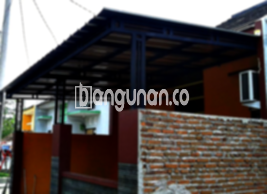

**Jasa Pasang Kanopi Rumah Minimalis di Mekarbaru Tangerang** – Menciptakan kenyamanan di rumah dimulai dari detail-detail kecil, termasuk perlindungan optimal dari cuaca. Apakah Mitra Bangunan di Mekarbaru Tangerang sedang mempertimbangkan pemasangan kanopi untuk rumah minimalis? Kami hadir sebagai solusi terpercaya dalam pembuatan dan pemasangan kanopi berkualitas dengan harga terjangkau. Kanopi tidak hanya melindungi teras atau halaman dari panas matahari dan hujan, tetapi juga menambah nilai estetika pada bangunan Anda.

Kanopi tersedia dalam berbagai material, termasuk baja ringan dan besi hollo, masing-masing memiliki karakteristik dan keunggulan tersendiri. Pemilihan material yang tepat akan menentukan kekuatan, ketahanan, dan tampilan akhir kanopi yang Anda inginkan.

Bagi Anda yang membutuhkan kanopi untuk ruko atau bangunan komersial lain, manfaat yang diperoleh sangat signifikan, seperti perlindungan dari cuaca ekstrem dan peningkatan kenyamanan pelanggan. Kanopi juga menawarkan berbagai manfaat lain yang berguna bagi properti Anda.



## Estimasi Biaya Kanopi Rumah Minimalis di Mekarbaru Tangerang

Sebelum memutuskan untuk memasang kanopi, penting bagi Anda untuk memahami perkiraan biaya yang diperlukan. Mengetahui kisaran harga kanopi rumah akan membantu Anda dalam perencanaan anggaran dan memilih opsi yang paling sesuai dengan kebutuhan dan kemampuan finansial Anda di Mekarbaru Tangerang.

Ada beberapa faktor utama yang memengaruhi harga kanopi:

### \- Jenis Material yang Dipilih oleh Jasa Pasang Kanopi Rumah Minimalis di Mekarbaru Tangerang

Material adalah aspek krusial dalam menentukan kualitas dan harga kanopi. Tersedia berbagai pilihan material seperti besi, baja ringan, dan lainnya. Anda dapat memilih material yang paling sesuai dengan preferensi dan anggaran Anda. Setiap material memiliki keunggulan dan kekurangan tersendiri, serta rentang harga yang berbeda pula.

### \- Desain Kanopi dari Jasa Pasang Kanopi Rumah Minimalis di Mekarbaru Tangerang

Desain kanopi juga memengaruhi total biaya pemasangan. Anda dapat memilih model yang sesuai dengan gaya arsitektur rumah Anda. Terdapat beragam pilihan desain yang tersedia, dan kompleksitas desain akan memengaruhi harga yang ditawarkan.

### \- Ukuran Kanopi

Ukuran kanopi yang Anda butuhkan juga berperan penting dalam penentuan harga. Luas area yang akan ditutupi kanopi akan langsung memengaruhi jumlah material yang digunakan dan durasi pengerjaan. Pastikan Anda mengukur area dengan tepat sebelum memesan kanopi.

Dengan mempertimbangkan faktor-faktor di atas, Anda akan memiliki gambaran yang lebih jelas mengenai perkiraan biaya pemasangan kanopi dan dapat membuat keputusan yang lebih tepat. Untuk mendapatkan informasi harga yang lebih akurat, Anda dapat menghubungi tim kami untuk konsultasi dan penawaran terbaik.

## Pilihan Model Kanopi Rumah Minimalis di Mekarbaru Tangerang



Jika Anda berencana untuk memasang kanopi di rumah Anda, ada banyak sekali model yang bisa Anda pilih. Salah satu pilihan yang paling direkomendasikan adalah kanopi berbahan baja ringan. Jenis kanopi ini menawarkan sejumlah keunggulan dibandingkan material lainnya. Berikut adalah beberapa keunggulan yang dapat Anda peroleh:

### \- Keawetan Sebagai Prioritas Utama

Setiap pemilik rumah tentu menginginkan kanopi yang tahan lama dan awet. Kanopi yang terbuat dari baja ringan memiliki kualitas yang sangat baik dan dirancang untuk bertahan dalam berbagai kondisi cuaca. Kekuatannya terjamin dan tahan terhadap karat, sehingga Anda tidak perlu khawatir tentang penggantian atau perbaikan dalam waktu dekat.

Kanopi baja ringan telah terbukti kokoh dan tahan lama, bahkan dapat bertahan selama bertahun-tahun tanpa kehilangan kekuatannya. 

### \- Variasi Model dari Jasa Pasang Kanopi Rumah Minimalis di Mekarbaru Tangerang

Bagi Anda yang ingin memiliki kanopi dengan tampilan yang unik dan personal, baja ringan menawarkan fleksibilitas desain yang luar biasa. Material ini dapat dibentuk menjadi berbagai model sesuai dengan preferensi Anda, termasuk kanopi galvalum yang memiliki banyak pilihan desain menarik. Kelebihan ini menjadikan kanopi baja ringan sangat populer di kalangan pemilik rumah di Mekarbaru Tangerang.

### \- Tingkat Keamanan yang Tinggi dari Jasa Pasang Kanopi Rumah Minimalis di Mekarbaru Tangerang

Baja ringan adalah material yang memiliki tingkat kekokohan yang tinggi, sehingga keamanan kanopi terjamin. Anda akan merasa lebih tenang karena kanopi baja ringan mampu menahan beban angin kencang dan risiko kerusakan lainnya sangat minim.

Jika Anda mencari kanopi yang kuat, aman, dan tahan lama untuk rumah Anda, kanopi berbahan baja ringan adalah pilihan yang tepat. Kami siap membantu Anda dalam memilih dan memasang kanopi yang sesuai dengan kebutuhan Anda.

Kami berharap informasi ini bermanfaat bagi Anda dalam memilih jasa pasang kanopi di Mekarbaru Tangerang. Untuk informasi lebih lanjut dan pemesanan, hubungi kami melalui tombol WhatsApp atau Telepon yang terdapat di halaman ini. Jangan ragu untuk berkonsultasi dengan tim kami, dan kami akan dengan senang hati membantu Mitra Bangunan mewujudkan kanopi impian Anda.

**Ref by:**  [Kanopi Rumah Minimalis Mekarbaru Tangerang](https://id.wikipedia.org/wiki/Kanopi)