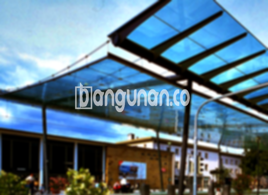

**Jasa Pasang Kanopi Rumah Minimalis di Mekarjaya Depok** – Memiliki area luar rumah yang nyaman dan terlindungi adalah impian setiap warga Mekarjaya Depok. Kanopi hadir sebagai solusi praktis untuk menjaga teras, carport, atau area lainnya dari panas matahari dan hujan deras. Mitra Bangunan hadir sebagai penyedia jasa pembuatan dan pemasangan kanopi berkualitas, dengan harga terjangkau di Mekarjaya Depok.

Kanopi bukan sekadar pelindung, melainkan juga elemen penting dalam estetika rumah Anda. Tersedia beragam material dan desain yang bisa disesuaikan dengan gaya arsitektur dan kebutuhan Anda. Apakah Anda mempertimbangkan kanopi baja ringan yang ekonomis, atau kanopi kaca yang memberikan kesan mewah?



## Harga Kanopi Rumah Minimalis di Mekarjaya Depok

Sebelum memutuskan untuk memesan kanopi, penting bagi Anda untuk memahami perkiraan biaya yang dibutuhkan. Perlu diingat bahwa harga kanopi dapat bervariasi tergantung pada beberapa faktor. Mempertimbangkan faktor-faktor ini akan membantu Anda memilih kanopi yang paling sesuai dengan anggaran dan preferensi Anda.

Berikut adalah beberapa faktor utama yang memengaruhi harga kanopi:

### – Jenis Material yang Digunakan

Pemilihan material kanopi sangat berpengaruh terhadap harga. Beberapa material populer seperti baja ringan, galvalum, dan kaca memiliki rentang harga yang berbeda. Anda dapat memilih material berdasarkan kebutuhan estetika, kekuatan, dan anggaran Anda.

### – Desain dan Model Kanopi

Desain kanopi yang kompleks atau unik biasanya memerlukan biaya lebih tinggi dibandingkan desain yang sederhana. Anda dapat memilih dari berbagai model kanopi yang tersedia, mulai dari model minimalis hingga model yang lebih artistik.

### – Ukuran Kanopi yang Dibutuhkan

Ukuran kanopi secara langsung memengaruhi jumlah material yang digunakan dan waktu pengerjaan. Semakin besar ukuran kanopi, semakin tinggi biayanya. Pastikan Anda mengukur area yang akan ditutupi kanopi dengan akurat sebelum melakukan pemesanan.

Untuk informasi lebih lanjut mengenai harga kanopi, Anda dapat melihat tabel harga yang tersedia  atau menghubungi tim kami untuk mendapatkan penawaran khusus.

## Rekomendasi Ragam Kanopi Rumah Minimalis di Mekarjaya Depok

**Ref by:**  [Kanopi Rumah Minimalis Mekarjaya Depok](https://id.wikipedia.org/wiki/Kanopi)

Ada banyak pilihan jenis kanopi yang bisa Anda pertimbangkan untuk rumah Anda di Mekarjaya Depok. Salah satu pilihan yang populer adalah kanopi berbahan baja ringan. Material ini menawarkan sejumlah keunggulan yang menjadikannya pilihan ideal untuk berbagai kebutuhan.

### – Kekuatan dan Keawetan yang Terjamin

Salah satu keunggulan utama kanopi baja ringan adalah kekuatannya. Material galvalum yang digunakan dalam pembuatan kanopi baja ringan memiliki ketahanan yang sangat baik terhadap cuaca ekstrem, korosi, dan rayap. Hal ini memastikan bahwa kanopi Anda akan bertahan lama dan tidak memerlukan perawatan yang intensif.

### – Pilihan Desain yang Variatif

Kanopi baja ringan tersedia dalam berbagai desain dan model, sehingga Anda dapat dengan mudah menemukan desain yang sesuai dengan gaya arsitektur rumah Anda. Anda dapat memilih desain minimalis yang modern, desain klasik yang elegan, atau desain custom yang unik.

### – Keamanan yang Optimal

Baja ringan adalah material yang kuat dan kokoh, sehingga dapat memberikan perlindungan yang optimal terhadap berbagai risiko, seperti angin kencang atau benda jatuh. Anda dapat merasa tenang mengetahui bahwa kanopi baja ringan Anda akan memberikan perlindungan yang handal bagi rumah dan keluarga Anda.

Apabila Anda sedang mencari jasa pasang kanopi di Mekarjaya Depok, jangan ragu untuk menghubungi kami. Kami siap membantu Anda memilih kanopi yang tepat dan memberikan layanan pemasangan yang profesional. Dengan pengalaman dan keahlian kami, Anda dapat yakin bahwa kanopi Anda akan terpasang dengan sempurna dan tahan lama. Mitra Bangunan hadir untuk mewujudkan kenyamanan dan keindahan hunian Anda di Mekarjaya Depok. Hubungi kami melalui tombol WhatsApp atau Telepon di halaman ini untuk konsultasi dan pemesanan.