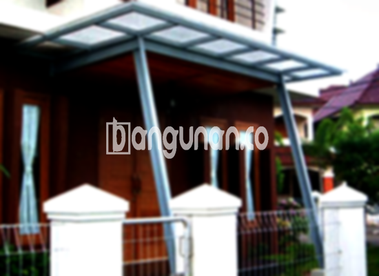

**Jasa Pasang Kanopi Rumah Minimalis di Mekarsari Depok** – Memiliki area luar rumah yang nyaman dan terlindungi adalah impian setiap warga Mekarsari Depok. Kanopi hadir sebagai solusi praktis untuk menjaga teras, garasi, atau area terbuka dari sengatan matahari dan hujan deras. Mitra Bangunan hadir untuk mewujudkan impian tersebut dengan layanan pemasangan kanopi berkualitas dan terjangkau.

Kanopi bukan sekadar elemen pelengkap, melainkan investasi jangka panjang untuk kenyamanan dan keamanan rumah Anda. Tersedia berbagai jenis kanopi yang bisa disesuaikan dengan gaya arsitektur dan anggaran, mulai dari kanopi galvalum hingga kanopi kaca.

Sebelum memutuskan jenis kanopi yang tepat, penting untuk memahami berbagai manfaat yang ditawarkan oleh penambahan struktur ini pada bangunan Anda.



## Harga Kanopi Rumah Minimalis di Mekarsari Depok

Bagi Anda yang berencana memasang kanopi di Mekarsari Depok, mengetahui perkiraan biaya menjadi langkah awal yang bijak. Harga kanopi bervariasi tergantung pada sejumlah faktor penting yang perlu dipertimbangkan. Dengan memahami faktor-faktor ini, Anda dapat membuat keputusan yang tepat sesuai dengan kebutuhan dan anggaran Anda.

Penetapan harga kanopi dipengaruhi oleh beberapa elemen kunci, di antaranya:

### \- Jenis Material yang Digunakan

Pilihan material memiliki dampak signifikan terhadap harga akhir kanopi. Material yang umum digunakan meliputi baja ringan, galvalum, dan kaca. Setiap material memiliki karakteristik dan harga yang berbeda. Anda dapat memilih material yang paling sesuai dengan kebutuhan estetika dan fungsional Anda.

### \- Desain dan Model Kanopi

Desain kanopi yang Anda pilih juga akan memengaruhi biayanya. Model minimalis cenderung lebih terjangkau dibandingkan model yang rumit dengan desain khusus. Pertimbangkan gaya arsitektur rumah Anda dalam memilih desain kanopi yang harmonis.

### \- Ukuran dan Luas Area Kanopi

Ukuran kanopi akan berbanding lurus dengan jumlah material yang dibutuhkan. Semakin luas area yang ingin ditutupi, semakin besar pula biaya yang harus dikeluarkan. Lakukan pengukuran yang akurat untuk memastikan perhitungan biaya yang tepat.

Untuk informasi harga yang lebih detail dan penawaran khusus di Mekarsari Depok, silakan merujuk pada tabel harga yang tersedia  atau hubungi tim kami untuk konsultasi gratis.

## Pilihan Jenis Kanopi Rumah Minimalis di Mekarsari Depok

**Ref by:**  [Kanopi Rumah Minimalis Mekarsari Depok](https://id.wikipedia.org/wiki/Kanopi)

Saat Anda ingin memasang kanopi untuk rumah di Mekarsari Depok, terdapat beragam pilihan jenis kanopi yang dapat disesuaikan dengan preferensi dan kebutuhan Anda. Salah satu pilihan yang populer dan direkomendasikan adalah kanopi berbahan baja ringan. Kanopi baja ringan menawarkan sejumlah keunggulan yang menjadikannya pilihan ideal.

### \- Ketahanan dan Kekuatan yang Terjamin

Aspek utama yang dicari dalam sebuah kanopi adalah ketahanan terhadap cuaca ekstrem dan beban. Baja ringan dikenal dengan kekuatannya yang tinggi, sehingga kanopi yang terbuat dari material ini mampu menahan angin kencang, hujan deras, dan paparan sinar matahari langsung.

### \- Desain yang Fleksibel dan Menarik

Kanopi baja ringan menawarkan fleksibilitas desain yang luar biasa. Anda dapat memilih dari berbagai model dan gaya yang tersedia, atau bahkan memesan desain khusus sesuai dengan keinginan Anda. Hal ini memungkinkan Anda menciptakan kanopi yang sesuai dengan estetika rumah Anda.

### \- Keamanan yang Optimal

Keamanan merupakan prioritas utama dalam memilih kanopi. Baja ringan adalah material yang aman dan tidak mudah terbakar, sehingga dapat memberikan perlindungan ekstra bagi bangunan Anda. Investasi pada kanopi baja ringan adalah langkah bijak untuk meningkatkan keamanan rumah Anda.

Kanopi baja ringan merupakan solusi yang sangat baik untuk rumah Anda di Mekarsari Depok. Dengan ketahanan, fleksibilitas desain, dan keamanannya, Anda akan mendapatkan perlindungan yang optimal dan nilai estetika yang tinggi.

Mitra Bangunan siap melayani kebutuhan pemasangan kanopi Anda di Mekarsari Depok. Jangan ragu untuk menghubungi kami melalui tombol WhatsApp atau Telepon di halaman ini untuk mendapatkan penawaran terbaik dan layanan profesional. Kami akan dengan senang hati membantu Anda menciptakan area luar rumah yang nyaman dan terlindungi.