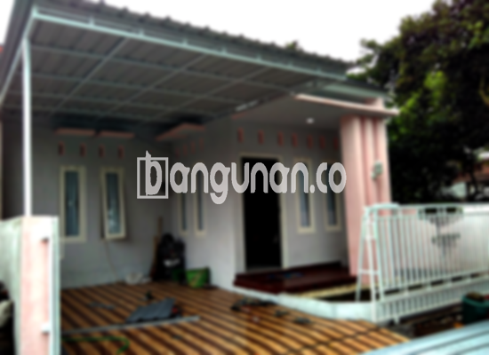

**Jasa Pasang Kanopi Rumah Minimalis di Mekarwangi Bogor** – Apakah Anda tengah merencanakan perlindungan optimal untuk teras, garasi, atau area luar rumah lainnya di Mekarwangi Bogor? Kanopi hadir sebagai solusi cerdas untuk melindungi dari sengatan matahari dan guyuran hujan. Sebagai Mitra Bangunan yang cerdas, Anda tentu ingin area luar rumah tetap nyaman dan terlindungi sepanjang tahun. Kami hadir untuk mewujudkan itu.

Kanopi tersedia dalam berbagai material, mulai dari baja ringan yang ekonomis hingga kaca yang elegan. Pilihan material ini memungkinkan Anda menyesuaikan kanopi dengan gaya arsitektur rumah dan anggaran yang tersedia. Setiap jenis kanopi memiliki karakteristik unik yang perlu dipertimbangkan dalam proses pemilihan.

Pemasangan kanopi bukan hanya tentang estetika, tetapi juga tentang fungsionalitas. Kanopi yang tepat dapat meningkatkan nilai properti Anda sekaligus memberikan perlindungan maksimal dari elemen cuaca. Dengan berbagai pilihan desain dan material, Anda dapat menemukan kanopi yang sempurna untuk memenuhi kebutuhan spesifik Anda.



## Estimasi Biaya Kanopi Rumah Minimalis di Mekarwangi Bogor

Apakah Anda berencana memasang kanopi untuk hunian atau tempat usaha di Mekarwangi Bogor? Sebelum mengambil keputusan, memahami kisaran biaya kanopi akan sangat membantu. Mengetahui perkiraan harga akan memungkinkan Anda merencanakan anggaran dengan lebih efektif dan memilih opsi yang paling sesuai dengan kebutuhan Anda.

Beberapa faktor utama memengaruhi harga kanopi, antara lain:

### \- Jenis Material yang Digunakan

Material merupakan salah satu penentu utama harga kanopi. Pilihan material yang tersedia meliputi baja ringan, besi hollo, polycarbonate, dan kaca. Setiap material memiliki keunggulan dan kekurangan tersendiri, serta tingkat harga yang berbeda. Anda dapat memilih material yang paling sesuai dengan anggaran dan preferensi estetika Anda.

### \- Desain dan Model Kanopi

Desain dan model kanopi juga berperan dalam menentukan harga. Desain yang lebih kompleks atau custom biasanya akan lebih mahal daripada desain standar. Anda dapat memilih dari berbagai model kanopi yang tersedia atau mendesain sendiri sesuai dengan keinginan Anda.

### \- Ukuran dan Luas Area Kanopi

Ukuran dan luas area yang akan ditutupi oleh kanopi juga memengaruhi harga. Semakin besar ukuran kanopi, semakin banyak material yang dibutuhkan, dan semakin tinggi pula biayanya. Pastikan Anda mengukur area yang akan ditutupi dengan tepat sebelum memesan kanopi.

Untuk informasi harga yang lebih detail dan penawaran khusus di Mekarwangi Bogor, Anda dapat menghubungi tim kami. Kami akan dengan senang hati membantu Anda menemukan solusi kanopi yang tepat sesuai dengan anggaran Anda. 

## Rekomendasi Jenis Kanopi Rumah Minimalis di Mekarwangi Bogor



Bagi Anda yang ingin memasang kanopi untuk rumah atau tempat usaha di Mekarwangi Bogor, terdapat berbagai jenis kanopi yang dapat Anda pertimbangkan. Salah satu pilihan yang paling populer adalah kanopi berbahan baja ringan. Kanopi baja ringan menawarkan kombinasi ideal antara kekuatan, ketahanan, dan harga yang terjangkau.

Berikut adalah beberapa keunggulan utama kanopi baja ringan:

### \- Keawetan dan Daya Tahan Tinggi

Kanopi baja ringan dikenal dengan keawetannya yang luar biasa. Material baja ringan memiliki ketahanan yang baik terhadap karat, korosi, dan cuaca ekstrem. Hal ini menjadikan kanopi baja ringan ideal untuk digunakan di lingkungan Mekarwangi Bogor yang memiliki iklim tropis.

### \- Pilihan Model yang Beragam

Kanopi baja ringan tersedia dalam berbagai model dan desain yang dapat disesuaikan dengan gaya arsitektur rumah Anda. Anda dapat memilih dari berbagai pilihan warna, bentuk, dan ukuran untuk menciptakan kanopi yang sesuai dengan selera Anda.

### \- Keamanan yang Terjamin

Baja ringan merupakan material yang kuat dan stabil, sehingga dapat memberikan keamanan yang terjamin bagi Anda dan keluarga. Kanopi baja ringan dirancang untuk menahan beban angin kencang dan hujan deras, sehingga Anda dapat merasa aman dan nyaman di bawahnya.

Selain baja ringan, Anda juga dapat mempertimbangkan material lain seperti polycarbonate dan kaca. Polycarbonate menawarkan solusi yang ringan dan transparan, sementara kaca memberikan tampilan yang elegan dan mewah. Pilihlah material yang paling sesuai dengan kebutuhan dan anggaran Anda.

Dengan berbagai pilihan yang tersedia, Anda dapat menemukan kanopi yang sempurna untuk melindungi dan mempercantik properti Anda di Mekarwangi Bogor. 

**Ref by:**  [Kanopi Rumah Minimalis Mekarwangi Bogor](https://id.wikipedia.org/wiki/Kanopi)

Mitra Bangunan yang berlokasi di Mekarwangi Bogor dan sekitarnya, jangan ragu untuk menghubungi kami untuk konsultasi gratis dan penawaran terbaik. Kami siap membantu Anda mewujudkan area luar rumah yang nyaman, terlindungi, dan indah dengan kanopi berkualitas tinggi. Hubungi kami melalui tombol WhatsApp atau Telepon di halaman ini untuk mendapatkan solusi terbaik!