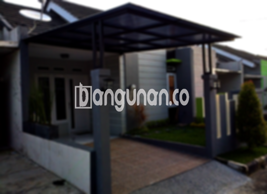

**Jasa Pasang Kanopi Rumah Minimalis di Melawai Jakarta** – Apakah Anda sedang mencari solusi untuk melindungi teras atau garasi rumah dari terik matahari dan hujan? Kanopi adalah jawabannya. Sebagai elemen penting dalam desain eksterior, kanopi tidak hanya memberikan perlindungan optimal, tetapi juga meningkatkan estetika bangunan Anda. Mitra Bangunan di Melawai Jakarta hadir sebagai solusi terpercaya untuk kebutuhan pemasangan kanopi berkualitas dan terjangkau.

Kanopi tersedia dalam berbagai material, seperti baja ringan dan besi hollo. Setiap material menawarkan keunggulan dan karakteristik unik yang dapat disesuaikan dengan preferensi dan kebutuhan Anda. Pilihan model yang beragam memungkinkan Anda menciptakan tampilan yang sesuai dengan gaya arsitektur rumah Anda.

Bagi Anda yang berencana memasang kanopi untuk ruko atau properti komersial, manfaatnya sangat signifikan. Kanopi memberikan perlindungan ekstra terhadap cuaca ekstrem, sekaligus meningkatkan daya tarik visual bisnis Anda. Selain itu, kanopi juga memiliki fungsi lain yang sangat bermanfaat bagi rumah Anda.



## Informasi Harga Kanopi Rumah Minimalis di Melawai Jakarta

Apakah Anda ingin mempercantik rumah dengan kanopi baru? Sebelum membuat keputusan, penting untuk memahami perkiraan biaya yang dibutuhkan. Dengan mengetahui harga kanopi rumah, Anda dapat merencanakan anggaran dengan lebih efektif dan memilih opsi yang paling sesuai dengan kemampuan finansial Anda.

Harga kanopi dipengaruhi oleh beberapa faktor utama, di antaranya:

### \- Material yang Digunakan oleh Jasa Pasang Kanopi Rumah Minimalis di Melawai Jakarta

Jenis bahan yang digunakan merupakan pertimbangan penting dalam menentukan biaya kanopi. Bahan-bahan populer seperti besi, baja ringan, dan polycarbonate memiliki harga yang bervariasi. Anda dapat memilih material yang sesuai dengan anggaran dan kebutuhan estetika Anda.

### \- Model Kanopi dari Jasa Pasang Kanopi Rumah Minimalis di Melawai Jakarta

Desain dan model kanopi juga memengaruhi harga secara signifikan. Terdapat berbagai pilihan model, mulai dari yang sederhana hingga yang lebih kompleks. Semakin rumit desainnya, biasanya semakin tinggi biayanya.

### \- Luas Area Kanopi

Ukuran area yang akan ditutupi oleh kanopi juga menjadi faktor penentu harga. Semakin luas area tersebut, semakin banyak material yang dibutuhkan, dan akibatnya, semakin mahal biaya pemasangan.

Dengan mempertimbangkan faktor-faktor ini, Anda akan lebih mudah menemukan kanopi yang sesuai dengan harapan dan anggaran Anda. Untuk informasi lebih detail mengenai harga, silakan lihat tabel harga  atau hubungi tim kami untuk konsultasi.

## Rekomendasi Ragam Kanopi Rumah Minimalis di Melawai Jakarta

Kami menawarkan berbagai pilihan jenis kanopi rumah minimalis yang dapat Anda sesuaikan dengan gaya dan kebutuhan Anda. Salah satu pilihan yang paling populer adalah kanopi berbahan baja ringan. Material ini memiliki keunggulan tersendiri dibandingkan material lainnya.

### \- Kekuatan dan Ketahanan Sebagai Keunggulan Utama

Setiap pemilik rumah tentu menginginkan kanopi yang kuat dan tahan lama. Kanopi yang terbuat dari bahan galvalum dikenal memiliki kualitas yang sangat baik. Ketahanannya terjamin untuk jangka waktu yang lama.

Banyak pengguna telah membuktikan bahwa kanopi baja ringan dapat bertahan puluhan tahun tanpa kehilangan kekuatannya. Ini menjadikannya investasi yang cerdas untuk perlindungan jangka panjang.

### \- Pilihan Model yang Beragam dari Jasa Pasang Kanopi Rumah Minimalis di Melawai Jakarta

Kami menyediakan berbagai model kanopi baja ringan yang dapat Anda pilih sesuai selera. Variasi model yang luas memungkinkan Anda untuk menyesuaikan tampilan kanopi dengan gaya arsitektur rumah Anda. 

### \- Keamanan Terjamin dari Jasa Pasang Kanopi Rumah Minimalis di Melawai Jakarta

Baja ringan merupakan bahan yang memiliki tingkat kekokohan yang tinggi, sehingga keamanannya tidak perlu diragukan lagi. Anda akan mendapatkan perlindungan optimal dengan menggunakan kanopi baja ringan. Risiko kerusakan dan roboh sangat minim.

Jika Anda mencari kanopi yang andal dan tahan lama untuk hunian Anda, kanopi berbahan galvalum adalah pilihan terbaik. Banyak keunggulan yang dapat Anda peroleh dengan memilih jenis kanopi ini.

**Ref by:**  [Kanopi Rumah Minimalis Melawai Jakarta](https://id.wikipedia.org/wiki/Kanopi)

Mitra Bangunan siap menjadi solusi terbaik untuk kebutuhan kanopi Anda di Melawai Jakarta. Jangan ragu untuk menghubungi kami melalui tombol WhatsApp atau Telepon yang tersedia di halaman ini untuk mendapatkan penawaran terbaik dan layanan pemasangan profesional. Kami akan dengan senang hati membantu Anda mewujudkan hunian impian Anda.