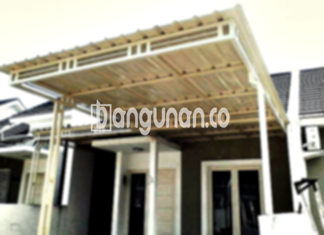

**Jasa Pasang Kanopi Rumah Minimalis di Menteng Bogor** – Menciptakan kenyamanan dan perlindungan di area luar rumah adalah perhatian utama bagi Mitra Bangunan di Menteng Bogor. Kanopi hadir sebagai solusi elegan dan fungsional untuk melindungi teras, garasi, atau area komersial dari teriknya matahari dan guyuran hujan. Kami hadir sebagai penyedia jasa borongan pembuatan dan pemasangan kanopi berkualitas dengan harga yang kompetitif di Menteng Bogor dan sekitarnya.

Kanopi tidak hanya berfungsi sebagai pelindung, tetapi juga dapat meningkatkan estetika bangunan Anda. Tersedia berbagai pilihan material seperti galvalum, baja ringan, kaca, dan polycarbonate, yang masing-masing menawarkan keunggulan unik sesuai kebutuhan dan gaya arsitektur Anda. 



## Harga Kanopi Rumah Minimalis di Menteng Bogor

Mempertimbangkan anggaran adalah hal bijak sebelum memutuskan untuk memasang kanopi. Anda mungkin bertanya-tanya mengenai kisaran harga kanopi rumah minimalis di Menteng Bogor. Sebelum Anda melakukan pemesanan, sebaiknya Anda memahami faktor-faktor yang memengaruhi harga kanopi. Dengan begitu, Anda dapat memperkirakan biaya yang dibutuhkan dan memilih kanopi yang sesuai dengan anggaran Anda.

Beberapa faktor yang memengaruhi harga kanopi meliputi:

### – Material yang Digunakan oleh Jasa Pasang Kanopi Rumah Minimalis di Menteng Bogor

Pemilihan material memiliki dampak signifikan terhadap harga kanopi. Berbagai material tersedia, seperti besi, baja ringan, dan kaca, masing-masing dengan karakteristik dan harga yang berbeda. Anda dapat memilih material yang paling sesuai dengan kebutuhan dan anggaran Anda.

### – Model Kanopi dari Jasa Pasang Kanopi Rumah Minimalis di Menteng Bogor

Model kanopi juga memengaruhi harga. Terdapat beragam pilihan model kanopi yang dapat Anda pilih, mulai dari model sederhana hingga model yang lebih kompleks. Semakin rumit model kanopi, semakin tinggi biayanya.

### – Luas Kanopi

Luas area yang akan ditutupi oleh kanopi juga memengaruhi harga. Semakin luas area yang akan ditutupi, semakin banyak material yang dibutuhkan, dan semakin tinggi biayanya. 

Untuk informasi lebih detail mengenai harga, Anda dapat melihat tabel harga yang tersedia  atau menghubungi tim kami untuk mendapatkan penawaran harga yang disesuaikan dengan kebutuhan Anda.

## Pilihan Model Kanopi Rumah Minimalis di Menteng Bogor

**Ref by:**  [Kanopi Rumah Minimalis Menteng Bogor](https://id.wikipedia.org/wiki/Kanopi)

Kami menawarkan berbagai pilihan model kanopi yang dapat Anda pilih untuk bangunan Anda di Menteng Bogor. Salah satu pilihan yang paling populer adalah kanopi berbahan baja ringan. Material ini menawarkan sejumlah keunggulan yang membuatnya menjadi pilihan ideal bagi banyak pelanggan.

### – Kekuatan dan Ketahanan Tinggi

Kanopi berbahan baja ringan dikenal karena kekuatannya yang luar biasa. Material ini mampu menahan beban berat dan tahan terhadap kondisi cuaca ekstrem. Anda dapat mengandalkan kanopi baja ringan untuk memberikan perlindungan jangka panjang bagi bangunan Anda.

### – Pilihan Model yang Beragam

Kanopi baja ringan hadir dalam berbagai model dan desain yang dapat disesuaikan dengan gaya arsitektur bangunan Anda. Anda dapat memilih model yang paling sesuai dengan selera Anda dan menciptakan tampilan yang harmonis.

### – Keamanan Terjamin

Keamanan adalah prioritas utama kami. Kanopi baja ringan dirancang dengan mempertimbangkan standar keamanan tertinggi. Material ini tidak mudah berkarat atau mengalami korosi, sehingga aman digunakan dalam jangka waktu yang lama. 

Dengan memilih kanopi baja ringan, Anda tidak hanya mendapatkan perlindungan yang optimal, tetapi juga nilai estetika yang tinggi untuk bangunan Anda di Menteng Bogor. 

Mitra Bangunan yang sedang mencari solusi kanopi yang berkualitas dan terjangkau di Menteng Bogor, jangan ragu untuk menghubungi kami melalui tombol WhatsApp atau Telepon di halaman ini. Kami siap memberikan konsultasi gratis dan membantu Anda menemukan kanopi yang sempurna untuk kebutuhan Anda.