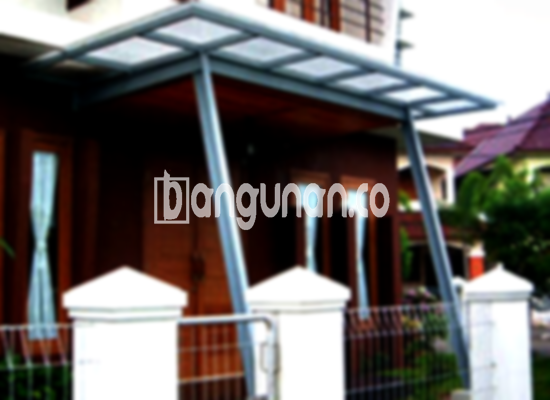

**Jasa Pasang Kanopi Rumah Minimalis di Menteng Jakarta** – Apakah Anda sedang merencanakan pemasangan kanopi untuk rumah atau bangunan komersial di Menteng Jakarta? Kanopi adalah solusi ideal untuk melindungi area luar ruangan dari terik matahari dan hujan deras. Struktur atap ini tidak hanya meningkatkan kenyamanan, tetapi juga menambah nilai estetika properti Anda. Kami hadir sebagai penyedia jasa borongan pembuatan dan pemasangan kanopi yang terpercaya di Menteng Jakarta, menawarkan solusi yang sesuai dengan kebutuhan dan anggaran Anda. Mitra Bangunan di Menteng Jakarta dapat mengandalkan kami untuk mendapatkan kanopi berkualitas tinggi dengan harga yang kompetitif.

Kanopi tersedia dalam beragam material, termasuk galvalum dan besi hollo. Setiap material memiliki karakteristik unik yang memengaruhi kekuatan, tampilan, dan biaya. Anda dapat memilih jenis kanopi yang paling sesuai dengan preferensi desain dan kebutuhan fungsional properti Anda.

Bagi Anda yang ingin memasang kanopi, terdapat banyak manfaat yang bisa diperoleh. Selain perlindungan dari cuaca ekstrem, kanopi juga dapat memperluas ruang hidup Anda dan menciptakan area outdoor yang nyaman untuk bersantai atau beraktivitas.



## Estimasi Biaya Kanopi Rumah Minimalis di Menteng Jakarta

Mencari informasi harga kanopi rumah sebelum melakukan pemesanan merupakan langkah yang cerdas untuk memastikan anggaran Anda sesuai. Anda dapat membandingkan berbagai opsi kanopi untuk menemukan yang paling sesuai dengan preferensi dan kebutuhan Anda.

Beberapa faktor utama yang memengaruhi harga kanopi antara lain:

### \- Pemilihan Bahan oleh Jasa Pasang Kanopi Rumah Minimalis di Menteng Jakarta

Bahan baku merupakan pertimbangan penting dalam menentukan harga kanopi. Berbagai jenis material seperti besi dan baja ringan memiliki harga yang berbeda-beda. Anda dapat memilih bahan yang sesuai dengan anggaran dan kebutuhan estetika Anda.

### \- Model Kanopi dari Jasa Pasang Kanopi Rumah Minimalis di Menteng Jakarta

Model kanopi yang Anda pilih juga akan memengaruhi harga secara keseluruhan. Tersedia beragam pilihan desain, dan masing-masing memiliki kompleksitas dan biaya pembuatan yang berbeda. Konsultasikan dengan tim kami untuk menemukan model yang paling sesuai dengan gaya arsitektur rumah Anda.

### \- Luas Area Kanopi

Ukuran atau luas area yang akan ditutupi kanopi adalah faktor penentu lainnya. Semakin luas area yang perlu dilindungi, semakin banyak material yang dibutuhkan, dan semakin tinggi biayanya. Lakukan pengukuran yang cermat untuk memperkirakan luas kanopi yang dibutuhkan.

Untuk informasi lebih detail mengenai harga, kami sarankan Anda untuk menghubungi kami. Tim kami akan dengan senang hati memberikan estimasi biaya yang akurat berdasarkan kebutuhan spesifik Anda.

## Pilihan Model Kanopi Rumah Minimalis di Menteng Jakarta



Kami menawarkan beragam model kanopi rumah minimalis yang bisa Anda pilih. Satu opsi yang populer adalah kanopi berbahan baja ringan, yang dikenal karena keunggulannya yang luar biasa dibandingkan material lain. Berikut beberapa keunggulan yang bisa Anda dapatkan:

### \- Kekuatan dan Ketahanan Tinggi

Kekuatan utama yang dicari saat memilih kanopi adalah keawetannya. Kanopi yang dibuat dari baja ringan menawarkan kualitas yang sangat baik dan terjamin kekuatannya untuk menahan berbagai kondisi cuaca.

Banyak pengguna telah membuktikan daya tahan kanopi baja ringan, bahkan setelah bertahun-tahun penggunaan masih tetap kokoh dan berfungsi dengan baik.

### \- Model yang Bervariasi dari Jasa Pasang Kanopi Rumah Minimalis di Menteng Jakarta

Selain kekuatannya, kanopi baja ringan juga menawarkan fleksibilitas desain yang tinggi. Anda dapat memilih dari berbagai model dan desain yang sesuai dengan gaya arsitektur rumah Anda. Keunggulan ini menjadikan kanopi baja ringan favorit banyak orang.

### \- Tingkat Keamanan yang Optimal dari Jasa Pasang Kanopi Rumah Minimalis di Menteng Jakarta

Material baja ringan memiliki tingkat kekuatan yang tinggi sehingga memberikan tingkat keamanan yang optimal. Anda akan mendapatkan perlindungan yang andal dari berbagai risiko seperti kerusakan dan roboh.

Jika Anda mencari kanopi yang kuat, aman, dan tahan lama, kanopi berbahan baja ringan adalah pilihan yang tepat. Kami menawarkan berbagai pilihan desain dan ukuran untuk memenuhi kebutuhan Anda.

Dengan berbagai pilihan model dan material yang tersedia, Anda pasti akan menemukan kanopi yang sempurna untuk mempercantik dan melindungi properti Anda di Menteng Jakarta. Kami siap membantu Anda dalam memilih dan memasang kanopi yang sesuai dengan kebutuhan dan anggaran Anda.

**Ref by:**  [Kanopi Rumah Minimalis Menteng Jakarta](https://id.wikipedia.org/wiki/Kanopi)

Mitra Bangunan yang sedang mencari jasa pasang kanopi di Menteng Jakarta, hubungi kami lewat tombol WhatsApp atau Telepon di halaman ini, dan kami siap membantu Anda.