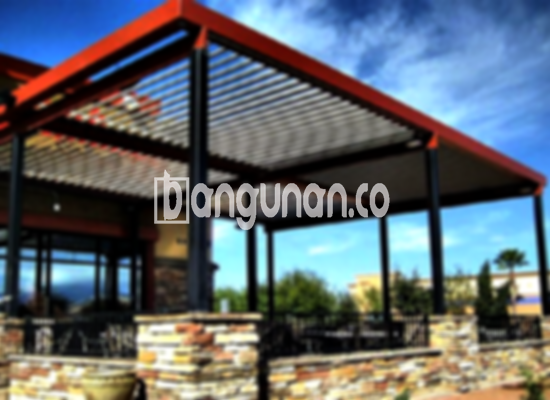

**Jasa Pasang Kanopi Rumah Minimalis di Meruya Jakarta** – Memiliki area luar ruangan yang nyaman dan terlindungi dari cuaca ekstrem adalah impian setiap pemilik rumah. Mitra Bangunan di Meruya Jakarta tidak perlu lagi mencari solusi yang rumit. Kami hadir sebagai penyedia jasa pembuatan dan pemasangan kanopi berkualitas dengan harga terjangkau, memberikan perlindungan optimal untuk rumah Anda.

Kanopi bukan hanya sekadar pelengkap bangunan; ia merupakan investasi penting untuk kenyamanan dan estetika hunian Anda. Ada berbagai jenis kanopi yang tersedia, mulai dari baja ringan hingga kaca, masing-masing dengan karakteristik dan keunggulannya sendiri. Anda dapat memilih material yang paling sesuai dengan kebutuhan dan anggaran Anda.



## Harga Kanopi Rumah Minimalis di Meruya Jakarta

Bagi Anda yang berencana memasang kanopi untuk rumah di Meruya Jakarta, memahami perkiraan harga menjadi langkah awal yang bijak. Sebelum membuat keputusan, sebaiknya Anda mempertimbangkan berbagai faktor yang memengaruhi biaya pembuatan kanopi. Dengan memahami variabel-variabel ini, Anda dapat memilih opsi yang paling sesuai dengan anggaran dan kebutuhan Anda.

Harga kanopi ditentukan oleh beberapa faktor penting, di antaranya:

### – Material yang Digunakan

Pilihan material adalah faktor utama yang memengaruhi harga kanopi. Material seperti besi, baja ringan, dan polikarbonat memiliki harga yang berbeda-beda. Setiap material menawarkan kelebihan dan kekurangan masing-masing, sehingga penting untuk memilih yang paling sesuai dengan kebutuhan Anda.

### – Model dan Desain Kanopi

Model dan desain kanopi juga memengaruhi harga. Model yang kompleks dan membutuhkan proses pembuatan yang rumit tentu akan lebih mahal dibandingkan model yang sederhana. Jelajahi berbagai pilihan desain untuk menemukan yang paling sesuai dengan gaya arsitektur rumah Anda.

### – Luas Area yang Ditutupi

Luas area yang akan ditutupi kanopi secara langsung memengaruhi jumlah material yang dibutuhkan. Semakin luas area yang ditutupi, semakin banyak material yang diperlukan, dan semakin tinggi biayanya. Penting untuk mengukur area yang akan ditutupi dengan akurat sebelum memesan kanopi.

Untuk informasi lebih detail mengenai harga dan penawaran terbaik, silakan lihat tabel harga yang tersedia  atau hubungi tim kami untuk konsultasi gratis. Kami akan membantu Anda menemukan solusi kanopi yang tepat sesuai dengan anggaran Anda.

## Rekomendasi Ragam Kanopi Rumah Minimalis di Meruya Jakarta

**Ref by:**  [Kanopi Rumah Minimalis Meruya Jakarta](https://id.wikipedia.org/wiki/Kanopi)

Jika Anda sedang mencari kanopi untuk rumah, garasi, atau area komersial di Meruya Jakarta, ada banyak pilihan yang tersedia. Salah satu opsi yang paling populer dan direkomendasikan adalah kanopi berbahan baja ringan. Material ini menawarkan kombinasi ideal antara kekuatan, ketahanan, dan harga yang terjangkau. Berikut adalah beberapa keunggulan kanopi baja ringan:

### – Kekuatan dan Ketahanan Tinggi

Kanopi berbahan baja ringan dikenal karena kekuatan dan ketahanannya terhadap berbagai kondisi cuaca. Material ini tahan terhadap karat, korosi, dan serangan rayap, sehingga dapat bertahan lama tanpa memerlukan perawatan khusus. Anda dapat mengandalkan kanopi baja ringan untuk memberikan perlindungan optimal selama bertahun-tahun.

### – Desain Fleksibel dan Estetis

Kanopi baja ringan dapat dibuat dalam berbagai desain dan ukuran sesuai dengan kebutuhan Anda. Anda dapat memilih dari berbagai pilihan warna dan finishing untuk menciptakan tampilan yang sesuai dengan gaya arsitektur rumah Anda. Ke fleksibelan desain ini menjadikan kanopi baja ringan sebagai solusi yang ideal untuk berbagai jenis bangunan.

### – Keamanan Terjamin

Baja ringan adalah material yang kokoh dan aman digunakan untuk pembuatan kanopi. Dengan konstruksi yang tepat, kanopi baja ringan dapat menahan beban angin kencang dan hujan deras. Anda dapat merasa tenang dan nyaman dengan kanopi baja ringan yang terpasang di rumah Anda.

Selain baja ringan, kami juga menyediakan berbagai jenis kanopi lainnya, seperti kanopi kaca, kanopi polycarbonate, dan kanopi galvalum. Pilihlah jenis yang paling sesuai dengan kebutuhan dan preferensi Anda.

Mitra Bangunan yang berlokasi di Meruya Jakarta siap membantu Anda dalam memilih dan memasang kanopi yang sempurna untuk rumah Anda. Hubungi kami melalui tombol WhatsApp atau Telepon yang tersedia di halaman ini untuk mendapatkan penawaran terbaik dan layanan profesional. Kami akan dengan senang hati membantu Anda mewujudkan hunian yang nyaman dan terlindungi.