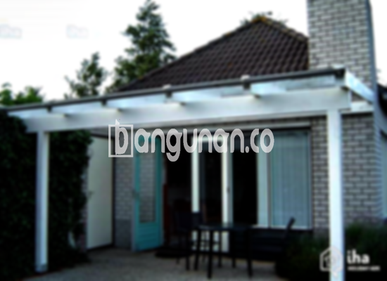

**Jasa Pasang Kanopi Rumah Minimalis di Meruyung Depok** – Memiliki area luar rumah yang nyaman dan terlindungi adalah dambaan setiap pemilik rumah di Meruyung Depok. Kanopi hadir sebagai solusi praktis untuk menjaga teras, garasi, atau area lainnya dari cuaca ekstrem. Mitra Bangunan hadir untuk memberikan solusi terbaik dalam pembuatan dan pemasangan kanopi yang berkualitas dan terjangkau untuk rumah Anda. Dengan desain minimalis yang modern, kanopi kami akan meningkatkan estetika sekaligus fungsionalitas hunian Anda.

Kanopi tersedia dalam berbagai material, termasuk galvalum dan besi hollo. Memilih jenis kanopi yang tepat akan sangat mempengaruhi tampilan dan ketahanan struktur. Kami siap membantu Anda menentukan material yang paling sesuai dengan kebutuhan dan anggaran Anda.

Pemasangan kanopi bukan hanya soal estetika, tetapi juga memberikan berbagai manfaat penting bagi rumah Anda. Berikut beberapa keunggulan yang bisa Anda rasakan:



## Harga Kanopi Rumah Minimalis di Meruyung Depok

Anda berencana memasang kanopi untuk rumah di Meruyung Depok? Sebelum mengambil keputusan, penting untuk mengetahui perkiraan harga kanopi rumah terlebih dahulu. Membandingkan opsi yang berbeda akan membantu Anda menemukan kanopi yang sesuai dengan kriteria Anda.

Terdapat beberapa faktor utama yang memengaruhi harga kanopi, antara lain:

### \- Material yang Digunakan oleh Jasa Pasang Kanopi Rumah Minimalis di Meruyung Depok

Pemilihan material merupakan aspek krusial dalam menentukan kualitas dan harga kanopi. Bahan-bahan populer seperti besi, baja ringan, dan polycarbonate masing-masing memiliki karakteristik dan rentang harga yang berbeda. Anda dapat memilih material yang paling cocok untuk rumah Anda berdasarkan pertimbangan anggaran dan preferensi estetika.

### \- Model Kanopi dari Jasa Pasang Kanopi Rumah Minimalis di Meruyung Depok

Model kanopi juga berperan penting dalam menentukan harga akhir. Beragam pilihan model tersedia, mulai dari desain sederhana hingga yang lebih kompleks. Semakin rumit desainnya, biasanya semakin tinggi biayanya. Anda dapat mencari inspirasi model kanopi di berbagai sumber untuk menemukan yang paling sesuai dengan gaya rumah Anda.

### \- Ukuran Kanopi

Ukuran kanopi, yang meliputi panjang dan lebar, secara langsung memengaruhi jumlah material yang dibutuhkan dan kompleksitas pemasangan. Pengukuran yang akurat sangat penting untuk memastikan perhitungan harga yang tepat.

Setelah Anda mempertimbangkan faktor-faktor tersebut, Anda akan mendapatkan gambaran yang lebih jelas tentang biaya yang dibutuhkan. Kami menyediakan berbagai pilihan kanopi dengan kualitas terjamin dan harga yang kompetitif. Untuk informasi harga yang lebih detail, silakan lihat tabel harga di bawah ini atau hubungi tim kami untuk konsultasi.



## Rekomendasi Variasi Kanopi Rumah Minimalis di Meruyung Depok

Kami menawarkan beragam variasi desain kanopi rumah minimalis yang dapat Anda pilih untuk mempercantik tampilan rumah Anda di Meruyung Depok. Salah satu pilihan yang populer adalah kanopi berbahan baja ringan. Material ini menawarkan sejumlah keunggulan dibandingkan material lainnya.

### \- Kekuatan dan Keawetan Utama

Ketika Anda berinvestasi pada kanopi, kekuatan dan keawetan menjadi prioritas utama. Kanopi berbahan galvalum dikenal memiliki kualitas yang sangat baik dan tahan lama. Material ini mampu menahan berbagai kondisi cuaca ekstrem dan memberikan perlindungan jangka panjang untuk rumah Anda.

Banyak pelanggan kami yang telah membuktikan keawetan kanopi baja ringan selama bertahun-tahun. Hal ini menjadikannya pilihan yang cerdas dan ekonomis dalam jangka panjang.

### \- Pilihan Model yang Beragam dari Jasa Pasang Kanopi Rumah Minimalis di Meruyung Depok

Kami menyediakan berbagai model kanopi berbahan baja ringan yang dapat Anda sesuaikan dengan gaya arsitektur rumah Anda. Pilihan model yang beragam ini memungkinkan Anda untuk menciptakan tampilan yang unik dan personal.

### \- Tingkat Keamanan yang Tinggi dari Jasa Pasang Kanopi Rumah Minimalis di Meruyung Depok

Baja ringan adalah material yang memiliki tingkat kekokohan tinggi, sehingga memberikan keamanan optimal bagi hunian Anda. Risiko kerusakan dan roboh sangat minim jika Anda memilih kanopi berbahan baja ringan.

Bagi Anda yang ingin memasang kanopi untuk rumah di Meruyung Depok, kanopi baja ringan merupakan salah satu pilihan yang sangat direkomendasikan. Keunggulannya dalam hal kekuatan, keawetan, dan keamanan menjadikannya investasi yang cerdas bagi rumah Anda.

**Ref by:**  [Kanopi Rumah Minimalis Meruyung Depok](https://id.wikipedia.org/wiki/Kanopi)

Mitra Bangunan siap membantu Anda mewujudkan kanopi impian di Meruyung Depok. Jangan ragu untuk menghubungi kami melalui tombol WhatsApp atau Telepon yang tersedia di halaman ini untuk mendapatkan penawaran terbaik dan konsultasi gratis. Kami berkomitmen untuk memberikan layanan terbaik dan kepuasan maksimal bagi setiap pelanggan.