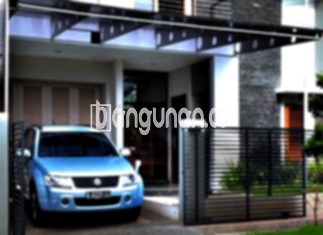

**Jasa Pasang Kanopi Rumah Minimalis di Mojokerto** – Pernahkah Mitra Bangunan mempertimbangkan manfaat memiliki kanopi untuk melindungi area luar rumah di Mojokerto? Kanopi merupakan penutup atap yang sering diaplikasikan pada teras depan rumah atau area parkir kendaraan. Tujuan utama pemasangan kanopi adalah menjaga halaman rumah agar terlindungi dari paparan sinar matahari langsung dan hujan deras. Dengan adanya kanopi, halaman depan rumah akan terasa lebih nyaman dan aman untuk digunakan.

Kanopi tersedia dalam berbagai pilihan material, termasuk baja ringan dan besi hollo. Anda dapat memilih jenis kanopi yang paling sesuai dengan kebutuhan dan preferensi desain rumah Anda. Setiap material memiliki karakteristik dan keunggulan tersendiri, yang memberikan fleksibilitas dalam menciptakan tampilan kanopi yang unik dan menarik.

Pemasangan kanopi tidak hanya memberikan perlindungan dari cuaca ekstrem, tetapi juga menambah nilai estetika pada rumah Anda. Kanopi dapat menjadi elemen desain yang mempercantik tampilan fasad rumah dan menciptakan kesan yang lebih modern dan elegan.



## Informasi Harga Kanopi Rumah Minimalis di Mojokerto

Apakah Anda sedang mencari informasi mengenai biaya pemasangan kanopi untuk rumah Anda di Mojokerto? Sebelum memutuskan untuk membeli kanopi, akan sangat bermanfaat jika Anda memiliki gambaran yang jelas mengenai perkiraan harga yang mungkin dikeluarkan. Dengan mengetahui kisaran harga, Anda dapat membuat perencanaan anggaran yang lebih realistis dan memilih kanopi yang sesuai dengan kemampuan finansial Anda.

Harga kanopi dapat dipengaruhi oleh beberapa faktor penting, di antaranya:

### \- Jenis Material yang Digunakan

Pemilihan material konstruksi kanopi merupakan salah satu faktor utama yang memengaruhi harga. Terdapat berbagai pilihan material yang tersedia, seperti besi, baja ringan, dan polycarbonate. Setiap material memiliki karakteristik dan harga yang berbeda-beda. Anda dapat memilih material yang paling sesuai dengan kebutuhan dan anggaran Anda.

### \- Desain dan Model Kanopi

Desain dan model kanopi juga berperan penting dalam menentukan harga. Model yang lebih rumit atau memerlukan proses fabrikasi khusus biasanya akan lebih mahal dibandingkan dengan model yang sederhana dan standar. Konsultasikan dengan profesional untuk mendapatkan rekomendasi desain yang tepat sesuai dengan anggaran Anda.

### \- Ukuran Kanopi yang Diinginkan

Luas area yang akan ditutupi oleh kanopi juga memengaruhi harga. Semakin luas area yang akan ditutupi, semakin banyak material yang dibutuhkan, dan semakin tinggi biaya pemasangannya. Pastikan Anda mengukur area yang akan ditutupi kanopi secara akurat sebelum melakukan pemesanan.

Untuk memperoleh informasi lebih rinci mengenai harga kanopi, Anda dapat menghubungi tim kami untuk mendapatkan penawaran harga yang disesuaikan dengan kebutuhan spesifik Anda.

## Rekomendasi Jenis Kanopi Rumah Minimalis di Mojokerto



Bagi Anda yang tengah merencanakan pemasangan kanopi di Mojokerto, terdapat berbagai jenis kanopi yang dapat Anda pertimbangkan. Salah satu jenis yang sangat direkomendasikan adalah kanopi berbahan baja ringan. Material ini dikenal karena keunggulan-keunggulan yang ditawarkannya, menjadikannya pilihan yang populer dan praktis.

### \- Kekuatan dan Keawetan Material

Salah satu keunggulan utama kanopi baja ringan adalah kekuatannya yang luar biasa. Baja ringan mampu menahan beban berat dan tahan terhadap berbagai kondisi cuaca ekstrem. Kanopi berbahan baja ringan juga tidak mudah berkarat, sehingga memiliki umur pakai yang panjang dan tidak memerlukan perawatan yang rumit.

### \- Fleksibilitas Desain yang Tinggi

Kanopi baja ringan menawarkan fleksibilitas desain yang tinggi. Anda dapat memilih dari berbagai model dan bentuk yang tersedia, atau bahkan mendesain kanopi sesuai dengan keinginan Anda. Hal ini memungkinkan Anda untuk menciptakan tampilan kanopi yang unik dan sesuai dengan gaya arsitektur rumah Anda.

### \- Tingkat Keamanan yang Terjamin

Keamanan merupakan aspek penting dalam memilih material kanopi. Baja ringan dikenal sebagai material yang aman dan tidak mudah pecah atau hancur. Hal ini mengurangi risiko terjadinya kecelakaan dan memberikan ketenangan pikiran bagi Anda dan keluarga.

Dengan mempertimbangkan keunggulan-keunggulan tersebut, kanopi baja ringan merupakan solusi ideal untuk melindungi dan mempercantik rumah Anda di Mojokerto.  Semoga ulasan ini membantu Anda dalam menentukan pilihan material kanopi yang tepat.

Mitra Bangunan yang sedang mencari solusi perlindungan dan keindahan untuk rumah di Mojokerto, jangan ragu untuk menghubungi kami. Kami siap memberikan konsultasi gratis dan membantu Anda memilih kanopi yang paling sesuai dengan kebutuhan dan anggaran Anda.

**Ref by:**  [Kanopi Rumah Minimalis Mojokerto](https://id.wikipedia.org/wiki/Kanopi)